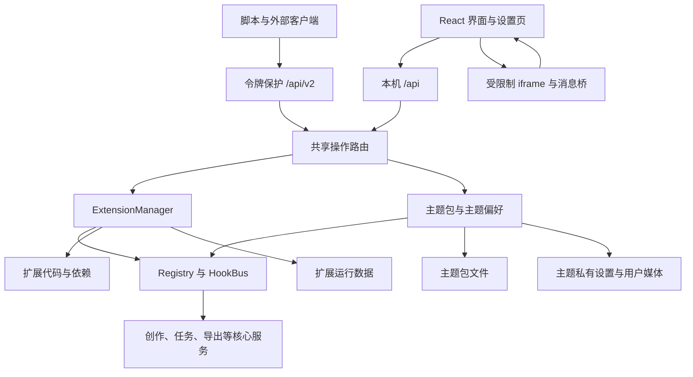

# Mio · 绘页：扩展与自定义主题架构详解及深度审查

> 审查日期：2026 年 11 月 19 日（北京时间）。本文依据实际源码、提交差异、项目约定和隔离验证编写。它既是本轮代码审查记录，也是面向维护者和扩展作者的架构说明。审查发现不等于已经修复；本文中的建议也不代表现有实现。

## 阅读目录

- [1. 审查范围、方法与阅读约定](#1-审查范围方法与阅读约定)
  - [1.1 时间边界与固定版本](#11-时间边界与固定版本)
  - [1.2 审查对象与交付物](#12-审查对象与交付物)
  - [1.3 两条判断轴与证据等级](#13-两条判断轴与证据等级)
  - [1.4 审查方法与验证边界](#14-审查方法与验证边界)
- [2. 系统全景与本轮变化的架构位置](#2-系统全景与本轮变化的架构位置)
  - [2.1 宿主的产品边界](#21-宿主的产品边界)
  - [2.2 模块图与数据流](#22-模块图与数据流)
  - [2.3 几类身份不能混用](#23-几类身份不能混用)
  - [2.4 数据平面的层次](#24-数据平面的层次)
  - [2.5 注册表与操作包装器](#25-注册表与操作包装器)
  - [2.6 从一次性加载到长生命周期界面](#26-从一次性加载到长生命周期界面)
  - [2.7 安全边界的三个层级](#27-安全边界的三个层级)
  - [2.8 大包处理的架构目标](#28-大包处理的架构目标)
  - [2.9 如何使用后续章节](#29-如何使用后续章节)
- [3. 扩展系统架构](#3-扩展系统架构)
  - [3.1 扩展在产品里的位置：可选能力的承载单元](#31-扩展在产品里的位置可选能力的承载单元)
  - [3.2 模块地图与职责边界](#32-模块地图与职责边界)
  - [3.3 包身份、用户覆盖与随包扩展](#33-包身份用户覆盖与随包扩展)
  - [3.4 清单模型是输入协议，不是任意配置容器](#34-清单模型是输入协议不是任意配置容器)
  - [3.5 从浏览器上传到磁盘归档的第一阶段](#35-从浏览器上传到磁盘归档的第一阶段)
  - [3.6 归档预检如何阻断路径与体积问题](#36-归档预检如何阻断路径与体积问题)
  - [3.7 暂存目录与安装提交的语义](#37-暂存目录与安装提交的语义)
  - [3.8 内容摘要实际上覆盖什么](#38-内容摘要实际上覆盖什么)
  - [3.9 启用是一笔带内容前提的生命周期操作](#39-启用是一笔带内容前提的生命周期操作)
  - [3.10 为什么操作锁与目录变化标记要同时存在](#310-为什么操作锁与目录变化标记要同时存在)
  - [3.11 requirements 声明允许什么，不允许什么](#311-requirements-声明允许什么不允许什么)
  - [3.12 依赖安装计划与共享环境保护](#312-依赖安装计划与共享环境保护)
  - [3.13 已确认缺陷：普通传递依赖没有被满足性检查覆盖](#313-已确认缺陷普通传递依赖没有被满足性检查覆盖)
  - [3.14 注册表的覆盖层与回退保证](#314-注册表的覆盖层与回退保证)
  - [3.15 钩子：有顺序的领域介入，而不是任意事件总线](#315-钩子有顺序的领域介入而不是任意事件总线)
  - [3.16 稳定 SDK 与不稳定逃生口](#316-稳定-sdk-与不稳定逃生口)
  - [3.17 任务执行器为什么必须携带来源与摘要](#317-任务执行器为什么必须携带来源与摘要)
  - [3.18 路由挂载与激活身份防混淆](#318-路由挂载与激活身份防混淆)
  - [3.19 完整工作区与普通面板的权限边界不同](#319-完整工作区与普通面板的权限边界不同)
  - [3.20 市场是分发目录，不是新的信任根](#320-市场是分发目录不是新的信任根)
  - [3.21 市场流式下载的实际收益与剩余成本](#321-市场流式下载的实际收益与剩余成本)
  - [3.22 运行服务的所有权与停用回收](#322-运行服务的所有权与停用回收)
  - [3.23 三种扩展数据对象不可混为一谈](#323-三种扩展数据对象不可混为一谈)
  - [3.24 私有偏好的 JSON 与路径约束](#324-私有偏好的-json-与路径约束)
  - [3.25 已确认缺陷：偏好没有进入完整工作区备份](#325-已确认缺陷偏好没有进入完整工作区备份)
  - [3.26 扩展备份参与者与受信快照](#326-扩展备份参与者与受信快照)
  - [3.27 停用与卸载：先阻止新使用，再处理资源与文件](#327-停用与卸载先阻止新使用再处理资源与文件)
  - [3.28 安全模式与故障恢复边界](#328-安全模式与故障恢复边界)
  - [3.29 本轮测试提供了什么证据](#329-本轮测试提供了什么证据)
  - [3.30 规范轴与需求轴的独立评价](#330-规范轴与需求轴的独立评价)
  - [3.31 建议的修复顺序与验收尺度](#331-建议的修复顺序与验收尺度)
  - [3.32 面向后续扩展作者的实践说明](#332-面向后续扩展作者的实践说明)
- [4. 主题后端与数据架构](#4-主题后端与数据架构)
  - [4.1 主题对象的边界与本轮变化](#41-主题对象的边界与本轮变化)
  - [4.2 四类主题来源与注册顺序](#42-四类主题来源与注册顺序)
  - [4.3 磁盘布局实际上有三种所有权](#43-磁盘布局实际上有三种所有权)
  - [4.4 主题模型与语义令牌解析](#44-主题模型与语义令牌解析)
  - [4.5 声明式设置不是任意动态表单](#45-声明式设置不是任意动态表单)
  - [4.6 包清单、文件允许集合与引用闭包](#46-包清单文件允许集合与引用闭包)
  - [4.7 媒体路径校验与真实文件系统校验](#47-媒体路径校验与真实文件系统校验)
  - [4.8 大文件导入的分段处理链](#48-大文件导入的分段处理链)
  - [4.9 ZIP 安全提取与格式限制](#49-zip-安全提取与格式限制)
  - [4.10 暂存发布、回滚与进程内锁](#410-暂存发布回滚与进程内锁)
  - [4.11 导出为什么重新生成主题身份](#411-导出为什么重新生成主题身份)
  - [4.12 媒体格式校验提供什么保障](#412-媒体格式校验提供什么保障)
  - [4.13 CSS 扫描器的能力与边界](#413-css-扫描器的能力与边界)
  - [4.14 主题卡片样式的受限暴露](#414-主题卡片样式的受限暴露)
  - [4.15 资源 HTTP 服务如何保持惰性](#415-资源-http-服务如何保持惰性)
  - [4.16 自定义设置页面与 nonce 注入](#416-自定义设置页面与-nonce-注入)
  - [4.17 私有偏好的 JSON 验证与原子落盘](#417-私有偏好的-json-验证与原子落盘)
  - [4.18 用户壁纸上传、索引与读取](#418-用户壁纸上传索引与读取)
  - [4.19 工作区备份的既有保护机制](#419-工作区备份的既有保护机制)
  - [4.20 已确认缺陷一：内置主题壁纸阻断备份](#420-已确认缺陷一内置主题壁纸阻断备份)
  - [4.21 已确认缺陷二：备份遗漏私有设置与媒体](#421-已确认缺陷二备份遗漏私有设置与媒体)
  - [4.22 删除与重装的状态命运](#422-删除与重装的状态命运)
  - [4.23 大包成本、并发和容量预算](#423-大包成本并发和容量预算)
  - [4.24 现有测试证明了哪些事实](#424-现有测试证明了哪些事实)
  - [4.25 需求轴审查结论](#425-需求轴审查结论)
  - [4.26 后续修复的最小闭环](#426-后续修复的最小闭环)
- [5. 前端主题与扩展宿主架构](#5-前端主题与扩展宿主架构)
  - [5.1 从“换颜色”到一组受约束的视觉能力](#51-从换颜色到一组受约束的视觉能力)
  - [5.2 Shell是主题解析的唯一所有者](#52-shell是主题解析的唯一所有者)
  - [5.3 服务端目录、本机偏好与暂态草稿属于不同状态层](#53-服务端目录本机偏好与暂态草稿属于不同状态层)
  - [5.4 主题选择解析与缺失主题回退](#54-主题选择解析与缺失主题回退)
  - [5.5 快捷明暗切换保留每种模式的最近选择](#55-快捷明暗切换保留每种模式的最近选择)
  - [5.6 根元素令牌是主题与公共控件的连接面](#56-根元素令牌是主题与公共控件的连接面)
  - [5.7 背景透明化改变的是表面色，而非作品内容](#57-背景透明化改变的是表面色而非作品内容)
  - [5.8 背景节点通过Portal放在应用根之外](#58-背景节点通过portal放在应用根之外)
  - [5.9 视频资源拥有明确的装载和卸载步骤](#59-视频资源拥有明确的装载和卸载步骤)
  - [5.10 页面可见性、循环和播放速度相互独立](#510-页面可见性循环和播放速度相互独立)
  - [5.11 减少动态效果的优先级是显式公式](#511-减少动态效果的优先级是显式公式)
  - [5.12 用户壁纸选择复用背景播放器，却遗漏了动态元数据](#512-用户壁纸选择复用背景播放器却遗漏了动态元数据)
  - [5.13 主题卡是目录操作入口，不应持有全局主题副作用](#513-主题卡是目录操作入口不应持有全局主题副作用)
  - [5.14 卡片专用样式可以在主题未选中时加载](#514-卡片专用样式可以在主题未选中时加载)
  - [5.15 全量主题样式表使用可追踪的link生命周期](#515-全量主题样式表使用可追踪的link生命周期)
  - [5.16 紧急恢复快捷键为高自由度CSS提供逃生口](#516-紧急恢复快捷键为高自由度css提供逃生口)
  - [5.17 视觉脚本授权绑定的是主题ID与内容摘要](#517-视觉脚本授权绑定的是主题id与内容摘要)
  - [5.18 脚本先进入无同源iframe，再进入Worker](#518-脚本先进入无同源iframe再进入worker)
  - [5.19 颜色桥以白名单和浏览器解析共同约束输入](#519-颜色桥以白名单和浏览器解析共同约束输入)
  - [5.20 脚本颜色恢复采用“仍属于我才恢复”的策略](#520-脚本颜色恢复采用仍属于我才恢复的策略)
  - [5.21 脚本有取回、取消、节流和执行时限](#521-脚本有取回取消节流和执行时限)
  - [5.22 声明式设置让主题作者不必编写业务页面](#522-声明式设置让主题作者不必编写业务页面)
  - [5.23 设置草稿使用ref支持连续事件，但没有解决异步版本](#523-设置草稿使用ref支持连续事件但没有解决异步版本)
  - [5.24 主题偏好查询共享缓存驱动实时应用](#524-主题偏好查询共享缓存驱动实时应用)
  - [5.25 已确认缺陷：旧保存响应可反转最新主题操作](#525-已确认缺陷旧保存响应可反转最新主题操作)
  - [5.26 用户壁纸上传与偏好选择是两个独立写操作](#526-用户壁纸上传与偏好选择是两个独立写操作)
  - [5.27 自定义设置页优先于schema，显示层仍由宿主管理](#527-自定义设置页优先于schema显示层仍由宿主管理)
  - [5.28 自定义设置页只获得两个异步数据动作](#528-自定义设置页只获得两个异步数据动作)
  - [5.29 设置页的消息身份与请求并发是两个独立维度](#529-设置页的消息身份与请求并发是两个独立维度)
  - [5.30 不应把“禁止connect-src”写成对所有外发行为的证明](#530-不应把禁止connect-src写成对所有外发行为的证明)
  - [5.31 受信工作区扩展与普通沙箱面板是两种宿主](#531-受信工作区扩展与普通沙箱面板是两种宿主)
  - [5.32 工作区surface是后端贡献，前端只解释展示属性](#532-工作区surface是后端贡献前端只解释展示属性)
  - [5.33 主题上下文通过快照消息同步给受信页面](#533-主题上下文通过快照消息同步给受信页面)
  - [5.34 工作区消息校验绑定具体iframe和一次会话](#534-工作区消息校验绑定具体iframe和一次会话)
  - [5.35 浮窗位置由锚点与用户位移共同构成](#535-浮窗位置由锚点与用户位移共同构成)
  - [5.36 拖动使用指针捕获，尺寸同时受JS与CSS约束](#536-拖动使用指针捕获尺寸同时受js与css约束)
  - [5.37 浮窗偏好按扩展共享，再按surface分层](#537-浮窗偏好按扩展共享再按surface分层)
  - [5.38 最小化保留iframe，是状态保留而非停止执行](#538-最小化保留iframe是状态保留而非停止执行)
  - [5.39 鼠标穿透开关目前只作用于iframe节点](#539-鼠标穿透开关目前只作用于iframe节点)
  - [5.40 全局快捷键管线是异步扩展链，不是浏览器事件冒泡](#540-全局快捷键管线是异步扩展链不是浏览器事件冒泡)
  - [5.41 按键回复通过eventId关联，但仍要观察实例生命周期](#541-按键回复通过eventid关联但仍要观察实例生命周期)
  - [5.42 已确认缺陷：普通浮窗交互会清空快捷键订阅](#542-已确认缺陷普通浮窗交互会清空快捷键订阅)
  - [5.43 优先级同时影响层级与事件顺序，但不是焦点管理](#543-优先级同时影响层级与事件顺序但不是焦点管理)
  - [5.44 现有测试分别守住了哪些边界](#544-现有测试分别守住了哪些边界)
  - [5.45 组件级复现能证明什么，不能证明什么](#545-组件级复现能证明什么不能证明什么)
  - [5.46 前端后续演化应优先收紧状态与生命周期契约](#546-前端后续演化应优先收紧状态与生命周期契约)
- [6. 共享基础设施、开放接口与发布链路](#6-共享基础设施开放接口与发布链路)
  - [6.1 为什么上传解析器成为公共基础设施](#61-为什么上传解析器成为公共基础设施)
  - [6.2 multipart 状态机与清理责任](#62-multipart-状态机与清理责任)
  - [6.3 流式与线程池是两个不同问题](#63-流式与线程池是两个不同问题)
  - [6.4 本机 API、v2 与生成客户端](#64-本机-apiv2-与生成客户端)
  - [6.5 scope 的当前语义](#65-scope-的当前语义)
  - [6.6 备份不是任意目录打包](#66-备份不是任意目录打包)
  - [6.7 归档上限与磁盘预算](#67-归档上限与磁盘预算)
  - [6.8 旧版移除与新版独立性](#68-旧版移除与新版独立性)
  - [6.9 随包数据清单的信任边界](#69-随包数据清单的信任边界)
  - [6.10 skip-worktree 的保护与局限](#610-skip-worktree-的保护与局限)
  - [6.11 测试夹具如何避免复制个人状态](#611-测试夹具如何避免复制个人状态)
  - [6.12 CI 门禁能证明与不能证明的事情](#612-ci-门禁能证明与不能证明的事情)
  - [6.13 后续验证设计建议](#613-后续验证设计建议)
- [7. 已确认发现、分轴判断与修复验收](#7-已确认发现分轴判断与修复验收)
  - [7.1 如何理解优先级](#71-如何理解优先级)
  - [7.2 规范轴 Standards](#72-规范轴-standards)
  - [7.3 需求轴 Spec](#73-需求轴-spec)
  - [7.4 专项证据：扩展后端](#74-专项证据扩展后端)
  - [7.5 专项证据：主题后端](#75-专项证据主题后端)
  - [7.6 专项证据：前端宿主与状态](#76-专项证据前端宿主与状态)
  - [7.7 修复顺序与最小验收闭环](#77-修复顺序与最小验收闭环)
  - [7.8 未计入缺陷的边界与后续专项](#78-未计入缺陷的边界与后续专项)
- [8. 验证记录、交付边界与维护索引](#8-验证记录交付边界与维护索引)
  - [8.1 本轮实际执行结果](#81-本轮实际执行结果)
  - [8.2 为什么测试通过仍然发现缺陷](#82-为什么测试通过仍然发现缺陷)
  - [8.3 复现证据的保存方式](#83-复现证据的保存方式)
  - [8.4 架构维护的入口索引](#84-架构维护的入口索引)
  - [8.5 后续变更应维护的五个不变量](#85-后续变更应维护的五个不变量)

## 1. 审查范围、方法与阅读约定

### 1.1 时间边界与固定版本

用户指定“近一天之内的改动都算”。本轮把开始审查时刻固定为北京时间 2026 年 11 月 19 日 13:52，取此前二十四小时，即 2026 年 11 月 18 日 13:52 至 2026 年 11 月 19 日 13:52。基线为 `ea6ce58cff7ef54ca714bcb2ca29502330e76de1`，被审版本为 `7837110be614f166a6a1ce3464d82f949f5dc9a5`。比较命令为 `git diff ea6ce58...7837110`。后续为了交付本文产生的文档提交，不属于被审功能版本。

| 提交 | 北京时间 | 内容与审查归属 |
|---|---|---|
| `d2650fd` | 11 月 18 日 16:38 | 扩充独立主题包、隔离主题脚本与扩展依赖声明 |
| `54a243b` | 11 月 18 日 18:59 | 移除旧版源码，调整 CI、随包数据工具与测试夹具 |
| `6aff876` | 11 月 18 日 22:36 | 合并主题导入入口，调整外观设置交互 |
| `cefcb1c` | 11 月 18 日 23:35 | 扩展安装改为流式处理 |
| `812ebd2` | 11 月 19 日 00:56 | 大主题、扩展包、哈希与主题备份分块处理 |
| `4e043d1` | 11 月 19 日 09:53 | 视频背景透出与循环播放 |
| `d07d7ba` | 11 月 19 日 11:19 | 视频背景遵循减少动态效果偏好 |
| `7837110` | 11 月 19 日 13:41 | 主题私有设置、本地壁纸、主题设置页、悬浮扩展 |

这八个提交一共涉及 558 个文件，新增 9,986 行、删除 131,461 行。这个统计不能直接解释为新增功能规模：其中大量删除来自 `legacy/`。审查旧版移除时，重点是当前新版是否仍依赖已删除文件、发行和测试入口是否改用独立实现，而不是逐行重审已经从主分支退出的整个旧产品。

### 1.2 审查对象与交付物

本轮审查的对象是仓库中的扩展与主题实现，包括为这些实现服务的 API、前端宿主、数据组织、打包、备份和验证链路。扩展中的产品提示词、代理自身指令和宿主插件机制是不同对象，本文不会把其中一类的调整当成另一类的实现。

交付物是根目录的本文件。审查过程中没有以“顺手修复”为名重写业务代码，也没有引入新的 UI 入口。所有已经确认的问题应作为后续修复的独立输入；它们的影响、触发条件和验证方式在审查结论中说明。这个选择符合代码审查的职责：先把真实风险和证据交付给维护者，使后续修复能保持范围清晰。

本文不是接口规范的替代品。对外格式以 `docs/EXTENSION_MARKET.md`、`docs/THEME_PACKAGES.md`、`server/mio_server/extensions/README.md` 和运行时 OpenAPI 为准；架构目标以 `docs/ROADMAP.md` 为准。当说明文档与实现不一致时，本文会指出差异，而不会为了让叙述顺畅而默认文档已经落地。

### 1.3 两条判断轴与证据等级

规范轴检查实现是否符合仓库已有约束，例如基座精简、专业能力通过扩展或开放 API 使用、运行数据与代码分离、测试不复制完整个人数据目录、接口变化同步生成客户端。需求轴检查本轮声明的能力是否完整、是否存在行为错误，以及新能力是否破坏原有端到端流程。两个轴分别给出结论，避免“格式规范”掩盖功能缺陷，或“功能能跑”掩盖数据边界问题。

除明确约定外，重复代码、职责发散、原始字符串承担领域身份等只能视为设计判断，不能自动升级成缺陷。本轮不把格式工具已经能够抓住的缩进、引号和 import 排序包装成深度发现，也不把可信 Python 扩展原本就能执行任意代码重新描述为这次新增的安全漏洞。

本文使用三个证据等级。第一类是已确认缺陷：有确定输入、实际路径和可观察的错误结果，或有无需额外假设即可成立的执行顺序。第二类是已知限制：实现有明确边界，但不一定违反承诺，例如 Python 扩展不做进程隔离。第三类是改进建议：希望未来更易维护、更易验证或更稳健，但不声称现在已经产生错误。安全相关判断还必须区分攻击者能力，不能假设攻击者已经能写任意本机文件，再把等价能力当成权限突破。

### 1.4 审查方法与验证边界

本轮先固定版本和需求，再按三个可独立分析的方向并行审查：扩展后端与依赖生命周期、主题后端与数据包、前端主题与扩展宿主。主审补充共享上传解析器、开放接口生成、CI、旧版移除和发行数据工具，然后整合跨模块问题。并行审查的价值在于分别沿着不同状态机追踪，不是让多个审查者重复扫描同一份文件。

功能确认优先使用隔离临时目录、内存数据库、模拟网络和现有单元测试。没有调用真实云端模型、付费接口或 GPU，没有安装浏览器，也没有运行浏览器 E2E。对依赖安装路径的审查不需要真的把第三方依赖装进用户环境；可通过解析器、计划检查与模拟 pip 结果验证边界。

执行测试前运行了 `python tools/protect_local_data.py`，为 64 个随包文件设置本地 skip-worktree 保护。这个操作只改变当前检出目录的 Git 索引标记，不证明数据内容等于发行默认值，也不应被解释为忽略数据安全。若本机随包文件已经被运行时改写，发行校验应保留其拒绝行为，不应为了获得绿色结果而覆盖用户数据。

## 2. 系统全景与本轮变化的架构位置

### 2.1 宿主的产品边界

Mio 是本地优先的漫画创作工作室。作品、分镜、候选图、排版和导出属于主流程；ComfyUI 与云端出图是可选择的执行后端。前端采用 React、TypeScript、TanStack Query 与 Zustand，后端采用 FastAPI、Pydantic 与 SQLite。主界面强调日常创作入口，专业能力保留在后端和开放 API 中，再由可选扩展按需提供入口。

理解这一点后，扩展与主题的分工就比较明确。扩展改变宿主能做什么：注册导出器、出图渠道、工作流适配器、业务面板、路由或操作包装器。主题改变已有界面如何呈现：颜色、尺寸、阴影、表面透明度、背景媒体、布局 CSS 和受限制的视觉脚本。主题可以重排或隐藏已有 UI，但不应因此获得作品写入、生成任务或任意业务 API 的能力。

这种分工不是一个名称偏好，而是用户信任模型。导入主题通常表示允许一份视觉数据参与显示；启用 Python 扩展则表示信任某份代码及其依赖进入宿主进程。把主题放进扩展执行链，会迫使简单换肤也承担代码信任；把扩展伪装成主题，则会绕开需要显式确认的业务权限。独立目录和独立 API 是保持这条边界的第一层措施。

### 2.2 模块图与数据流

图中的两组 API 并不意味着两套业务实现。`server/mio_server/api/v2.py` 的 `ROUTERS` 复用本机界面的路由模块，令牌验证和作用域检查作为 v2 的额外依赖挂入。`server/mio_server/api/operations.py` 则为具体端点建立稳定操作身份，使扩展可以在经过 FastAPI 参数验证之后包装同一个操作。由此，UI 与机器人调用应共享数据语义、错误格式和扩展层。

这种复用也会放大遗漏的影响。新增一个主题偏好路由后，如果它已进入共享 `ROUTERS`，那么本机与开放 API 通常都会获得它；但它是否被客户端生成器正确建模、是否按预期映射到 scope、响应是否携带可用于另一组 API 的资源地址，仍然需要单独检查。路由复用不能自动证明权限、客户端和媒体引用的全部一致性。

### 2.3 几类身份不能混用

扩展清单 ID 表示一个分发单元，内容摘要表示被用户审阅的那份具体内容，加载实例表示当前进程中已经执行并注册贡献的对象。三者分别回答“哪个扩展”“哪份代码”“哪次加载”。只按 ID 判断启用状态，会让同 ID 的替换包借用旧确认；只按摘要判断路由，也可能让旧加载实例在停用后继续提供能力。因此管理器和路由需要在身份检查上相互配合。

主题 ID 表示可选视觉方案，但主题包路径、注册表来源与用户偏好目录不是同一回事。内置主题、导入主题、扩展贡献主题可以进入同一主题列表，却有不同的删除、导出和资源寻找规则。代码中通过 contribution 的 source 区分这些来源。源码阅读时若只追踪主题 ID，容易忽略同名遮盖、来源切换和用户数据清理的问题。

浮窗还多出面板身份与宿主会话身份。扩展的 workspace 声明提供左侧菜单工作区入口，floating_surfaces 声明提供独立悬浮界面，两者是不同声明。iframe 的 contentWindow 是消息来源校验的重要组成部分，不能只相信 payload 中自报的扩展 ID。窗口大小和位置是用户偏好，事件订阅是当前 iframe 会话的临时能力，它们的生命周期不应被无意绑定到同一次 React 渲染。

### 2.4 数据平面的层次

| 数据类别 | 典型位置 | 主要生命周期 |
|---|---|---|
| 随包扩展代码 | 根目录 `extensions/<id>/` | 随应用分发或独立打包 |
| 用户安装扩展 | 数据目录中的 `extensions/<id>/` | 安装、替换、停用、卸载 |
| 扩展运行数据 | `extensions_data/<id>/` | 默认跨卸载保留，按选择删除 |
| 随包主题 | 根目录 `themes/<id>/` | 随发行包存在，不能按用户主题删除 |
| 用户主题包 | 数据目录中的 `themes/<id>/` | 导入、选择、导出、删除 |
| 新增主题私有偏好 | `theme_data/<id>/preferences.json` | 按主题 ID 保存的用户设置 |
| 新增用户壁纸 | `themes/<id>/user_wallpapers/` | 用户上传与单独删除 |
| 新增扩展窗口偏好 | `extension_data/<id>/preferences.json` | 窗口位置、尺寸等用户设置 |

表中最后三项尤其需要注意。它们是本轮新增的实现事实，不代表已经完整遵循原有备份、卸载或代码/数据分离约定。特别是 `extension_data` 与既有的 `extensions_data` 只差一个字母，却是两个不同的目录；用户壁纸又被放在主题包目录内部。后面的审查章节会说明这些组织方式与现有包扫描、备份和信任机制如何相互作用。

### 2.5 注册表与操作包装器

`Registry` 是能力汇聚点，而不是一个执行沙箱。核心服务先通过注册表寻找能力，再调用贡献值。扩展启用后可以注册贡献，停用时撤销自己的贡献。多来源的同一能力需要有确定优先级，否则本机安装包和随包版本可能出现“列表看到一份，执行用另一份”的歧义。本轮专门补充了后端优先级回归，说明这条边界已成为明确维护对象。

`wrap_endpoint` 在操作调用开始时取得当前包装层快照，并从外层向内层调用。每一层获得一个 `next_operation`，最多调用一次；这一限制避免一个普通包装器不小心执行两次创建任务、写作品或导出等有副作用操作。包装器不能替换应用上下文，但能转换参数、结果或整个操作行为。因此它属于可信扩展能力，不能和主题设置页的有限消息协议混为一谈。

操作包装器的调用快照不代表完整事务。某个操作已经开始后，扩展停用通常只能阻止新的入口，不能自动回滚已经进入执行的副作用；数据库事务和任务幂等仍由各业务服务承担。架构说明应明确这些边界，不能因为管理器使用锁或发布检查，就笼统声称所有启停与业务调用都具有跨线程、跨文件、跨数据库的原子性。

### 2.6 从一次性加载到长生命周期界面

过去的令牌主题比较接近纯函数：读取 JSON，校验 token，生成 CSS 变量，选中即应用。本轮把主题扩充为包内 CSS、图片、视频、字体、受限脚本、自定义设置页、偏好和用户壁纸。每一项单独看都不复杂，组合后却形成多个需要同步结束的生命周期：样式节点卸载、脚本 Worker 终止、旧消息失效、媒体暂停、对象 URL 释放和异步请求取消。

扩展浮窗也有类似变化。一个独立页面只需在进入时挂载、退出时卸载；悬浮窗则可能在主页面切换后继续存在，还能调整尺寸、移动、穿透点击并订阅全局事件。这要求把宿主级状态与 iframe 会话状态区分开。渲染所需对象可以每次更新，消息桥与订阅清理却必须围绕明确的窗口实例，而不是任意一个随渲染变化的函数引用。

因此本轮审查不能只看新增按钮是否出现。真正重要的是组合操作：上传壁纸后还能否备份，切换主题后旧脚本是否仍生效，调整窗口后全局事件是否还送达，替换扩展后旧路由是否可调用，以及减少动态效果时 CSS、视频、动态图和脚本是否遵循同一语义。架构是否可靠，主要体现在这些边界的衔接处。

### 2.7 安全边界的三个层级

第一层是本机 HTTP 服务的来源防护。README 明确本机 `/api` 不要求登录，因此 Host 检查、写请求同源检查和 WebSocket 防护承担防止其他网页滥用本机服务的职责。它们保护浏览器来源边界，不等于给公开网络部署提供完整用户认证；文档也明确不应把本机端口直接暴露到公网。

第二层是开放 API 令牌与 scope。v2 通过统一验证入口区分 read、write、render、admin，扩展管理属于高权限操作。新增端点必须在这套规则中获得正确分类；仅仅给 OpenAPI 加一个 bearer 标记不足以保证每条路径的权限语义正确。资源 URL 若硬编码为 `/api`，在本机界面中可能正常，却不一定能作为远程令牌客户端的直接调用地址。

第三层是扩展与主题各自的执行边界。Python 扩展和依赖安装在宿主环境运行，本质是可信代码；iframe 与 Worker 主要约束浏览器端页面和视觉脚本。CSP、sandbox、nonce 和 postMessage 来源校验需要一起使用，任一项都不是“完全安全”的同义词。尤其是 CSS 本身可以隐藏、覆盖和仿制现有控件，所以主题恢复快捷键具有实际可用性价值，但它也不能替代导入来源判断。

### 2.8 大包处理的架构目标

本轮把主题包和单文件上限提高到 10 GiB，同时把工作区备份上限提高到压缩后 12 GiB、解压后 16 GiB。这样的上限意味着“读取一个文件”已经不能被当成轻量操作。必须分别考虑请求体缓冲、multipart 临时文件、ZIP 解压、包验证、安装暂存、导出临时文件和备份暂存是否会同时存在。

所谓分块处理，只能证明内存占用不随单个媒体文件线性增长；它不等于磁盘占用小、不等于 CPU 开销小，也不等于异步服务器绝不阻塞。用户导入一个数 GiB 视频时，上传临时文件、解压暂存与目标目录可能短时共存。维护者需要在文档中保留足够磁盘空间的要求，并把所有失败路径上的临时文件回收纳入验证。

### 2.9 如何使用后续章节

扩展作者可优先阅读扩展生命周期、SDK 和权限部分；主题作者可优先阅读包格式、资源校验、设置桥接和前端应用部分；维护者应把最后的审查发现和验证矩阵与相应调用链对照。每个章节以当前实现为起点，再解释取舍和风险，不把未来方案写成已经存在的代码。

本文有意保留某些看似重复的领域词：安装、启用、注册、挂载、渲染、持久化、备份和恢复各自代表不同动作。例如安装成功只表示文件被接受，不表示扩展已执行；偏好写入成功只表示当前工作区有文件，不表示备份能带走它。把这些动作说清楚，比用一个“支持”概括全部链路更有助于长期维护。

## 3. 扩展系统架构

### 3.1 扩展在产品里的位置：可选能力的承载单元

Mio 的扩展不是向主程序目录随意放置一个脚本的别名，而是带有明确身份、声明文件、独立资源和启用过程的功能包。仓库要求日常创作界面保持精简，因此扩展承担了主界面不宜常驻、又需要进入作品流程的专业能力。它既能只贡献画册模板等数据，也能提供后端路由、任务执行器和完整工作区。由此，扩展架构同时解决两个问题：让核心能力可以复用，以及让用户能够明确选择哪些附加能力参与当前工作区。

核心代码并没有实现一个完全不同的第三方业务运行时。`Registry` 让内置能力与外部贡献使用相同的命名空间和查找机制，`ExtensionAPI` 则把贡献绑定到来源与内容摘要。这使扩展能够沿现有作品、生成、排版和导出路径工作，避免为每个插件复制一套业务接口。真正需要区分的是信任等级：受信 Python 扩展的权限很高，普通界面面板通过有限桥接调用宿主，主题则有自己的可视化边界。

因此，评估扩展是否安全不能只看某个 iframe 有无沙箱，也不能把“装在扩展目录”理解为已经获得进程隔离。当前设计选择的是本机受信扩展模型，防止的是未确认内容被自动加载、旧激活身份继续冒充新实例、归档越界写入以及卸载误删；它不承诺阻止用户明确启用的恶意 Python 代码访问本机。依据见 `docs/ROADMAP.md` 的扩展系统约定、`server/mio_server/registry.py:1` 与 `server/mio_server/extensions/sdk.py:27`。

### 3.2 模块地图与职责边界

扩展后端可以分成六层。最外层 `api/extensions.py` 把 HTTP 请求转换成安装、启用、停用、删除和读取目录等操作；`manifest.py` 定义包身份、贡献字段、目录约束与内容摘要；`manager.py` 管理从磁盘包到运行实例的生命周期；`sdk.py` 向扩展提供稳定的注册入口；`registry.py` 与 `hooks.py` 保存并分发有效贡献；任务引擎、作品服务和导出器等业务模块在实际执行点消费这些贡献。

市场与依赖是并列的辅助模块。`marketplace.py` 负责目录来源、缓存、下载校验以及包身份对照，不负责激活；`dependencies.py` 只处理已审阅扩展的依赖声明与共用环境安装。数据侧还有独立的 SDK 设置、私有偏好、备份参与者和受信包快照。把这些模块画成一条单向链会漏掉事实：加载器调用依赖模块，依赖完成后才进入注册；备份恢复则需要在扩展未启用时读取已审阅的数据契约。

这个划分让主要变更可以局部落地，但目前 HTTP 文件的职责已经较重。同一个模块同时生成扩展清单、传输包、注入工作区桥、提供偏好 API，并包含主题列表。这并非自动构成错误，却增加了“新增一种数据区域而没有同步备份”的可能性。本轮已确认的偏好遗漏正位于这种跨生命周期接缝。后续拆分宜按安装传输、运行表面、数据存储三个边界进行，而不是按文件长度机械拆文件。主要入口见 `manager.py:125`、`marketplace.py:136`、`dependencies.py:114`。

### 3.3 包身份、用户覆盖与随包扩展

每个扩展由小写字母、数字、短横线和下划线组成的 ID 标识。清单模型约束其长度为二至四十八字符，发现阶段还会调用数据目录所用的标识符校验。一个工作区同时知道项目随包的 `extensions/<id>` 与工作区内的 `extensions/<id>`。`ExtensionManager.info()` 优先选择工作区中具有清单的同 ID 包；不存在时才回到随包目录。这是一种按 ID 遮蔽的机制，不是两个同名扩展同时运行。

覆盖规则影响更新与卸载的解释。导入相同 ID 可以替代工作区中的包，卸载导入版本后，随包版本可能重新变得可发现，但它并不会因此继承刚被删除包的运行实例。删除流程最终移除该 ID 的启用状态，避免用户刚卸载一个覆盖包，另一个实现就自动启动。市场展示也使用相同的 `info()` 结果，所以“已安装版本”反映实际优先级，而不是简单读取某一个目录。

`Info` 是给管理界面使用的状态投影，不等于磁盘清单本身。它合成包名称、摘要、错误、内置标记、数据保留标记、Python 与 requirements 存在性、面板列表和当前贡献。新增加的 `has_requirements` 会使没有 Python 入口但带依赖声明的包被标成含代码，符合依赖安装可能执行构建代码的实际风险。相关代码在 `manager.py:83`、`manager.py:96`、`manager.py:147` 和 `manager.py:210`。

### 3.4 清单模型是输入协议，不是任意配置容器

`Manifest` 使用严格模型描述身份、元数据、Python 入口、工作区入口、备份入口和声明式贡献。声明式贡献包含主题、画册模板、拟声字、切片预设、普通面板，以及最近新增的悬浮表面。清单的价值在于把能预检的错误提前到安装或启用前：例如悬浮入口必须是相对 HTML 路径，不能带查询、片段、控制字符或目录穿越；同一包中的悬浮表面 ID 必须唯一。

最近新增的优先级使用严格整数，不能把布尔值当成整数使用；悬浮位置则限制为边缘锚点或有界数值，并为偏移提供默认值。`global` 是必须显式提供的布尔字段，这让插件作者必须说明表面是否跨页面存在。与完全动态的 Python 贡献相比，这些字段是宿主可以提前理解并呈现的契约，因此值得保持严格且小巧，避免引入没有消费者的描述性字段。

不过清单通过不代表包的全部业务已经有效。`read_manifest()` 检查声明路径的目录归属，部分资源在贡献解析时才验证，Python 模块更需要真正加载才能知道是否提供 `activate()`。因此安装结果应解释为“结构可接受并已保存”，启用成功才表示本次激活完成，真实生成与导出仍有各自的执行验收。模型及校验入口见 `manifest.py:57`、`manifest.py:73`、`manifest.py:82`、`manifest.py:112`、`manifest.py:160`。

### 3.5 从浏览器上传到磁盘归档的第一阶段

原始 ZIP 上传现在逐块读取 `request.stream()`，累计实际字节数，在超过五十 MiB 时中止；内容写入临时目录内的归档文件，而不是先聚合成完整字节串。结束后，异步路由通过线程池调用 `install_path()`，让 ZIP 解析、解压与后续磁盘操作脱离该异步协程。这是本轮流式化最直接的变化，能避免上传体与 ZIP 内部缓冲同时占据多份整包内存。

文件夹导入共用有界 multipart 解析器，但随后仍要将多个文件构造成临时 ZIP，以复用同一安装器的安全与身份检查。该路径只接受约定字段，检查文件名、重复路径、数量与总字节数，并跳过常见开发依赖、缓存和环境文件。每个上传文件按一 MiB 读写，所有上传对象都在 `finally` 中关闭。它牺牲一次磁盘编码步骤，换取 ZIP 与文件夹安装不分叉成两套生命周期。

流式化降低的是大对象常驻内存，不会消除临时空间、压缩计算或磁盘带宽成本。上传临时文件和安装暂存目录可能同时存在；导入期间仍应预留足够空间。五十 MiB 是扩展包限制，不能套用主题的大视频上限；文件夹传输与解压后的限制也不是同一个数值。接口入口见 `api/extensions.py:147` 与 `api/extensions.py:172`，安装入口见 `manager.py:557`。

### 3.6 归档预检如何阻断路径与体积问题

安装器首先检查磁盘 ZIP 自身大小，再打开中央目录并逐项过滤目录条目。文件条目不能包含反斜线、空字节、绝对路径、空段、点段和父目录段；大小写折叠后的路径也必须唯一。这一点对 Windows 尤其重要，因为大小写不同的两个名字可能落在同一个物理文件上。仅检查字面字符串不相同不足以防止跨平台覆盖。

归档可以直接以清单为根，也可以外包一个唯一的顶层文件夹。安装器先确定这一公共前缀，再用完全相同的前缀寻找清单。清单大小有一 MiB 上限，读取本身也用上限加一的方式验证，不把归档元数据当成唯一依据。随后解析清单确定最终 ID，检查目标是否存在以及是否允许覆盖，并确认旧来源没有需要保护的执行任务。

解压前计算所有文件声明体积之和，最大为二百 MiB；解压时继续累计实际读取量，防止只依赖不可信的声明值。文件数量上限是两千。路径检查、声明上限、实际复制上限和独占创建不是重复保险，而是分别约束目录位置、预检预算、实际消耗与覆盖行为。相关实现集中在 `manager.py:561-643`，常量位于 `manager.py:45-48`。

### 3.7 暂存目录与安装提交的语义

通过预检后，安装器把内容写到扩展根目录下按 ID 命名的 staging 区域，创建输出文件时使用独占模式。写入结束后重新读取已解压的清单，并与预检得到的模型比较。这样可以确认最终落盘的身份确实是刚才用于选择目标目录和覆盖策略的身份，而不是在两个读取路径中使用了不同清单。

只有暂存内容有效后，加载器才卸载当前实例、移除原目标、把 staging 重命名为正式目录，并把状态保存为禁用且不携带受信摘要。覆盖安装因此不会偷偷让新版本继承旧版本的代码信任。旧扩展的运行数据由独立目录保存，不随替换代码目录被删除。最后返回新的 `Info`，供用户再次审阅与启用。

这里需要准确区分“有暂存”与“完整事务”。当前提交段并没有为旧代码目录提供可回滚的目录交换日志；磁盘错误或进程崩溃发生在删除原目录与重命名之间时，不能宣称旧安装一定恢复。该顺序在基线中已经存在，本轮并非新引入的缺陷，但它是架构详解必须说明的安装事务边界。`finally` 会清理未提交的 staging，正常失败不会长期留下半包；跨崩溃恢复仍是另一层能力。

### 3.8 内容摘要实际上覆盖什么

扩展摘要按排序后的相对路径遍历文件，将路径长度、路径字节、文件长度和内容依次加入 SHA-256。长度前缀使不同路径与内容的拼接不会产生不明确边界，排序让摘要不依赖文件系统枚举顺序。缓存、版本控制目录、虚拟环境、前端依赖目录以及 Python 字节码被明确排除，避免开发或运行时缓存变化导致不必要的重新确认。

本轮把每个文件的 `read_bytes()` 改成一 MiB 分块读取，摘要值的协议仍保持相同。实现会先记录文件大小，读取后核对实际总量；文件在哈希期间增大或缩小会触发异常。它没有声称拥有文件系统快照能力，因此同长度并发修改与任意本机写者仍需理解为本地文件可信性边界。目录摘要的作用是把用户确认、激活实例和后续请求绑定到相同内容，不是替代操作系统访问控制。

排除目录也有操作上的含义。运行所需的前端构建结果必须真正位于受摘要覆盖的包文件里，不能依赖未分发的 `node_modules`；Python 依赖则由共用环境管理，其安装内容没有被打包摘要冻结。包摘要能证明本次启用了哪份包，不能单独证明共用解释器、系统库和远程服务版本完全相同。代码依据为 `manifest.py:201` 与 `manifest.py:212`。

### 3.9 启用是一笔带内容前提的生命周期操作

用户启用时必须提交 `expected_digest`。管理器重新读取包并计算当前摘要，只有与用户刚才看到的摘要一致才继续。已经存在运行实例时，还要先确认该来源的任务可以安全替换。随后保存启用状态，调用加载流程；加载抛出异常或返回失败都会恢复先前设置，避免一次失败启用把持久状态伪装成成功。

加载流程不只执行 Python 入口。它会保存旧贡献与钩子的快照、暂时移除旧模块、创建新的 `ExtensionAPI`，标记目录处于变化中，执行依赖检查和声明式贡献，最后再运行 `activate(mio)`。启用前、依赖安装后以及激活完成后都有内容摘要复核。这三处检查分别约束审阅后的文件变化、依赖检查期间的包变动和扩展自身在激活时修改包内容的情况。

成功后才把新 API 与模块作为 `Loaded` 发布并刷新路由；失败则清理新服务、恢复旧贡献、旧模块及旧服务引用，记录错误。这个过程保护的是宿主能掌控的注册状态和资源，不可能撤销扩展 Python 已经写出的外部文件、发出的网络请求或 pip 对共用环境产生的变更。相关状态机在 `manager.py:245`、`manager.py:350` 与 `manager.py:419`。

### 3.10 为什么操作锁与目录变化标记要同时存在

`operation_serialized` 把启停、安装、卸载和部分 SDK 注册操作置于任务规划操作锁之下。它避免扩展正要被卸载时，另一个线程又使用其执行器规划新任务。该锁和任务引擎内部锁不是同一个东西；完成回调另有严格的获取顺序，防止规划与结果交付互相等待。调用者不能在持有作品数据库锁时随意再请求这把操作锁。

目录变化标记解决的是另一个问题。生命周期操作可能短暂移除一批贡献，再添加新贡献；如果 HTTP 包装链在中间时刻被捕获，就会得到既不是旧目录也不是新目录的半成品。`catalog_transition` 在注册表短锁内递增计数，操作结束递减；`operation_layers()` 发现计数非零就快速返回冲突，要求客户端在目录稳定后重试。

两者组合体现了有意义的粒度区分：昂贵或可执行用户代码的激活过程不持有注册表互斥锁；短锁只保证快照与标记的一致性；跨生命周期的任务规划则依靠操作锁串行化。这也解释了为什么不能简单把全部扩展操作包在一把全局锁里。后者虽然看似容易证明，却可能让慢依赖安装长时间阻塞无关请求，并增加回调死锁风险。实现见 `manager.py:56`、`manager.py:136` 与 `jobs/operations.py:19`。

### 3.11 requirements 声明允许什么，不允许什么

扩展根目录可放一个可选的 `requirements.txt`。读取器要求它是普通文件，拒绝符号链接和 Windows 重解析点，大小不超过六十四 KiB，依赖条数不超过一百。每一行按 PEP 508 解析，支持版本约束、extras 与环境标记。注释与空行会被忽略，不适用于当前环境的标记声明不会参与本次安装。

这不是完整透传 pip requirements 语法的入口。以选项或路径开头的内容被拒绝，直接 URL、包含文件、本地目录与直接 wheel 地址也不允许。相同规范化包名不能重复声明，以免扩展作者依赖隐式合并规则制造难以审阅的约束。包名标准化会把大小写和常见连接符差异归为同一身份，避免一份文件在表面上列出两个名字，实际却操作同一个分发包。

这些限制缩小了用户需要理解的声明面，但没有把公共包仓库变成可信执行环境。某个普通包名可能解析到源代码分发，在准备元数据或构建时执行代码；pip 仍使用当前解释器与其环境配置。文档已经说明共享环境和受信来源的重要性。架构上应把依赖安装视为启用受信扩展的一部分，而不是无代码的安全预览。解析器见 `dependencies.py:29`，上限见同文件第十九至二十二行。

### 3.12 依赖安装计划与共享环境保护

安装器先判定声明是否满足，只有存在缺失或不满足的项时才启动 pip。命令使用当前 `sys.executable`，避免意外把包装到另一个解释器中；禁用交互，设置五分钟超时，并捕获输出。首次调用使用 dry-run 和 JSON 报告，逐个检查计划中的包名、版本与已有环境。若某个已安装包的版本将被改变，立即拒绝正式安装。

这一规则不仅检查扩展直接声明的包，也遍历 dry-run 解析出的传递安装动作。因此，一个扩展声明看似只增加新库，但其解析结果需要升级宿主已有依赖，也会被拒绝。对于新安装的直接依赖，计划版本还必须满足原声明；格式异常、缺失报告或非法版本都按失败处理。正式安装结束后，再检查直接声明是否满足，而不是仅凭 pip 的退出码宣布成功。

共享环境策略降低了安装和磁盘成本，并保持导入包的可移植性；代价是不存在每扩展独立的依赖图，也没有自动解决互斥版本的能力。用户需要自行选择相容扩展或解决环境冲突。当前两次 pip 调用没有把第一次解析计划固化成带哈希锁文件，因而“计划检查”与“实际解析”并非严格同一事务。这一点应作为加固建议陈述，不能在没有可复现触发条件时写成已确认升级漏洞。代码见 `dependencies.py:114-203`。

### 3.13 已确认缺陷：普通传递依赖没有被满足性检查覆盖

本轮检查发现，`_satisfied_with()` 对 `distribution.requires` 的递归完全放在遍历 extras 的循环内。没有 extras 的普通要求，检查完顶层分发版本便直接视为满足。这意味着某个已安装库的基础依赖丢失或版本失配时，只要扩展写的是普通包声明，依赖层就不会发现，也不会启动 pip 尝试修复；扩展可能在激活或第一次调用中才因导入失败停止工作。

隔离复现没有安装任何真实包。将元数据查询替换为：顶层 `parent-lib` 已安装、版本满足，但它要求的 `missing-child>=2` 不存在；requirements 仅写 `parent-lib>=1`。实际查询只访问顶层包，`ensure_requirements()` 返回空元组，pip 调用次数为零。这不是推断远程仓库行为，而是直接验证当前分支的条件分支遗漏。最小缺陷位置是 `dependencies.py:101-110`，代码由本轮 `d2650fd` 增加。

修复应始终验证基础依赖，再结合所选 extras 验证额外依赖，并保留环境 marker、规范化名称和递归去环规则。只在顶层补一次 `pip check` 会扩大检查范围到无关包，还可能改变用户对启用动作的理解；更合适的回归应围绕当前扩展所需的依赖闭包，覆盖普通依赖、嵌套普通依赖、可选依赖、循环依赖和已装版本冲突。该问题列为 P2，属于依赖功能正确性缺陷，而不是对共享环境设计本身的否定。

### 3.14 注册表的覆盖层与回退保证

注册表同时维护顶层有效贡献与全部来源层。某个扩展用 `replace=True` 注册同一扩展点和 ID 时，会把自身作为最新一层，而不是破坏性覆盖原对象；停用时按来源移除所有层，原先的内置或其他扩展贡献会重新露出。来自同一来源的更新会先移除该来源旧层，防止反复启用不断堆叠出重复贡献。

这个机制对导出器、版式和操作包装器尤其重要。用户可能只想暂时替换一种输出格式，关闭扩展后应恢复原行为，而不能出现“原实现已经被删掉”的永久损坏。注册表只管理对象身份与层次，不替贡献实现验证业务语义；扩展提供的导出器仍必须遵循声明接口，版式仍必须尊重保存的手工排版，不能因为有注册入口就绕过作品约束。

加载器的快照恢复保留原贡献对象及其层内索引，失败激活时恢复同样的回退次序。它不通过重新调用旧扩展激活来恢复，这避免了一次失败额外触发旧入口副作用。`registry.changed` 事件则让消费者能失效缓存或刷新目录。理解这一层后，才能正确区分“注册成功”“当前顶层生效”和“旧任务仍绑定旧执行器”三个并行存在的状态。实现见 `registry.py:67`、`registry.py:120`、`manager.py:445` 与 `manager.py:464`。

### 3.15 钩子：有顺序的领域介入，而不是任意事件总线

领域钩子拥有固定名称与类别。过滤钩子把当前值按顺序传给处理器，处理器可以返回替换值，返回空值则保留原值；通知钩子收到事件载荷，不参与返回值合成。处理器抛出的异常被记录，后续处理仍继续，从而避免一个可选扩展使整个领域流程直接中断。未知名称在注册时拒绝，减少拼写错误导致的静默失效。

本轮把优先级统一为整数越大越先执行，默认值改为零；同优先级仍保留注册顺序。该约定与面板、悬浮表面和前端事件排序保持一致，减少插件作者在不同接口里切换方向的负担。严格整数校验还排除了布尔优先级。已有回归覆盖顺序、同优先级稳定性和非法优先级，说明这次方向变化是明确协议调整，而不是偶然排序改变。

钩子异常容忍并不意味着可以忽略副作用。某个过滤器在抛异常前已经修改了可变对象时，后续流程可能仍看到部分修改；扩展作者应尽量构造新结果或在自己的边界内完成校验。通知钩子也不应承担必须原子完成的数据库提交。对可靠交付有要求的工作，应进入任务执行器和持久结果机制。相关实现见 `hooks.py:62`、`hooks.py:67`、`hooks.py:101` 与 SDK 的 `sdk.py:148`。

### 3.16 稳定 SDK 与不稳定逃生口

`ExtensionAPI` 把扩展身份、来源、审阅摘要和激活 ID 固定在一个实例上。常用入口包括贡献注册、任务执行器注册、任务提交、领域钩子、类型化路由、运行服务、私有设置和日志。所有正常贡献都自动附上来源与摘要，扩展不能通过元数据伪称另一份已审阅摘要。API 的 `_enabled` 标记让旧实例在停用后无法继续通过正常 SDK 添加贡献。

稳定不等于任意调用都没有前提。例如任务提交要求扩展当前执行器仍是被选择的来源且摘要一致；可安装的 ComfyUI 适配器需要符合契约版本和必要方法；服务应通过宿主管理以便停用时回收。扩展如果绕过这些入口，直接保存全局对象或开线程，自然也绕过了宿主能够提供的生命周期保证。架构文档必须把保证附在具体路径上，而不是泛称“所有插件都可安全卸载”。

`mio.internal` 返回完整应用上下文，是明确允许的逃生口，但不属于稳定协议。它让专业扩展能快速试验尚未正式抽象的能力，也意味着受信 Python 本来就拥有很大权限。因此新增稳定接口时，应从真实重复需求中提取领域边界；不能为了声称封装完整，把整个应用上下文再包成一层没有约束的代理。实现见 `sdk.py:27`、`sdk.py:78`、`sdk.py:106`、`sdk.py:121` 与 `sdk.py:207`。

### 3.17 任务执行器为什么必须携带来源与摘要

统一任务引擎把任务执行器身份保存为 kind、source 和 digest。kind 说明工作类型，source 说明是内置还是哪个扩展，digest 则说明用户审阅的具体实现。仅保存 kind 会造成严重歧义：用户排队后更新扩展，同名执行器可能已经采用不同输入、输出或外部协议；重启后若自动选择最新实现执行旧任务，既无法解释结果，也可能重复写入作品或发出收费请求。

当前 SDK 因此要求提交使用本次激活且仍被选中的执行器。已排队任务保留原身份；旧来源缺失时阻塞，不自动回退到同名内置实现或另一扩展。运行中的任务捕获执行器对象，执行、取消和结果交付沿用同一对象。对结果重放还有额外的 replay-safe 声明，声明者必须保证以交付身份去重，而不是简单再调用一次写操作。

这也解释了为什么停用、替换和删除扩展需要检查任务状态。只有没有危险执行或未交付结果时，生命周期才能继续；排队但尚未执行的任务可以保留为等待原实现的状态。扩展架构的正确性不仅存在于加载器中，还依赖消费者按持久身份解析贡献。否则再严格的清单与摘要都只能保护启用瞬间，无法保护长时间任务。契约见 SDK 文档“任务执行器”，入口代码在 `sdk.py:106` 与 `sdk.py:121`。

### 3.18 路由挂载与激活身份防混淆

扩展路由同时挂到本机 API 与带令牌的开放 API。普通 router 默认使用较高管理权限，`mio.route()` 可为具体路由声明更合适的 read、write 或 render 范围。动态刷新会移除上次生成的扩展路由，再把新路由插到前端单页应用兜底路由之前；同时清除 OpenAPI 缓存，使接口描述反映当前路由目录。

每条挂载路由都捕获具体的 `Loaded` 对象和当时持久化的摘要。请求到来时，不仅检查同 ID 是否仍启用，还检查当前管理器中的实例是否就是捕获对象、持久启用状态是否一致、包内容摘要是否仍相同。这样旧路由不会在用户关闭后重新开启相同 ID 时，自动获得新激活的授权。WebSocket 与普通 HTTP 使用各自合适的拒绝方式。

当前代码已经实现启停后即时刷新，无需重启才能挂新路由。SDK 文档前部与代码一致，但后部若仍写“新增路由重启挂载”，应理解为文档更新遗漏，不能拿旧描述否定实际实现。对架构维护而言，最重要的是把“路由存在”和“路由激活身份有效”分开：动态路由表解决可达性，guard 才解决本次请求能否使用某个受信实现。代码见 `api/extension_routes.py:14`、`:22`、`:62` 与 `sdk.py:185`。

### 3.19 完整工作区与普通面板的权限边界不同

普通面板使用不带同源权限的沙箱 iframe，不能直接读取应用存储，也不能自行联网；它通过清单声明的有限请求模板与宿主通信。完整工作区则是受信扩展提供的独立前端产物，可以使用本机 API，其安全前提更接近受信 Python 扩展。把二者统称 iframe 扩展而不说明差别，会让用户误以为所有前端插件都受相同限制。

普通面板桥会核对激活 ID、摘要、面板声明、目标路由与权限范围。请求模板不能指定任意 URL、请求头或其他扩展的路由；上下文、路径参数和返回体都有额外校验。前端会话还限制重复请求标识、并发、输入输出体积，并在关闭时中止本地等待。桥接不自动重试写请求，因为客户端取消并不能证明服务端没有产生副作用。

新悬浮表面扩展的是工作区表面模型：服务端依据已审阅包生成 URL 与元数据，并注入用于移动、尺寸、点击穿透和全局事件的桥。桥消息仍要检查来源窗口、同源和会话。这些校验防止错误窗口串线，不会把受信工作区降权成普通面板。目录入口在 `api/extensions.py:235`，工作区资源与桥分别在 `:286`、`:297`、`:313`，面板桥验证入口在 `server/mio_server/extensions/panel_bridge.py:56`。

### 3.20 市场是分发目录，不是新的信任根

市场目录保存可以发现和下载的包元数据，不会因为某条目出现在目录中就自动启用代码。远程目录必须是规定版本的 JSON，最多五百项和二 MiB；每项包含 ID、名称、版本、包 URL 和 SHA-256，重复 ID 拒绝。HTTP 地址不允许嵌入用户名密码，片段会移除。目录来源可以替换，但并不等于项目已经接入某个公共第三方市场。

目录缓存默认十分钟，刷新失败保留同来源上次成功结果并显示错误；切换来源则清空旧缓存，防止用户以为正在从新来源安装，实际仍使用旧目录条目。目录摘要覆盖来源与原始条目数据，安装请求必须携带列表时看到的摘要。用户选择后目录变化会得到冲突，而不是静默下载另一版本。

市场安装还核对所选包摘要、下载实际摘要、ZIP 清单 ID 与版本，最后交给与本地导入相同的安装器。包替换后保持禁用，依旧要经过独立启用步骤。这种双层设计的好处是：市场只增加分发便利，不分叉出“市场包天然可信”的隐形例外。主要实现见 `marketplace.py:53`、`:77`、`:160`、`:196` 与 `:254`。

### 3.21 市场流式下载的实际收益与剩余成本

本轮 `_download_to()` 把 HTTP 响应按一 MiB 分块写入独占创建的临时文件，同时计算 SHA-256。响应声明长度超过限制会提前拒绝；没有长度或声明不可靠时，也会按实际读取量执行上限。因此下载校验与磁盘存储不需要再额外遍历完整内存字节串。安装器直接接收临时路径，避免下载函数与安装函数之间的整包复制。

小型目录仍可以读入内存，因为其二 MiB 上限与使用方式决定这不是大视频或扩展包同类的内存风险。分发层没有为了追求“所有东西都流式”牺牲接口清晰度；真正高价值的变化是让有五十 MiB 上限的包在下载、校验、解压链上都使用文件。归档内单个成员也由安装器按块复制，避免出现外层已流式、内层又整文件读取的假优化。

剩余成本包括 ZIP 中央目录、声明模型、哈希遍历、临时空间以及安装锁持有时间。远程目录仍由用户配置，地址语法检查并不是通用 SSRF 隔离承诺；作为本机管理动作，它允许用户指定本地或内部服务。审查时应区分明示的网络能力与越权缺陷，不能仅凭允许 HTTP 就报告严重漏洞。下载实现见 `marketplace.py:91`，小目录读取见 `:111`，归档身份预检见 `:119`。

### 3.22 运行服务的所有权与停用回收

扩展可通过 `mio.service()` 注册运行对象，SDK 记录其所有权，并在停用或激活失败时逆序调用可用的 `close()`。服务关闭异常会记录日志，避免一个服务回收失败阻断其余回收；如果上下文中当前对象仍是该服务且不再忙碌，才移除引用。管理器在重新加载前也检查上一服务是否仍有未结束请求。

这一机制让 AI 辅助等持有会话、锁或后台请求的扩展可以参与宿主生命周期，但它不是线程终止器。`close()` 必须由扩展实现正确取消、等待或标记未知状态，宿主不能安全杀死任意 Python 线程。扩展若绕过 SDK 创建外部进程，或在激活时把资源写入无法追踪的全局变量，也不在自动回收保证内。所有权协议应和服务的忙碌状态一起设计。

加载失败时，管理器会先停掉新服务，再把旧服务引用恢复；成功替换时才停掉旧激活。这避免失败替换导致工作区既没有旧服务，也没有新服务的常见问题。不过如果新旧实现争用同一外部端口、同一文件锁或不可重入服务，扩展作者仍需在激活设计中处理切换次序。宿主只保证对象目录的恢复，不能回滚外部系统的副作用。实现见 `sdk.py:57`、`:63` 与 `manager.py:350`。

### 3.23 三种扩展数据对象不可混为一谈

代码包位于 `extensions/<id>`，正常运行数据位于 `extensions_data/<id>`，最近新增的通用私有偏好则位于 `extension_data/<id>/preferences.json`。三个名字相近，却有不同职责。代码包决定审阅摘要；SDK 数据区存放设置及扩展自己管理的文稿、附件等；偏好区主要供宿主保存悬浮表面状态，并通过独立接口读写，避免把界面坐标塞入扩展自己的业务配置对象。

分开存储的意图合理：用户拖动悬浮窗不应使扩展包摘要变化，也不应覆盖 AI 辅助的渠道配置。SDK 的 `load_settings()` 与 `save_settings()` 仍使用复数目录内的 `settings.json`，新偏好 API 使用单数目录，彼此不会读错同一文件。但物理目录分离随即产生额外生命周期义务：发现数据、卸载保留、显式删除、备份、恢复和内容摘要都必须考虑两者。

本轮管理器已把新偏好纳入 `has_data` 与 `delete_data`，说明它不是浏览器临时缓存，而是需要保留的本地状态。然而备份尚未接入，导致“卸载可保留、恢复却丢失”的不对称。架构评估应从数据对象的完整生命周期审查，而不应只证明 GET 与 PUT 可以往返。存储入口见 `extension_preferences.py:15`、`:28`，SDK 设置见 `sdk.py:193`，删除流程见 `manager.py:289`。

### 3.24 私有偏好的 JSON 与路径约束

私有偏好限制为一 MiB 的 UTF-8 顶层 JSON 对象。解析器拒绝重复键、NaN、Infinity、指数溢出产生的非有限浮点数以及过深递归；保存时先按 JSON 编码，再用同一验证器验证编码结果，以保证磁盘内容和读取契约一致。文件不存在时返回空对象，不凭空创建；路径存在但不是普通文件时拒绝，避免把目录或特殊文件误当偏好。

目录解析先固定工作区真实路径，再校验偏好根目录、扩展子目录和目标文件，拒绝链接及重解析点。标识符与旧数据路径共用验证逻辑，防止把 HTTP 中的扩展 ID 变成任意文件路径。原子写使用同目录临时文件加替换，保证正常写入失败时旧 JSON 不会被半截内容破坏。API 写入按流累计长度，超过上限即终止，解析和磁盘替换在受任务操作锁保护的线程池操作中完成。

偏好 API 允许读取保留数据，即使扩展已经卸载；若没有保留文件，则必须存在有效清单。这让重新安装同 ID 包可以恢复界面偏好，而不执行已卸载代码。它也意味着 API 不应该假定每个可读偏好一定对应当前运行扩展。当前接口是完整对象替换，没有 revision 或逐字段合并契约，多窗口写者需要由调用端协调，否则天然具有最后写入者覆盖语义。实现见 `extension_preferences.py:34-100` 与 `api/extensions.py:395-440`。

### 3.25 已确认缺陷：偏好没有进入完整工作区备份

新偏好的根目录是单数 `extension_data`，旧通用设置备份只枚举复数 `extensions_data` 内的 `settings.json`；备份参与者又要求根严格等于某扩展的复数数据目录。因此现有通用复制器、参与者枚举和归档白名单都不会识别新偏好。`with_workspace_head()` 也只合并旧设置和已识别数据，偏好变化不会改变工作区内容摘要。

本轮做了真实隔离恢复验证：先取得工作区 head，写入一个悬浮位置偏好，再次读取 head，二者相同；导出默认完整工作区备份后，归档中找不到任何偏好文件；随后执行 stage、apply、关闭上下文并以同一工作区重新创建上下文，原偏好读取结果变为空对象。这验证的不只是“某个辅助函数没复制文件”，而是用户实际备份与下次启动恢复链路会丢失数据。

该项列为 P2，最小新增位置为 `extension_preferences.py:15-24`。完整修复需要把偏好纳入归档允许路径、源摘要、快照、恢复保护备份、重启恢复与凭据处理规则，并覆盖停用或已卸载但保留的数据。单纯把文件加进 ZIP 会被导入白名单拒绝；只纳入导出、不纳入 head，则仍无法阻止恢复计划抹掉刚改过的偏好。相关接缝见 `backups/snapshot.py:54`、`backups/participants.py:173` 和 `backups/extension_data.py:143`。

### 3.26 扩展备份参与者与受信快照

SDK 的通用 `settings.json` 可以由宿主直接理解并备份，其他业务数据则不能靠整目录复制。扩展可能保存密钥、进行中请求、附件索引或需要成对出现的文件；不理解语义就照搬，既可能泄密，也可能恢复出不可用状态。因此扩展可声明独立的备份入口，只导出数据规则，不启动交互服务、不联网，并实现文件枚举、大小限制、快照、锁和恢复守卫等接口。

恢复发生在应用上下文与扩展管理器构造之前，不能依赖交互扩展已经启用。宿主从随包目录或本工作区已经审阅的包快照中装载数据契约，且绝不从导入备份 ZIP 中执行 Python。外部扩展成功启用时，`remember_package()` 把确切包复制到工作区旁的恢复目录并核对摘要；后续关闭扩展不会撤销这份数据规则。这样才能兼顾“禁用不启动代码服务”与“禁用数据仍可恢复”。

参与者只能声明自己的数据根，不能抢占 SDK 通用设置或另一个扩展的文件；实际枚举结果还会验证路径安全、普通文件与工作区归属。快照锁顺序也由宿主约定，防止扩展持锁方式破坏备份一致性。受信快照是恢复协议的一部分，不是把备份带来的任意代码自动信任。实现见 `server/mio_server/extensions/trust.py:16`、`backups/participants.py:59`、`:144` 与 `:199`。

### 3.27 停用与卸载：先阻止新使用，再处理资源与文件

停用不会删除代码或用户数据，而是卸载运行实例、移除来源贡献与钩子、刷新路由，最后保存禁用状态。卸载则需要更多前提：只允许删除用户导入包，内置扩展只能关闭；服务不能忙碌；任务执行器来源必须可安全释放；代码根目录和待删除树必须是普通本地路径。用户显式选择 `delete_data` 时，才把 SDK 数据与新偏好一起删除。

删除前后的重复路径检查有实际理由。`deactivate()` 是受信扩展代码，可能改变文件系统状态；因此管理器在执行它之后再次验证根、代码树与数据树，并确认解析得到的目录没有变化。这不是无意义的重复校验，而是跨越了可执行扩展代码的信任边界。缺少第二次校验时，扩展或并发操作可能把一个待删除目录换成链接，让后续删除作用于意外位置。

默认保留数据支持重新安装同 ID 扩展继续使用。需要注意，卸载代码不等于消除所有曾运行代码的外部痕迹；共享 Python 依赖不会随卸载自动卸载，受信恢复快照也有独立用途，扩展可能还有自己管理的外部文件。这些都是产品模型应清楚表达的边界。当前删除流程的主要证据位于 `manager.py:280`、`:289`、`:419`，路径树安全在 `backups/extension_data.py:72`。

### 3.28 安全模式与故障恢复边界

`MIO_SAFE_MODE=1` 让启动过程跳过全部扩展加载，是扩展把应用拖入启动故障时的重要逃生入口。它不需要先打开被故障扩展破坏的设置页，也不依赖插件自己的停用按钮。安全模式只控制加载，不代表自动删除代码、清空数据或修复共享 Python 环境；如果依赖安装已破坏解释器中的库版本，仍需要单独处理环境。

加载器把激活异常转成扩展错误状态，恢复宿主掌控的贡献目录，并继续提供错误信息。启用 API 返回的是当前 `Info`，调用方应检查状态和错误，而不是只因 HTTP 成功响应就显示“功能已经可用”。运行中的 Python 扩展还可能在正常启动后产生延迟错误，这需要服务本身报告、记录并在停用时正确释放资源，不能把所有故障都归到初始 activate 阶段。

故障恢复应分成包结构问题、内容未审阅、依赖不满足、激活失败、业务请求失败与结果未知几个层次。每层有不同的安全重试语义：重新上传不执行代码；重新启用会再次运行 activate；重试生成则可能产生外部副作用，必须由任务引擎处理。把这些动作合成一个“修复扩展”按钮，反而容易模糊用户授权。安全模式实现见 `manager.py:333`，错误回滚见 `manager.py:389-412`。

### 3.29 本轮测试提供了什么证据

扩展相关回归覆盖了摘要确认、文件变化后拒绝加载、失败激活回滚、安全模式、ZIP 路径检查、磁盘归档分块解压、文件夹 multipart 安装、面板优先级、悬浮元数据、桥脚本注入、偏好隔离和启用前后依赖检查。依赖模块测试用替身模拟 pip，验证普通安装命令、extras、非法声明、重复包、超大文件以及拒绝改动已有包版本。

这些测试对本轮新增行为具有针对性，但覆盖范围仍需要按契约审视。偏好测试只验证读写隔离、卸载保留或删除，没有把新数据走一遍工作区备份恢复；依赖满足性只覆盖 extras 指定的依赖，没有测试普通包的基础依赖缺失。这两个漏测点与本轮确认缺陷一一对应，说明仅统计新增测试数量无法证明跨模块闭环完整。

另一些内容不能从单测通过直接推出：真实公共仓库所有分发形态均可安装、任意扩展均可安全热替换、磁盘满时旧安装必定保留、多个工作区共享解释器时没有竞争、任意前端产物都能用桥正确通信。此处应把它们记录为未覆盖边界，给出后续验收方法，而不是把未运行的真实服务或浏览器测试写成已验证。主要测试文件为 `test_extensions.py`、`test_extension_dependencies.py` 与 `test_extension_backend_priority.py`。

### 3.30 规范轴与需求轴的独立评价

规范轴关注实现是否遵循仓库自己的协作与架构约定。当前扩展仍保持可独立分发、明确启用、数据与代码分离、专业能力通过扩展或 API 接入，没有因为新增依赖或悬浮表面就把专业功能重新强塞到默认核心界面。明显需要修正的是新偏好数据没有接入既有备份生命周期；此外，偏好与旧设置重复实现安全 JSON、路径和原子存储流程，是值得评估的重复代码异味。

需求轴则检查承诺是否真正实现。目录安装后保持禁用、摘要核对、共享依赖冲突拒绝、按需安装、流式传输以及优先级等主要能力都有直接代码路径。普通传递依赖的满足性遗漏属于“看似实现依赖检查，实际检查不完整”；新偏好备份遗漏属于“读写功能完成，但工作区恢复闭环不完整”。这两类问题不会因为代码格式规范或局部测试绿色而自动消失。

不宜把判断性异味与确定缺陷混为一张严重度表。HTTP 扩展模块职责较多、重复 JSON 校验、两个数据根仅差一个字母，是维护性风险证据，但不是每一项都能单独证明用户受损。架构重构可以沿这些接缝设计，但修复优先级应先由真实数据丢失与依赖失败场景决定，避免一次审查顺手变成大范围改造。此评价基于当前仓库文档与本轮差异，不使用未提供的外部需求替代现有产品约定。

### 3.31 建议的修复顺序与验收尺度

第一步应补齐新偏好的完整数据生命周期。验收不能止于导出文件存在，而应包含：保存后内容 head 改变；默认与含凭据两种备份策略正确；stage 后偏好改变会使原计划失效；保护备份保留当前值；真实下次启动恢复还原原值；已卸载但保留的数据仍可导出恢复；显式删除则清理两类数据；链接、重复 JSON 键和超大文件持续被拒绝。

第二步修正依赖闭包检查。用元数据替身构造父包满足但基础依赖缺失、基础版本冲突、嵌套 extras、marker 不适用以及循环依赖，确认既不漏检，也不无限递归。安装计划仍必须拒绝改变当前已有包版本，并且不回显 pip 中可能含凭据的输出。这里无需调用真实收费服务，也无需为验证逻辑安装公共包；依赖解析和子进程边界已有足够好的替身入口。

第三步再评估架构加固：把计划与安装约束绑定、为代码目录交换增加失败恢复、建立主题和扩展私有数据的统一存储协议、缩小 API 模块职责。每项都应有独立问题和验收条件，避免为追求抽象一致性改变用户已有数据语义。项目明确处于早期阶段，不要求人为维持旧接口兼容，但仍应保持用户作品与本机状态安全；“可以重构”不等于可以忽略恢复证明。

### 3.32 面向后续扩展作者的实践说明

编写新扩展时，先明确它属于数据贡献、受限面板还是受信完整工作区，再选择最低复杂度入口。能用声明式画册模板解决的，不必创建 Python 服务；需要一个已存在核心操作的按钮时，优先使用受限面板桥；需要独立多页交互、持久会话或模型渠道时，再使用工作区与后端服务。选择应由能力边界决定，而不是为了演示所有 SDK 方法而堆叠模块。

包内前端资源使用相对路径并提交构建产物；运行数据写入专属数据目录，不能写回受摘要覆盖的代码文件。把所有依赖放进受支持的 requirements 声明，并尽量选择与宿主共用环境兼容的版本范围。activate 只注册贡献与资源，deactivate 负责释放，不在加载时自动开始生成或调用收费模型。长任务进入统一任务引擎，明确 owner、幂等键和结果交付策略。

如果扩展需要备份私有文件，应从第一版就设计数据契约，明确哪些文件可能含密钥、哪些索引必须与附件成对出现、恢复后如何标记未完成请求。代码能重新安装，用户文稿与对话却不应依赖“恰好留在旧目录”才能找回。最近一轮扩展架构已经具备可复用的生命周期骨架；继续扩展时最值得坚持的不是增加更多注册点，而是让每个新增状态都有完整的创建、修改、导出、恢复与删除路径。

## 4. 主题后端与数据架构

### 4.1 主题对象的边界与本轮变化

当前主题系统不是把一段颜色配置写进设置后就结束的轻量功能，而是一条完整的数据供应链：主题定义进入校验模型，文件进入独立包管理器，运行时注册表决定可发现性，HTTP 层分发样式、媒体、视觉脚本与设置页面，客户端选择主题并组合用户私有偏好，工作区备份负责跨重启保存可恢复状态。阅读这条链时，必须区分主题的可分发内容、用户运行数据与宿主的业务权限。三者有不同所有者，也有不同删除、导出与恢复规则。混淆这些边界，通常不会首先表现为颜色错误，而会表现为导出后的主题失效、备份失败或恢复后的设置丢失。

本轮的关键变化集中在 `server/mio_server/themes.py`、`theme_media.py`、`theme_packages.py`、`api/theme_packages.py` 与新增的 `api/theme_preferences.py`。前一阶段的主题主要表达可校验的视觉令牌，现在额外承载背景图片与视频、独立样式、视觉脚本、声明式设置表单、自定义设置页面以及本机壁纸。与此同时，主题与扩展的生命周期继续分离：独立主题不需要通过 Python 扩展启用流程，扩展附带的主题则随扩展注册与撤销。这个选择符合路线图“独立可视化数据包”的方向，但“数据包”不等于“没有主动内容”；CSS 和脚本的约束仍必须由专门的边界承担。

本节以固定审查版本 `7837110` 为事实基准。下文标明“已确认缺陷”的项目来自隔离目录中的实际调用或可直接核查的代码链；“设计限制”描述已知实现取舍；“建议”是后续改善方向，不表示当前功能已经拥有相应保障。这样区分的目的，是避免把设计意图误写成可用承诺，也避免把未来可能出现的问题混进本次确定结论。

### 4.2 四类主题来源与注册顺序

宿主在 `AppContext.create()` 中先建立核心能力及内置主题，再创建 `ThemePackageManager` 并执行 `load_all()`，随后把数据库中的用户令牌主题分层注册，扩展启用时还可以贡献主题。对应来源字符串分别是 `builtin`、`theme-package`、`user` 与 `ext:<扩展ID>`。这些来源不是纯展示标签：能否删除、资源去哪里读取、能否提供设置页面，都依赖它们分支判断。相关入口可见 `server/mio_server/context.py:164`、`context.py:315` 与 `api/theme_packages.py:216`。

`ThemePackageManager.load_all()` 依次扫描随包目录和工作区目录，并对每个目录重新执行完整包校验。这里没有把“磁盘上存在文件夹”当成安装成功，只有清单、主题模型、资源引用及路径检查全部通过，才会写入运行时注册表。工作区包会被记录进 `_installed`，为后续删除提供所有权依据。发现坏包时记录警告并跳过，而不是让单个主题阻止整个工作室启动。启动可用性因此得到保护，但用户也可能只看到主题消失；诊断日志应保留包身份和失败原因，不能仅报告未找到主题。

注册顺序决定冲突规则。独立包安装时如果注册表已经有同 ID 主题，`_publish()` 会拒绝，而不是静默替换。数据库用户主题在上下文加载中采用显式替换机制，这一既有层级与包管理器的拒绝规则需要整体理解。扩展贡献还受扩展信任与启用状态约束，不能因为主题看起来是数据就绕过扩展生命周期。后续若要实现主题覆盖或版本升级，应在身份与来源模型上明确定义替换规则，不能在几个文件入口中分别放宽同名检查。

### 4.3 磁盘布局实际上有三种所有权

随包主题位于仓库根目录 `themes/<id>/`，导入的独立主题位于 `<数据目录>/themes/<id>/`，私有设置位于 `<数据目录>/theme_data/<id>/preferences.json`。本轮又把上传壁纸放入 `<数据目录>/themes/<id>/user_wallpapers/`。最后这个位置在逻辑上属于用户数据，在物理上却嵌入包目录。对于导入主题，它是包文件夹里的一个特殊例外；对于内置主题，它会在工作区生成一个没有主题清单的同名文件夹。这个差异正是本次备份缺陷的起点。

从所有权看，包作者拥有 `mio-theme.json`、`theme.json`、可选 CSS、脚本、设置页面及包内资源；用户拥有偏好 JSON 与自行上传的壁纸；宿主拥有索引、注册表、数据校验和恢复流程。当前代码通过 `_folder_files()` 特判 `user_wallpapers`，让包扫描器忽略用户媒体。这样可以避免把私有照片或视频意外加入公开分发 ZIP，是合理的隐私目标。不过，忽略只是包导出策略，不应该自动变成工作区备份策略。分发包和工作区备份的目标不同，复用扫描器时必须重新检查语义。

更清晰的长期布局是把可分发主题与用户私有状态分别放在不同根目录，用户状态再按主题 ID 组织。是否实际调整目录应由后续修复任务决定，本次审查没有移动用户数据。无论采用哪种布局，都应定义四张清单：哪些内容随主题 ZIP 导出，哪些内容随工作区备份，删除主题时哪些保留，重装同 ID 时哪些继续使用。当前文档已经明确用户壁纸不进主题 ZIP，但对完整工作区恢复及主题删除后的数据命运还缺乏同等完整的契约。

### 4.4 主题模型与语义令牌解析

`Theme` 是严格 Pydantic 模型，ID、名称、明暗模式、令牌、背景、样式文件、脚本文件和设置声明均有独立字段。令牌分成颜色、阴影与长度三组，未知名称直接拒绝。颜色并非任意 CSS 字符串，只接受透明色、指定长度的十六进制值以及受限制的 RGB/HSL 函数。长度只接受零值或带 `px`、`rem` 的数值，按控件高度、圆角与间距设置范围。阴影限制图层数、长度范围及颜色形式。因此，通过 JSON 令牌不能直接注入任意资源地址或用分号追加另一条样式。

`parse_theme()` 把底层校验错误整理成可读的主题错误；`resolved()` 以同明暗模式的基础色板补足缺失项。这里有一个值得保留的细节：语义控件的默认值留在 CSS 中推导，而不是把所有派生颜色固定成基础主题的快照。这样，一个只改强调色的主题仍能让按钮与焦点等语义表面跟随它变化，不会出现主色已变而派生控件残留旧色的问题。详见 `server/mio_server/themes.py` 的 `resolved()` 和 `to_json()`。

令牌校验与完整 CSS 是两个权限等级。前者约束视觉变量，后者可重排乃至隐藏既有界面。不能因为令牌模型严格，就声称导入主题完全不能破坏界面可用性；文档也承认 CSS 可以隐藏界面，并提供快捷键恢复。后端所保护的是路径、资源获取与业务调用边界，不是作者视觉设计的正确性。架构测试应分别验证这两类承诺：一类验证令牌无法逃逸语法，另一类验证完整 CSS 的资源限制和紧急恢复链路。

### 4.5 声明式设置不是任意动态表单

本轮通过 `ThemeSetting` 判别联合定义四种设置：滑块、开关、静态或动态选择器、文件上传。每个字段都要求有限长度的 ID 和纯文本标签，标签与说明拒绝尖括号和控制字符。字段 ID 会拒绝 `constructor`、`prototype`、`then` 等可能与 JavaScript 对象或 Promise 语义冲突的名字。滑块的最小值、最大值、步长和默认值必须相互一致；开关使用严格布尔值；静态选择项要求值唯一，并且默认值在类型与内容上都能匹配一个选项。

选择项使用严格字符串、布尔、整数和有限浮点数，避免把字符串 `"1"`、数字 `1`、布尔 `true` 当成同一种值。字符串值还有字符集合与长度限制。动态壁纸选择使用 `options_source: "wallpapers"`，不能同时声明静态选项。上传字段没有可分发默认媒体路径，它只是引导用户把本机文件写入用户数据区。整张模式最多三十二项，并检查字段 ID 不重复，这使前端渲染成本和交互规模有一个明确上界。

需要注意的是，偏好 API 并不根据这张模式逐字段校验。它保存的是任意有界 JSON 对象，因此模式描述的是常规设置面板的呈现契约，而不是服务器的完整业务模式。自定义设置页面也可以使用模式以外的私有字段。这种灵活性适合视觉包作者，但意味着客户端不能把服务器存储过的值自动当成可信的滑块数值、播放速度或媒体身份。消费偏好时仍必须进行类型与范围检查；这一职责不能只依赖导入时的模式校验。

### 4.6 包清单、文件允许集合与引用闭包

独立主题以 `mio-theme.json` 和 `theme.json` 为必需文件。清单字段集合必须精确匹配规定的六项，不接受悄悄附带的额外字段；清单 ID 与主题 ID、清单名称与主题名称必须一致，主题文件只能固定为 `theme.json`。ID 拒绝 Windows 保留设备名，文件夹名称也必须与主题身份一致。由此可见，安装不是对任意 ZIP 的通用解压，而是把一组符合封闭格式的资源转换成已注册视觉包。

`allowed_package_path()` 只接受固定元数据文件、满足命名模式的 HTML 设置页面，以及通过 `asset_parts()` 的媒体路径。脚本和 CSS 还必须分别由 `script_file`、`style_file` 显式声明，设置页面也必须与字段声明一致。多塞一份未声明脚本不是“暂时不用”，而是整个包校验失败。资源引用还形成一个闭包：包内媒体必须被背景或 CSS 引用，不能携带无关文件；CSS 引用必须指向实际存在的允许资源。相关逻辑集中在 `server/mio_server/theme_packages.py:147`。

这个封闭模型让发布包可审计，也减少把个人文件误打包的概率。但它还有兼容成本：设置页面只允许内联脚本与内联样式，不能随意引用一个额外业务脚本；媒体资源名称受限，作者不能直接把带中文文件名的任意相册目录整体拖入包。这里的限制不是操作系统路径能力不足，而是分发格式有意收窄。未来增加新资源类别时，应同时修改模型、允许路径、签名校验、导出、备份和 HTTP 响应，不能只在导入器中放行后缀。

### 4.7 媒体路径校验与真实文件系统校验

`asset_parts()` 使用 POSIX 风格路径解析资源名，要求首段为 `assets`，拒绝路径规范化前后不一致的写法，并限制目录深度、目录名、文件主体和后缀。`supports_background()` 进一步把背景种类与允许图片或视频格式对应起来。这样的字符串校验解决的是包内命名空间问题，无法单独阻止磁盘上的符号链接、Windows junction 或其他重解析点。因此代码又用 `_regular_path()`、`lstat()` 和 `resolve()` 检查实际节点性质。

运行时资源读取对根文件夹、中间父目录和最终文件分别检查，避免用户把 `assets` 替换成链接后让 HTTP 层读到包外数据。包安装、加载、删除及回滚也会重复确认目录归属。重复检查在这里不是无意义的防御堆积，因为每一个阶段的信任依据不同：导入前检查原始路径字符串，写入前检查目标工作区，发布前检查暂存树，读取前检查可能已被外部程序修改的磁盘内容。检查的位置必须靠近实际操作，才有机会发现阶段间变化。

这些检查仍不等于操作系统级的不可竞争路径访问。校验和打开之间存在时间窗口，拥有同一用户文件系统写权限的进程可能改变文件。当前项目面对的是本机可信用户导入第三方包的边界，并没有通过目录句柄、受限句柄解析或独立进程提供强隔离。架构说明应把这一点写成威胁模型限制，而不是把普通路径校验描述成对同权限恶意进程的完整防护。本次没有证实通过常规主题包导入能实现目录穿越。

### 4.8 大文件导入的分段处理链

ZIP 导入接口 `import_theme_package()` 先检查声明长度，再遍历请求流，实际计数不能超过十 GiB；每块写到临时 ZIP 文件，随后在线程池调用 `install_package_path()`。包管理器在自己的主题根目录创建暂存文件夹，逐项解压并再次计数，完成结构与内容校验后才发布。HTTP 上传临时目录与安装暂存目录是两份不同的磁盘占用，处理大包时不能只按最终安装大小估算可用空间。十 GiB 包不意味着十 GiB 空闲磁盘必然足够。

文件夹导入走共用 multipart 流解析器，再把上传文件句柄交给 `install_folder_streams()`。包管理器以一 MiB 为复制块，把每个文件写入暂存目录，实时维护单文件和总体字节数。它支持直接上传平铺包文件，也支持带一个顶层主题目录的浏览器文件夹选择结果，但不允许混合多个根或同时混用平铺与带根格式。资源子目录保持相对关系，不会把同名文件简单摊平成一个目录。入口和核心分别位于 `api/theme_packages.py:191` 与 `theme_packages.py:675`。

流式的准确含义是媒体和 ZIP 不需要完整驻留 Python 堆。它不意味着所有环节都异步，也不意味着磁盘占用有全局配额。当前原始 ZIP 上传在异步函数中同步写文件，慢盘可能短时阻塞事件循环；复制和校验的大部分重活放到了线程池。元数据、CSS、脚本与设置页面在各自小上限内整段读取，这是合理的有界折中。后续性能验收应分别量内存峰值、临时磁盘峰值、事件循环响应以及并发上传总量，不能只用“没有 read_bytes”代替完整资源预算。

### 4.9 ZIP 安全提取与格式限制

`_extract_zip_to_folder()` 在写入前先枚举 ZIP 条目，拒绝反斜杠、冒号、绝对路径、空段、点段与父目录段，拒绝符号链接、特殊文件和加密条目。文件名按不区分大小写的键去重，这对 Windows 环境尤其必要。它先根据 ZIP 声明的单项大小与总大小拒绝明显超限内容，再在真正复制时检查实际字节数是否超过声明，最后要求复制结果精确匹配声明。CRC 等容器错误会被转换成主题包错误并走暂存清理。

提取器兼容根目录直接包含包文件，或者整个包被一个顶层主题目录包住。顶层目录名需要与清单身份一致。显式目录条目也会检查，只允许确实用于资源路径的目录以及合法的单一包根。由此避免出现虽然没有写恶意文件、却携带无关目录树的模糊包格式。用户壁纸目录是一个特别分支：为防止重新打包个人数据，导入器会忽略它，而不是把它复制到新主题里。这个分支与备份的复用关系必须谨慎处理。

这里有一项可维护性限制：旧的 `_unpack()` 仍保留一份内存式 ZIP 解析逻辑，新接口主要使用磁盘式提取器。两者大部分结构校验重复，异常类型和细节并非完全相同。当前主要调用链已经转向流式实现，不能仅凭旧函数存在就判定线上仍整包驻留内存；但是今后增加格式规则时，应明确哪个函数是权威规则入口，防止测试调用旧助手通过，而真实 API 使用另一套分支。统一纯结构校验与不同字节来源，会比继续手工同步两份大型解析器更可靠。

### 4.10 暂存发布、回滚与进程内锁

`ThemePackageManager` 使用可重入锁包围安装和删除。安装时先在最终根目录中建立 `.theme-` 暂存目录，校验成功后 `_publish()` 再次检查 ID 与目标路径，把暂存目录重命名为正式主题目录，然后注册运行时贡献。如果注册失败，会尝试删除刚发布的目录。这构成“先准备完整内容，再切换可见性”的发布顺序，避免半解压主题直接被列表发现。相关实现见 `theme_packages.py:658`、`theme_packages.py:772`。

回滚特别避免在可疑路径上递归删除。`_discard_staging()` 确认文件夹确实直属于主题根目录、树结构仍然符合允许路径后才清理，否则留下警告供人工处理。这个取舍把“可能遗留一个坏暂存目录”的风险置于“意外删除包外数据”的风险之前，是合理的失败模式。需要注意，下一次扫描会尝试读取这些暂存目录并跳过；若持续失败而无人清理，磁盘空间仍可能积累。未来可增加受约束的垃圾暂存诊断，但不应为了自动清理而放松路径归属验证。

锁只保护同一管理器实例中的相关操作，不提供跨进程安装互斥，也没有把偏好写入、壁纸写入和主题删除全部纳入同一个事务。工作区自身有运行租约，正常部署不应同时开启多个写实例，但用户媒体线程和删除线程仍是不同路径。并发删除期间的上传可能失败，删除发生后已打开的文件响应也可能受平台行为影响。这些属于需要显式设计的生命周期协作问题。本次已确认的是备份与目录语义冲突，没有把尚未稳定复现的任意竞态升级为独立缺陷。

### 4.11 导出为什么重新生成主题身份

`package_theme_to_file()` 不直接原样压缩主题目录，而是从注册表中的主题对象生成规范化文档，补足颜色，去掉创建时间与原 ID，再把资源内容摘要加入规范化字符串，计算一个 `theme-<摘要前缀>` 身份。随后生成新的清单、主题文件和说明。这样导出的内置主题也能作为独立包导入，不会直接冒充宿主保留的主题身份；同样内容还能获得可预测的包身份。流式版本先计算资源摘要，再把资源写进 ZIP 时重算一次，以拒绝导出期间内容变化。

这个设计对只包含令牌的旧主题相当自然，但本轮加入了严格依赖主题 ID 的卡片 CSS。随包“壁纸播放器”的样式根是 `.theme-card[data-theme-id="theme-wallpaper"]`。导出把身份改成内容摘要 ID，CSS 仍原样保留旧根；重新导入后，卡片样式过滤器按新 ID 查找，得不到任何规则。隔离复现中导出的 ID 为 `theme-35525b588266100d`，对新 ID 调用 `_card_scoped_rules()` 返回空字符串。这是已确认的功能往返缺陷，定位在 `theme_packages.py:554` 一带的身份生成与 `api/theme_packages.py:420` 的精确作用域约定。

修复方向需要明确身份与内容的关系。可以让导出保留一种可安全独立安装的稳定身份，并显式处理保留 ID 冲突；也可以在导出时对由宿主定义的主题身份引用做受控重写。不能简单对所有 CSS 字符串全局替换原 ID，因为 URL、字符串内容、作者文本和脚本内部语义可能被误改。无论选择哪种方式，验收必须检查导出、安装、再次请求卡片样式的完整往返，而不只是 ZIP 里“存在 theme.css”或返回状态正常。

### 4.12 媒体格式校验提供什么保障

`theme_media.py` 维护图片、视频和字体允许后缀集合。`valid_media()` 用头部魔数确认文件内容与后缀基本匹配，例如 PNG 固定签名、JPEG 前缀、WebP 容器标识、MP4 的 `ftyp` 标记，以及 WOFF、TTF、OTF 等字体头部。包扫描对大媒体只读取短前缀，PNG 为动态图片探测保留稍大的前段，因此不会为了识别一个视频而解码或读取整个文件。用户上传壁纸复用同一签名表，避免两个入口出现相互矛盾的允许格式。

魔数匹配不是完整格式验证。一个只有合法 PNG 头部、但后续损坏的文件仍可能通过签名检查；测试中的微型字节夹具也依赖这一点。因此文档中的“格式无效”应解释为边界级检测，而不是已经验证媒体可播放、字体可安全解析或视频所有轨道都规范。真正的解码由浏览器执行，浏览器的媒体安全边界与系统组件仍然相关。本次没有调用外部解码器或真实媒体服务，也没有把签名通过当成播放效果验收。

`image_may_animate()` 为减少动态效果提供保守判断：GIF 直接视为可能动态，AVIF 检查序列品牌，PNG 在有限前缀中查找动画控制块，WebP 查找动画相关块。遇到前缀不足以确认的容器会倾向标记可能动态，避免把不确定内容当成静态展示。这里的设计目标是可访问性策略，而非媒体完整性。任何新增的用户媒体列表如果不返回或重新计算这个属性，前端就可能绕过原有动画暂停逻辑；后端元数据与前端播放策略必须共同验收。

### 4.13 CSS 扫描器的能力与边界

主题 CSS 允许调整宿主既有界面的样式，但是所有资源获取都应局限于打包资源。`validate_stylesheet()` 先处理注释与字符串，再扫描标识符和资源函数。它拒绝 `@import`、转义标识符以及 `image-set`、`-webkit-image-set`、`src` 等可能引入另一种资源表示的函数。普通 `url()` 必须解析成允许的 `assets/` 路径，并且文件存在于提供的资源集合中；外部域名、数据 URL、父目录路径和未声明资源都会失败。

这里不是通用 CSS 解析器，而是为当前允许格式编写的受限资源扫描器。它既有安全收益，也有兼容性成本。例如合法 CSS 中的转义标识符也会被拒绝，作者需要采用普通写法；所有声明是否符合浏览器完整语法，并不由这个函数验证。审查时应避免两种过度推论：不能因为它没有实现整个 CSS 语法就自动断言存在联网绕过，也不能因为目前已识别常见资源语法就声称对未来浏览器所有 CSS 新特性永久安全。

本次阅读没有发现一条已经实证、可通过当前校验并在受支持浏览器中外联的 CSS 载荷，因此没有把猜测列为缺陷。建议后续把一组恶意语法语料作为独立回归集，覆盖注释拼接、字符串转义、函数大小写、非法闭合和新资源函数，并明确浏览器支持范围。这个工作应通过已有测试机制完成，不需要为了审查而安装浏览器或启动未经授权的端到端环境。安全承诺最终要与实际允许语法集合相匹配。

### 4.14 主题卡片样式的受限暴露

卡片样式和当前选中主题样式走不同用途的端点。选中主题时 `/themes/{id}/style` 提供完整的已校验 CSS；列表里的每个主题则可以通过 `/themes/{id}/card-style` 提供只影响自己卡片的规则，因此未选中的主题也能展示作者设计的封面外观。`_card_scoped_rules()` 要求规则严格以 `.theme-card[data-theme-id="<当前ID>"]` 开头，拒绝顶层规则列表、嵌套规则和可走向兄弟节点的组合器。见 `api/theme_packages.py:418`。

过滤器保留卡片本身及其后代的规则，作者可调整卡片背景、边框、阴影和标题，而不能通过该端点顺便隐藏整个设置页面。它在前端加载多个卡片皮肤时提供了一个额外约束，避免列表浏览自动等同于启用所有完整主题 CSS。严格匹配也意味着主题 ID 成为样式协议的一部分，这正是导出身份改写必须处理的原因。只测试过滤器能排除 `body` 规则，还不足以证明主题分发的整个体验成立。

这个扫描器与完整 CSS 扫描器分担不同职责，前者管选择器作用范围，后者管资源引用。两者先后都要通过，不能只保留其中之一。卡片过滤器遇到不理解的嵌套结构倾向丢弃，而不是猜测性重写；这对隔离更保守，但可能让复杂作者样式静默缺失。未来若要支持媒体查询或现代嵌套规则，应该用明确的受限语法扩展和测试，而不是放宽根作用域检查。错误提示也可以区分“没有卡片规则”与“规则被安全策略过滤”，帮助作者定位问题。

### 4.15 资源 HTTP 服务如何保持惰性

`_theme_file()` 先从注册表取得主题，再根据来源选择随包目录、工作区目录或已加载扩展目录。背景、脚本、样式和允许的设置页面必须与主题声明对应；资源文件还必须符合 `assets/` 路径规则。普通媒体通过 `FileResponse` 提供，避免整个文件成为响应字节串。脚本端点明确使用纯文本、附件下载、`nosniff` 以及拒绝默认内容的 CSP，防止用户直接打开脚本 URL 时被当成宿主页执行。

用户壁纸采用更严格的专用响应头，包含不存储缓存、固定内联文件名、同源资源策略和独立沙箱 CSP。固定文件名使用服务器生成的媒体 ID，而不是把用户上传的原始名称直接写入响应头，减少换行和特殊字符进入头部的机会。原始名称只作为经过清理的展示元数据保存。这个细节与内容安全同样重要：文件上传功能既要限制读写路径，也要限制后续下载时的响应解释方式。

普通主题资源仍借助宿主环境的 MIME 推断，而用户壁纸使用显式后缀到媒体类型的映射。项目已经在教程资源上遇到跨平台 MIME 注册差异，本轮主题资源也值得补同类回归。当前不能仅因存在这种环境差异就把所有媒体判为失败，因为需要具体格式和平台证据；它是一个明确的测试缺口。对 MP4、WebM、字体与 AVIF 等格式，最好固定内容类型而不依赖 Windows 注册表或 Linux 系统 MIME 数据库的偶然状态。

### 4.16 自定义设置页面与 nonce 注入

主题可以声明一个根目录 HTML 文件作为设置页。后端只对 `theme-package` 来源提供该页面，读取前执行路径与大小检查。页面不直接得到宿主业务对象，响应采用不带同源权限的脚本沙箱，并设置禁止默认资源、网络连接、外部框架、对象、表单提交和基址修改的 CSP。后端为每次响应生成随机 nonce，把它加入允许的内联脚本，再注入固定桥接脚本。HTML 内容不是通过字符串粗暴全局替换处理，而是利用 `HTMLParser` 记录起始标签位置后逆序修改，保留正文其他内容。

固定桥接从 URL 片段读取会话标识，只接受指定字符与长度，并在消息中携带相同标识。响应还检查消息来源必须是父窗口，保存请求与响应 ID，三十秒未回应时拒绝 Promise。`window.theme` 通过只读属性暴露冻结对象，只提供 `getSettings()` 与 `updateSettings()` 两项方法。更新必须是对象，先 JSON 序列化验证，再限制为六十四 KiB，最后把纯 JSON 传给父窗口。父窗口仍需要核对具体 iframe 与会话，不能仅依赖消息里的主题 ID。

这种设计把主题设置逻辑限制在它自己的文档中，减少 DOM 访问和通用宿主能力暴露。但 CSP 中写了 `navigate-to 'none'` 并不自动证明所有目标浏览器都阻止沙箱页面自导航。本次没有运行浏览器端到端载荷，故没有把“可通过自导航外发数据”列为已确认缺陷；它是需要浏览器专项核实的安全边界。文档若承诺“不能网络”，应把所有可用网络原语纳入验证，而不只检查 `fetch()` 被 `connect-src` 禁止。隔离页面仍可执行作者脚本，其能力边界需要具体描述。

### 4.17 私有偏好的 JSON 验证与原子落盘

偏好接口仅允许已注册且身份合法的主题，读取不存在的文件返回空对象。写入只接受 `application/json`，请求体流实际累加不超过一 MiB，要求顶层是对象，拒绝重复 JSON 键、非法常量、非有限浮点数和无法解码的 UTF-8。与直接调用 `request.json()` 相比，这条路径明确控制了大小与数值语义，也避免同一个 JSON 在不同解析器中因为重复键获得不同含义。相关实现见 `api/theme_preferences.py:125` 至 `:235`。

落盘使用同目录临时文件，写入后刷新缓冲并同步文件，再用 `os.replace()` 切换到正式 `preferences.json`。临时文件与目标文件都重新检查普通文件属性。这样，即使写入中断，也通常保留旧的完整偏好或得到新的完整偏好，而不是留下一半 JSON。这是文件级原子替换，不是多个字段或多次请求之间的事务：接口采用整对象替换，两个客户端先读取再分别写入时，后提交的版本可以覆盖前一个版本的其他更改。

因此，自定义页面中的 `updateSettings()` 不应被理解为服务器提供原子补丁或字段合并。若未来要支持多个窗口同时编辑同一主题，最直接的机制是版本号或内容摘要配合条件写入；否则至少应让客户端明确一次写入包含当前完整对象。主题偏好不包含默认模式的强制合并，也不跟随主题版本自动迁移。本项目允许早期格式重构，这不要求现在加入迁移层，但需要在作者接口中说明默认值与未知字段由谁处理，避免把灵活 JSON 存储误认为稳定业务数据库。

### 4.18 用户壁纸上传、索引与读取

用户壁纸上传先规范展示文件名，去除路径、控制字符和首尾不适合的点与空格，再按后缀确定图片或视频种类。真正落盘的文件名由随机媒体 ID 加允许后缀组成，元数据是同 ID 的 JSON，记录原名、种类与后缀。上传使用共用有界 multipart 解析器，只接受一个 `file` 字段，大小上限六十四 MiB。工作线程再复制到壁纸目录的临时文件，并保留少量头部做签名检查。字节数为空、超限或签名不匹配都拒绝并清理临时文件。

媒体内容先通过原子重命名发布，随后元数据再原子写入。索引从目录中的元数据文件读取，不相信任意同名文件；`_read_record()` 要求记录字段集合精确、媒体 ID 匹配、展示名合法、后缀与种类一致，并确认实际文件仍是普通文件。列表按生成 ID 排序，读取时再次确认媒体头部，删除时删除实际媒体和元数据。所有操作都限制在当前主题的壁纸目录，未注册主题无法通过接口列出其残留数据。

这套设计避免了客户端控制服务器真实路径，也让文件重命名不影响稳定媒体身份。但是它没有单主题数量上限和总媒体配额，许多合法小上传仍可能耗尽磁盘；这是资源预算限制，不是路径穿越漏洞。另一个边界是内容与元数据并非单个事务，进程在两次发布间崩溃可能留下未索引媒体；列表会忽略无元数据文件，磁盘却不会自动回收。后续可增加只读诊断与受控清理，不宜在每次列表时删除一切不认识的文件，因为并发上传也会暂时产生中间状态。

### 4.19 工作区备份的既有保护机制

主题包通过 `backups/themes.py` 加入工作区数据参与者。扫描器要求工作区的主题根是普通目录，每个主题文件夹都必须通过 `_read_folder()`，随后把允许的包文件交给备份快照。复制按文件进行，并维护传入的总字节预算；复制前后大小不一致则拒绝。这条路径既保存主题定义，也保存媒体资源，不依赖启用扩展执行 Python。当前压缩后工作区总量上限十二 GiB，解压后上限十六 GiB，主题单包与单文件的十 GiB 上限仍在自身校验层生效。

工作区恢复并不是简单把 ZIP 任意解压到运行目录。它检查白名单路径、清单、文件大小与摘要，再构建恢复计划，绑定当前工作区内容头，要求运行任务静止，安排下一次启动时交换整个工作区目录。旧目录会保留在恢复保护位置。这个机制对正常主题包已经有真实重启恢复测试，见 `server/tests/test_backup_themes.py:18`。大媒体测试还通过禁止整文件读取，验证备份路径不会为视频调用 `read_bytes()`。

问题在于，本轮新增的用户私有数据没有同步成为备份参与者。`theme_data` 不属于允许路径；`user_wallpapers` 又被包扫描器明确跳过。备份机制本身越严格，漏接的新数据越不可能“碰巧跟着复制过去”。严格白名单是正确选择，修复应增加明确的数据契约与校验，而不是改成递归复制整个工作区。后者会把运行缓存、密钥、无关文件或可执行内容带进恢复包，破坏既有边界。

### 4.20 已确认缺陷一：内置主题壁纸阻断备份

使用随包“壁纸播放器”上传任意一个符合签名的小 PNG 后，文件会写入工作区的 `themes/theme-wallpaper/user_wallpapers/`。但这个工作区文件夹没有 `mio-theme.json` 或 `theme.json`，真正的主题包仍在程序随包目录。备份扫描器遍历工作区 `themes` 的每个子文件夹，对它们无条件调用 `_read_folder()`，因此把仅有用户壁纸的目录当成不完整主题包并抛错。这不是用户手工破坏目录结构，而是新功能的正常操作会生成的结构。

隔离复现直接创建临时 `AppContext`，调用 `_store_wallpaper()` 后分别调用 `Backups(ctx).head()` 与 `Backups(ctx).export()`，两者都得到 `ThemePackageError`。同一问题也适用于通过开放接口给内置纯令牌主题上传壁纸。受影响的不只是下载备份：依赖工作区内容头的备份页面和恢复计划也会被该异常干扰。建议列为 P1，因为日常正常使用新功能后，原本可用的数据保护链路整体失效。

根因连接点是 `api/theme_preferences.py:251` 的壁纸目录与 `backups/themes.py:27` 对每个目录都要求合法包的假设。修复可以分离用户壁纸根目录，也可以让备份明确区分包目录和用户媒体目录，但不能简单忽略所有缺清单文件夹，否则会把真正损坏的已安装包静默漏出备份。必须补一个真实跨模块回归：选择随包壁纸主题、上传、获取内容头、备份、检查归档、恢复后读取媒体。这条链比单独测试上传接口或独立主题包备份更能捕获本次回归。

### 4.21 已确认缺陷二：备份遗漏私有设置与媒体

对于已经包含合法清单的用户安装主题，上传壁纸不会触发上一项异常，因为包本身仍能通过 `_read_folder()`。然而 `_folder_files()` 会跳过 `user_wallpapers`，而 `theme_data/<id>/preferences.json` 完全没有被备份参与者枚举。隔离复现中，保存 `{"loop": false}` 并上传壁纸后，备份能够成功，但归档清单没有任何私有偏好或用户壁纸条目；操作前后工作区内容头也保持相同。这个结果说明两类新状态都不受现有完整性链覆盖。

恢复时交换的是完整工作区目录，因此这些未进入归档的文件不会出现在恢复后的活动工作区。旧目录可能仍保留本机保护副本，但这不能替代一个可用的完整备份，也不能帮到只拿到 ZIP 的另一台机器。恢复计划在暂存后也无法发现用户仅修改了这些偏好或壁纸，内容头不变会让过时计划继续满足原来的检查。建议列为 P2；它的修复优先级紧随备份阻断，因为它影响恢复完整性并且失败较隐蔽。

修复时应分别定义包导出与工作区备份的隐私语义。用户壁纸继续不进公开主题 ZIP 是正确的；进入管理员主动创建的工作区备份则需要清楚告知范围，并用媒体 ID、元数据字段集合、大小和签名白名单校验。私有偏好也应纳入字节上限和 JSON 验证，并参与工作区内容摘要。验收至少包含更改偏好导致内容头变化、删改媒体导致内容头变化、备份往返后列表和所选媒体可读取，以及不带私有数据的主题 ZIP 仍保持当前隐私边界。

### 4.22 删除与重装的状态命运

用户独立主题删除通过 `ThemePackageManager.remove()` 执行，它只允许 `_installed` 中记录的工作区包，验证路径后删除整个主题文件夹，再撤销注册。内置主题和扩展贡献不能从主题删除接口删除，扩展贡献应由扩展生命周期管理。用户令牌主题则删数据库文档并撤销注册。这些规则体现来源所有权，避免主题页误删随包文件或扩展代码。它们也说明主题身份不仅仅是下拉框里的字符串，而是连接存储与管理动作的键。

当用户壁纸嵌在导入主题文件夹里时，删除整个包会同时删除壁纸；私有偏好位于 `theme_data`，却不会随之删除。结果是同一个主题的两类用户数据具有不一致命运：一类永久从活动目录移除，另一类留存但在主题未注册时不可访问。如果再次安装同 ID，偏好可能重新出现，但其中原来的壁纸 ID 已经无对应文件。这并不直接违反一条明确的保留承诺，故本次把它记录为生命周期设计缺口，而不是再拆出一条已确认产品缺陷。

更完整的契约应该让删除动作显式表达是否保留私有数据，并把偏好与媒体作为一个用户数据单元处理。若产品决定主题删除即清理全部数据，应让界面与文档说明，并保证失败时不留下半清理状态；若决定保留，则应让重装恢复一致且提供独立清理入口。这个选择不需要照搬扩展的所有复杂选项，但应避免“因为物理目录碰巧不同，所以保留规则不同”的偶然行为。当前审查没有替用户做这个产品决策。

### 4.23 大包成本、并发和容量预算

新的十 GiB 上限改善了大型视频主题可用性，但也把系统瓶颈从 Python 内存转移到磁盘、线程池和请求生命周期。一个导入可能同时拥有上传 ZIP 与解压暂存树；一个导出会先完整读取资源计算摘要，再完整读取一次写 ZIP；一次工作区备份会复制快照、生成归档并验证。连续几次导入导出或多个并发请求，磁盘流量可能是主题大小的数倍。架构说明应把这些倍数写明，用户遇到慢盘时才不会误判成应用没有工作。

当前包管理器锁覆盖完整复制和校验，因此一个大包安装可能让其他主题安装与删除等待较长时间。这个选择保持发布状态简单，但也意味着不能只从单请求吞吐量评价体验。后续可以把纯上传和大部分不可见校验放到锁外，最后发布阶段再持有短锁；这样做必须保证暂存内容在发布前没有被改变，不能为了缩短锁而省掉最终校验。另一个方向是后台导入任务，提供取消、进度与失败清理，不过它属于新能力，不应在一次审查中擅自扩大改造。

容量限制也需要区分层级。单文件上限、单包上限、单次备份上限均存在，但当前没有整个主题库总量、用户壁纸总量、并发上传数量与临时文件总量的统一预算。对于本机单用户工具，这可以是早期取舍；对于局域网开放接口，资源耗尽的影响更明显。建议先测量典型与边界场景，记录峰值，再按实际瓶颈加入配额。没有证据时不应为了“安全”任意降低到破坏正常视频使用的大小。

### 4.24 现有测试证明了哪些事实

主题测试覆盖令牌类型和逃逸、独立包加载与删除、JSON 和 ZIP 往返、嵌套资源、CSS 外链拒绝、未引用资源拒绝、动态图片探测、流式大媒体、设置模式与设置页面、卡片规则过滤以及链接和重解析点拒绝。偏好测试覆盖对象隔离、重复键和非法数值、大小限制、未注册主题、路径链接、壁纸上传列表读取删除、格式签名及开放 API 路由。备份测试覆盖普通主题重启恢复、无关文件拒绝和大媒体不整段读取。这些都是实质保障，不应因为发现缺陷就一概否定。

本轮遗漏集中在模块交界处。上传测试确认用户媒体写入成功，包导出测试确认它不进入主题 ZIP，备份测试确认正常主题包能恢复，但没有把三者串成“内置主题上传后的完整工作区备份”。卡片过滤测试确认只暴露自己的规则，导出测试确认 CSS 文件存在，但没有确认身份改写之后同一条规则仍能被使用。这里不是测试数量不足的简单问题，而是验收图中缺少跨边界的边。

建议下一轮用较少但有代表性的交叉测试补图：每种主题来源至少一条私有设置和媒体的备份往返；带 ID 作用域 CSS 的导出再导入；设置页获取后切换主题的会话失效；修改包资源后的运行时重新校验；删除时的数据策略。测试夹具仍应采用小字节资源和临时工作区，不需要真实视频解码、云端 API 或 GPU。真正的浏览器播放、动效可访问性和 CSP 能力则单独列为人工或既有受控环境验收，不能由模拟 HTTP 测试替代。

### 4.25 需求轴审查结论

需求文档写明独立主题资源“可通过文件夹或 ZIP 导入导出并纳入备份”。包内背景与样式资源已经接入这条链，分块处理、路径校验和重启恢复测试基本匹配要求；新增用户偏好与壁纸却没有进入工作区备份契约，并且正常上传内置主题壁纸会阻断整条备份链。这属于实现后引入的新状态与既有完整性要求不一致。对应两项确定发现是备份阻断与恢复遗漏，不能用“用户壁纸不进入主题 ZIP”的另一条正确约定解释过去。

文档还承诺主题“可从主题卡导出独立 ZIP”，且卡片样式必须严格绑定主题 ID。两条要求分别实现，但组合后不成立：导出重算身份而未同步卡片规则，重新导入的壁纸播放器失去专属卡片皮肤。需求本身没有冲突，缺口位于身份生成与选择器协议之间。应增加端到端的数据往返断言，而不是只分别验证两个模块的局部输出。

没有发现新增专业业务界面、默认执行 Python 扩展、主动调用付费服务等越界改动。视觉脚本和设置页的隔离方向符合需求，但“不能网络”仍需要按具体浏览器原语验证，当前审查只确认了响应策略与桥接设计，没有把未执行的浏览器能力实验写成通过。建议需求文档把可分发包、私有用户数据、设置脚本与视觉脚本分别定义，减少一个“主题”术语同时承担四种不同生命周期的歧义。

### 4.26 后续修复的最小闭环

最小修复顺序应先恢复数据保护能力：定义用户主题数据的统一根或独立扫描器，修复内置主题只有壁纸目录时被误认为损坏包的问题；再把私有设置和媒体纳入备份清单、内容头和恢复白名单；最后修复主题导出身份与卡片选择器的一致性。每一步都可以保持当前产品入口和视觉设计，不需要重做主题系统，也不需要把主题变成 Python 扩展。修复应沿现有边界补齐状态，而不是为每个现象增加互不相关的例外。

完成标准应以用户可观察结果描述：选择随包壁纸主题并上传后，备份页面正常返回，生成的工作区包包含应保存的私有状态；拿该包恢复到临时工作区后，偏好值和媒体列表一致且媒体内容可读取；仅修改私有设置也会让旧恢复计划的内容头失效；导出的壁纸主题重新安装后仍有自己的卡片皮肤；公开主题 ZIP 继续不携带用户私有媒体。满足这些结果，才算把这轮架构变化接成闭环。

本节审查采用只读代码分析及隔离临时目录复现，没有修改生产逻辑、测试源码或用户运行数据。复现只使用几字节的合法格式头部夹具，并不代表真实视频解码与播放效果已经通过。保留这一边界很重要：架构解释的价值在于让下一位维护者知道哪些性质已有证据、哪些只是设计意图、哪些仍需专项验收，而不是用一份长文制造“所有事情都验证过”的错觉。

## 5. 前端主题与扩展宿主架构

本章以审查截止提交 `7837110` 为准，解释主题、壁纸、隔离脚本、设置页和受信工作区扩展在前端如何协作。这里描述的是当前代码实际承担的职责；修复建议单独标明，不将理想设计写成已经实现的能力。涉及的主要代码位于 `web/src/app/`、`web/src/extensions/`、`web/src/pages/settings/` 和 `web/src/api/open.ts`。本章的三个确认问题均使用隔离的组件级测试复现，没有访问模型服务，也没有运行浏览器端到端测试。

### 5.1 从“换颜色”到一组受约束的视觉能力

当前主题已经不是一张颜色表。它同时包含命名令牌、任意宿主样式表、图片或视频背景、可选择的用户壁纸、隔离运行的颜色脚本、声明式设置和自定义设置页面。这些能力共用主题身份，却不能共用完全相同的执行边界：令牌由宿主解释，样式由浏览器直接作用于宿主文档，媒体由独立背景节点播放，脚本只向宿主发送颜色指令，设置页则只读写当前主题的私有偏好。

这个划分解释了为什么前端没有把主题包直接作为一个React模块动态导入。动态导入会让第三方代码进入宿主执行上下文，也会把主题作者与应用的组件结构、构建依赖和内部状态绑定。现有实现选择以数据和资源URL为交界，再给确有需要的动态部分提供有限桥接。这样可以独立分发主题，但维护者也必须分别验证每条能力链，不能用“主题导入测试通过”代替脚本、媒体和设置生命周期的审查。

### 5.2 Shell是主题解析的唯一所有者

`web/src/app/useTheme.tsx:17-114` 定义 `ThemeProvider`。Shell只应挂载一份Provider，其他入口通过 `useThemeToggle` 读取当前明暗模式和修改选择。顶栏按钮、命令面板与主题卡都不应该另外订阅操作系统明暗模式，更不应各自向根元素写CSS变量。这延续了 `docs/UI_STYLES.md` 中单一主题所有者的约定。

Provider的职责可以按时间分成三段：先收集本机选择、系统偏好、主题目录、主题私有偏好与用户壁纸；再计算有效主题、背景、透明度、播放速度和暂停策略；最后将结果分别交给根元素令牌写入、样式表组件、背景组件和脚本hook。三段共处一个组件不等于所有副作用混在一起。样式表和视频各有清理逻辑，而Provider负责保证它们看到的是同一轮解析结果。审查时应沿这三个阶段检查，而不是只看一个主题按钮是否变色。

### 5.3 服务端目录、本机偏好与暂态草稿属于不同状态层

前端有三种容易混淆的状态。第一种是服务端事实，例如已注册主题、主题媒体列表、主题私有偏好和扩展工作区surface。它们通过TanStack Query缓存，由HTTP接口提供。第二种是浏览器本机偏好，例如当前主题ID、透明度、手动暂停、脚本授权和减少动态效果，放在Zustand持久化store。第三种是设置面板里的草稿、浮窗拖动中的位移等交互暂态，只存在于React状态与ref中。

三者的恢复语义不同。刷新页面后，本机偏好从 `mio.ui` 恢复，服务器事实重新查询，尚未提交的草稿则消失。换一个浏览器访问同一服务会共享服务器偏好，却不会自动共享当前主题选择和脚本授权。备份工作区能否携带服务端主题数据，也不意味着会携带浏览器localStorage。架构文档必须明确这种状态归属，否则用户会把“已保存主题设置”误解成所有设备的外观选择都同步。

### 5.4 主题选择解析与缺失主题回退

`web/src/app/theme.ts:21-31` 的 `resolveTheme` 接受选择字符串、当前目录和系统是否偏好深色。显式主题存在时直接返回该主题；选择system或者显式ID已经不存在时，按系统偏好退到深色 `ink` 或浅色 `paper`。因此用户卸载扩展、删除主题包或服务端目录暂未加载完成时，页面仍有可用基础配色。

这里的“回退显示”与“改写用户选择”不是同一操作。解析函数不主动把缺失ID从store删除，主题设置页也会单独显示所选主题缺失的提示。这使得暂时关闭扩展后重新启用时，原选择仍有机会恢复。代价是调试时必须同时观察choice和resolved.id，不能只看到本机保存了某个ID，就认定该主题当前已经生效。相同原则也适用于媒体：偏好里存在壁纸ID，但列表没有对应项时，Provider会退回包内背景。

### 5.5 快捷明暗切换保留每种模式的最近选择

`theme.ts` 的 `toggled` 不只是把dark字符串改成light。它根据当前模式寻找相反模式的最近显式主题；没有记忆时才使用内置默认。`ui-store.ts:87-92` 的 `setTheme` 在调用者提供模式、且选择不是system时更新 `recentThemes`。主题卡明确知道所选主题的mode，因此能够正确记录；系统选择不会覆盖两侧记忆。

这种设计让使用自定义深色主题的人临时切到浅色后，再次切回时返回原主题，而不是永远退到内置黑色。它也说明明暗切换入口不应自行计算另一主题的CSS。入口只发出状态变化，解析和应用仍由Provider完成。测试 `useTheme.test.tsx` 已覆盖多个入口共享一次系统订阅、切换后清理自定义令牌，以及紧急恢复快捷键；这些测试保护的是所有权关系，而非某一个按钮的外观。

### 5.6 根元素令牌是主题与公共控件的连接面

`applyTheme` 在 `<html>` 写入 `data-theme`、`data-theme-background`、`color-scheme` 和命名CSS变量。它用模块级 `applied` 集合记录上一次实际写过的令牌名，切换时逐项移除，再写入新主题的覆盖。没有提供的令牌由基础样式和语义派生规则补齐。这保证从圆角较大的主题切回普通主题时，不会残留上一主题的控件尺寸或阴影。

这里的清理只负责该函数曾经写入的变量，不是清空整个根元素style。字体缩放、密度等其他系统同样会使用根元素属性，整块删除style会破坏这些功能。集合式清理是正确的局部所有权做法。另一方面，该集合位于模块范围，前提是一份文档只有一个真正写主题的Provider；若将来出现嵌入式预览或多个独立根，需要避免直接复用同一全局集合，否则不同根的写入记录会互相覆盖。

### 5.7 背景透明化改变的是表面色，而非作品内容

有可见背景时，`theme.ts:42-48` 列出的bg、bg-deep、panel、panel-2和hover会混入透明色；侧栏也设置独立的半透明表面。目的在于让后面的媒体透过应用容器显示出来。文字、强调色、危险色等没有被统一降低不透明度，因此并非对整个应用根节点设置opacity。后者会连文字、图标和交互反馈一起变淡，不适合作为主题背景实现。

该处理并不承诺任意主题CSS都能保持可读性。主题样式表可以重新指定容器背景，局部作品呈现也可能保留专属色。架构上，基础令牌提供可解释的默认混合，而主题CSS拥有更高自由度。审查视觉问题时应先确认当前背景是否有效、透明度是否为零、混合变量是否存在，再检查主题CSS有没有覆盖。不能因为背景视频已经加载，就断言每一个工作区面板都应该完全透明。

### 5.8 背景节点通过Portal放在应用根之外

`web/src/app/themeBackdrop.tsx:69-99` 使用 `createPortal` 将背景节点挂到 `document.body`。`web/src/styles/base.css:98-120` 让背景fixed铺满窗口、层级为零、禁止指针事件，同时让 `#root` 成为相对定位且层级为一。这样背景不会挤占Flex布局，也不会成为某个设置面板的滚动内容。

这种DOM层级解决了两个实际问题：背景不应随着Shell内部滚动而移动；背景也不能拦截创作界面的点击。Portal只改变DOM挂载位置，React仍然管理它的生命周期。离开Provider或切换背景时仍会执行对应清理。相反，如果直接往body追加一个不受React管理的video，而不维护卸载清理，主题切换很容易留下继续下载和解码的媒体实例。本轮背景组件把这些副作用收在可定位的组件内，方向合理。

### 5.9 视频资源拥有明确的装载和卸载步骤

`BackgroundVideo` 的第一个effect根据URL设置video.src；清理时pause、移除src并调用load。单独移除DOM并不足以清楚表达停止资源使用的意图，这组操作让切换主题时的网络和解码状态更可控。播放速度由另一个effect写入，循环和可见性策略再由第三个effect管理，各自依赖相应的输入。

视频元素固定muted和playsInline，以适配无声背景和移动端内联播放。自动播放调用被捕获失败，随后在canplay时重试；这比只写autoPlay属性更能处理媒体尚未准备好的情况。不过，jsdom测试只能验证属性、事件和调用次序，不能证明每一种浏览器编码器、视频格式或系统省电策略都允许播放。媒体兼容性需要真实浏览器与实际样本另验，本轮不把组件测试当成编解码验收。

### 5.10 页面可见性、循环和播放速度相互独立

`themeBackdrop.tsx:34-62` 的同步函数在手动或策略暂停、或者document.hidden时暂停视频；否则在当前暂停状态下调用play。页面重新可见时会再次同步，因此隐藏标签页不会一直主动维持背景播放。ended事件在loop允许且页面可见时把currentTime归零并重新播放，这是原生loop之外的兜底。

播放速度从主题偏好中读取，Provider限制在零点二五倍到四倍之间；loop仅在明确等于false时关闭，未设置则循环。它们不改变所选壁纸ID，也不改变主题包本身。主题作者可以用schema提供更窄的滑块区间，但Provider仍有自己的最终限幅。这种双层约束分别服务于交互与运行时稳健性：表单限制正常输入，播放端防止自由JSON偏好或旧数据将video属性设置成异常范围。

### 5.11 减少动态效果的优先级是显式公式

`shouldPauseThemeVideo` 将四个输入合成一个布尔结果：手动暂停始终优先；Mio自身减少动态效果始终优先；系统减少动态效果在用户没有明确允许视频覆盖时也要求暂停。用户允许系统覆盖不会绕过Mio自身的选择。这比在多个组件中散落互相不同的if分支更容易审查和测试。

视觉脚本的策略更严格：Provider只在Mio和系统两者都没有要求减少动态效果时启用脚本，不受“允许视频覆盖系统偏好”选项影响。动画图片通过background.animated与统一paused输入决定是否移除，而不是尝试冻结GIF中的某一帧。这个实现选择比较保守，会让动画图片暂停时完全不显示，但能够避免在没有通用暂停API的图片格式上做虚假的暂停承诺。

### 5.12 用户壁纸选择复用背景播放器，却遗漏了动态元数据

Provider查询当前有效主题的偏好和壁纸列表，用preferences.wallpaper_id匹配列表项。匹配成功时，用户壁纸覆盖包内背景；没有匹配则保留原背景。新的background复制kind、url，并沿用包内透明度或者默认零点三五。播放速度和循环设置同样作用于用户视频，因此不需要再建一套壁纸播放器。

本轮确认的问题就在这条适配路径：`useTheme.tsx:58-64` 没有复制动画标记，`open.ts` 的 `ThemeWallpaper` 类型和后端响应也没有提供它。包内GIF可被检测为animated并在减少动态效果时隐藏，上传后的同一GIF却被视为普通图片。隔离测试将Mio减少动态效果设为true，使用真实Provider和查询hook，仍能看到上传GIF对应的img节点。应让包背景与用户壁纸共用完整的背景描述，尤其不能在类型转换时丢掉决定无障碍行为的字段。

### 5.13 主题卡是目录操作入口，不应持有全局主题副作用

`web/src/pages/settings/ThemesSection.tsx` 查询主题目录，展示预览、名称、作者、来源和当前选中状态。卡片点击只调用setTheme；导出使用下载接口；删除成功后如果删的是当前选择，则回到system。卡片没有直接修改根元素变量或挂载背景视频，因而多个卡片同时出现在列表里也不会争夺全局主题所有权。

预览窗口用主题自己的基础令牌内联着色，目的是快速提示色彩关系，并非真实缩小版应用截图。它不会执行主题脚本，也不会把全部主题CSS作用在预览内部。主题作者若需要表现特殊卡片样式，另有按主题ID限定的card_style_url。维护者应区分“预览没有表现完整CSS”和“选中主题没有生效”：前者是预览范围，后者才需要追查全局样式链。

### 5.14 卡片专用样式可以在主题未选中时加载

`ThemeCardStyles` 为每个有card_style_url的主题创建link，附上data-theme-card-style标记，卸载卡片时移除。它与 `ThemeStylesheet` 分开，原因是一个应用同一时刻只应应用一个全量主题，但主题列表需要同时展示多个包的卡片外观。后端必须在卡片端点严格限定选择器，前端只负责加载已被服务端处理的资源。

因此卡片样式端点属于非常关键的安全与隔离边界。如果它意外透出全局选择器，用户仅仅打开主题列表就会受到未选择主题的影响。前端无法通过link的data属性把CSS自动限制到某个DOM子树；这个属性只是管理标记。审查不能把data标记误当成样式沙箱。本轮后端审查单独检查选择器限制，而前端生命周期审查确认link会按卡片挂载和卸载移除。

### 5.15 全量主题样式表使用可追踪的link生命周期

`web/src/app/themeStylesheet.tsx:4-17` 根据style_url和theme.id创建stylesheet link。主题身份或URL变化时，旧effect清理旧link，新effect添加新link；没有样式URL时不创建。测试明确断言切换后旧标记消失，卸载后不留下主题link。它没有尝试把CSS读成字符串塞进宿主style，这避免了在前端再复制一套资源URL改写和校验规则。

这种方式的代价是异步装载期间可能有短暂视觉过渡，也没有内置CSS加载错误的用户反馈。若将来追求无闪烁切换，应在新样式加载后原子交换，而不是在多个卡片中增加临时全局class。当前实现把机制保持得很小，但实际大字体、超长样式和媒体资源的装载体验仍需单独测量。组件测试的“link存在”只能证明装载意图，不能证明浏览器最终成功解析了整个样式表。

### 5.16 紧急恢复快捷键为高自由度CSS提供逃生口

完整主题CSS有意允许重排或隐藏应用现有界面，这意味着一个错误主题可能把外观设置按钮本身藏掉。Provider注册Ctrl或Cmd加Shift加数字零，阻止对应默认动作并选择system。这个入口不依赖某个仍然可见的按钮，是允许高自由度CSS之后必要的恢复手段。

该快捷键恢复的是主题选择，不会删除主题包、用户壁纸或偏好，也不会撤销扩展启用状态。按键监听器与Provider一起清理，因此不应在每张主题卡再注册一份。它同时意味着受信扩展自己的全局按键监听不应轻易截断恢复快捷键，否则会破坏用户的可恢复性。当前扩展事件管线是独立的异步分发，不会按处理结果调用原生stopPropagation；这一事实需要在未来定义宿主快捷键优先级时明确保留。

### 5.17 视觉脚本授权绑定的是主题ID与内容摘要

`themeScriptKey` 只有在script_digest是六十四位小写十六进制时才产生授权键，键由主题ID和摘要拼成。本机store保存已启用键的数组，而不是只保存“某主题脚本已允许”。因此更新包中的脚本内容会改变摘要，原授权不再匹配，必须重新开启。这是把用户信任与实际执行内容绑定的正确方向。

脚本URL仍然只是取回内容的入口，不能替代摘要校验。`useThemeScript` fetch脚本后使用Web Crypto计算SHA二五六，并与目录给出的摘要比较；没有subtle能力时直接拒绝执行。这里选择的是失败关闭，而不是为了兼容不安全上下文而跳过校验。界面目前没有把摘要不符、不可用Web Crypto或脚本超限逐项显示给用户，因此“不执行”与“为什么不执行”仍是两个不同的可观测性问题。

### 5.18 脚本先进入无同源iframe，再进入Worker

`themeScript.ts:77-89` 生成srcdoc，宿主创建只允许scripts的sandbox iframe，不授予same-origin。bootstrap在收到父窗口的连接消息和MessagePort后创建Blob Worker，并把脚本源放进Worker。第三方视觉脚本拿不到宿主DOM，也不在设置页那样的文档脚本环境里运行，它面向的是Worker全局环境和冻结的theme对象。

两层结构各有目的。iframe提供独立文档的sandbox和CSP容器；Worker隔离可能阻塞的用户脚本，避免死循环直接卡住宿主主线程；MessageChannel给这次执行建立私有通信通道。它不是对Python扩展的安全模型，也不能被拿来解释受信工作区页面的权限。视觉脚本和受信workspace都叫“扩展式能力”，但一个只获得有限颜色指令，一个有应用级同源权限，必须在架构图上分开。

### 5.19 颜色桥以白名单和浏览器解析共同约束输入

视觉脚本只能发送set-color和reset-colors。宿主先检查消息类型、令牌名是否在COLOR_TOKENS、值是否为字符串和长度是否超限，再用SAFE_COLOR正则限制语法，最后在可用时调用CSS.supports确认颜色有效。允许的值不会包含url或任意CSS声明，因而不能通过颜色接口注入资源请求或添加新的样式规则。

正则与CSS.supports的角色不同：前者限定可接受的语言子集，后者确认当前浏览器实际理解该值。单用CSS.supports会接受比产品协议更广的语法；单用正则则可能接收形式接近但语义无效的值。颜色token白名单也与完整主题令牌不同，不提供字体、尺寸、阴影等写入口，视觉脚本不能借助超大尺寸改变整个工作区几何。扩展动态能力越小，验证和恢复越容易写成明确测试。

### 5.20 脚本颜色恢复采用“仍属于我才恢复”的策略

`activeColors` 为脚本写过的每个令牌保存previous和value。清理时只有当前根元素值仍等于该脚本最后写入的值，才恢复previous或删除属性。这避免主题切换已经写入新颜色后，旧脚本清理又盲目把新主题覆盖回去。它是一个轻量的所有权检查，适用于多个副作用先后触及同一CSS变量的情况。

这仍不是通用事务系统。若未来允许多个脚本并行、主题预览暂时覆盖颜色，或者应用期间频繁重新计算相同表面色，就应明确谁拥有最终写入权，而不是继续增加模块级Map。当前设计依赖“单一有效主题、单一脚本实例”的前提。审查时需要检查调用方有没有破坏这个前提，也需要把超时移除执行环境与清理已写颜色区分开：当前三十秒watchdog关闭通道并移除frame，但不会主动reset已经应用的颜色；真正effect清理会执行clearColors。

### 5.21 脚本有取回、取消、节流和执行时限

hook使用AbortController取回脚本，切换主题或关闭授权时中止请求，并用cancelled标记阻止迟到响应继续挂载frame。源代码长度超过一MiB不会执行。连接后的消息按一秒窗口计数，超过三十条就关闭通道、移除frame并清理颜色；另有三十秒watchdog限制这一轮执行环境的存活时间。

这些机制共同减少误写脚本的持续资源消耗，但不能理解成精确CPU配额。速率限制只统计抵达宿主的消息，Worker内部的纯计算不产生消息；watchdog负责最终移除环境。消息内容的结构化克隆也可能先于宿主校验发生，因此字节级输入上限与每秒条数并不完全等价。当前脚本业务接口很小，继续维持小消息比开放任意对象再事后统计更稳健。错误被捕获后静默退出，是当前可用性上的取舍，也使调试需要额外诊断入口。

### 5.22 声明式设置让主题作者不必编写业务页面

`ThemeSettingsPanel.tsx` 支持slider、switch、select和file_upload四种字段。后端目录返回schema，设置面板根据字段类型选择控件；label、description、default和选项定义来自主题。通用面板不按主题ID编写特殊React分支，因此壁纸播放器也只是一个带schema的主题，而非新的核心业务页面。

字段ID就是偏好对象中的键。slider在变化时先更新本地草稿，在指针释放或失焦时提交；switch和select立即提交。动态壁纸select把wallpapers列表转换成选项，file_upload使用独立媒体上传接口。这样的表达能力适合少量视觉参数。它没有条件显示、跨字段验证和任意布局，主题确实需要复杂交互时可以提供settings_page。声明式与自定义页面是两种展示方式，底下读写的仍然是同一份主题私有偏好。

### 5.23 设置草稿使用ref支持连续事件，但没有解决异步版本

面板同时维护draft state和draftRef。update从ref读取最新对象，合并一个键后立即更新ref与state，避免React尚未提交重新渲染时连续事件读到旧闭包。commit默认提交ref中的当前整对象，这对滑块的pointerup和blur事件尤其方便。上传成功后也通过update把wallpaper_id设置成新文件身份。

需要区分同步事件的新鲜度与异步响应的新鲜度。draftRef可以防止第二次点击漏掉第一次尚未渲染的值，却不能阻止第一次网络响应晚到。preferences.data变化的effect会重新替换draft，而查询hook对任何成功响应都写入cache。本轮的乱序复现正是穿过了这一层：两个请求载荷都正确，最后显示却仍被旧成功响应覆盖。因此修复不能只再加一个ref，而应为提交建立明确顺序或版本。

### 5.24 主题偏好查询共享缓存驱动实时应用

`web/src/api/open.ts:196-231` 以主题ID作为query key的一部分。设置面板和Provider使用同一个查询键，设置保存时的乐观写入会被Provider立即看到，因而壁纸、循环和播放速度无需刷新页面就能变化。onMutate先取消正在进行的偏好查询，记录previous，再把待保存对象合并进cache；失败时尝试回滚，成功时用返回值替换。

这条链说明“设置变化后实时生效”并不需要在两个组件之间另建事件总线。Query cache已经是共享的服务端状态视图。它也放大了版本错误的影响：过时响应不仅改回设置面板，还会让全局播放器退回旧状态。查询缓存的所有消费者都相信同一对象，因此写缓存的地方必须比普通局部setState更加谨慎。取消GET避免不了并发PUT之间的乱序，两者是不同的问题。

### 5.25 已确认缺陷：旧保存响应可反转最新主题操作

本轮隔离测试用两个开关构造确定时序：初始都是false，第一次提交将first设为true，第二次提交同时保留first并把second设为true。两个HTTP载荷都正确。让第二个请求先成功，面板显示两个开关都开启；再让第一个请求成功，`open.ts` 的onSuccess无条件把旧整对象写回cache，second随后变回关闭。问题不是用户没有按保存，也不是schema默认值解释错误。

推荐先明确偏好接口究竟是替换还是补丁。如果保持整对象PUT，前端至少应按主题串行提交，并用提交序号阻止过时回滚；后端若需要支持多个页面或客户端同时编辑，应增加revision与条件写。单纯禁用一个按钮不能覆盖slider、上传回调和自定义设置页等其他保存来源。测试也应同时覆盖“旧成功晚到”和“旧失败晚到”，否则修复一条路径后仍可能由onError把新状态回滚。

### 5.26 用户壁纸上传与偏好选择是两个独立写操作

上传hook用FormData把file传给当前主题的wallpapers端点，成功后使壁纸列表查询失效；面板随后更新wallpaper_id并保存偏好。文件持久化和选择此文件因此不是同一个原子操作。如果上传成功而偏好保存失败，文件仍在列表中，用户可以再次选择；不应把这种状态误称为上传丢失。反过来，删除壁纸成功后，如果当前选择正是它，面板再把选择清空。

这种拆分适合可复用素材，但需要清楚的失败反馈。上传和删除会toast错误；偏好提交也会toast错误，不过乐观缓存回滚与并发存在上述问题。用户壁纸管理列表允许直接选择和删除，文件上传字段内部的列表主要用于显示已有文件及当前选择标记。前端不把文件字节塞进偏好JSON，也不通过localStorage保存媒体，这对较大视频和备份分层很重要。

### 5.27 自定义设置页优先于schema，显示层仍由宿主管理

有settings_page_url时，面板优先显示iframe；只有偏好查询成功才挂载页面。查询pending时展示加载提示，失败时展示错误。没有自定义页面时才按schema渲染。Dialog的遮罩、标题、关闭按钮和焦点管理留在宿主，因此主题设置页面不需要自己实现整个应用弹窗。

这种布局把复杂主题交互限制在弹窗内容区，也保留了统一退出入口。不过主题全量CSS本来就可重排宿主，Dialog不能被视为针对恶意CSS的安全容器；紧急恢复快捷键仍然必要。这里真正的代码隔离来自iframe的sandbox与后端CSP，而不是Radix组件。架构审查应分别检查视觉可恢复性、脚本权限和偏好数据范围，三者互相关联，却由不同层提供保证。

### 5.28 自定义设置页只获得两个异步数据动作

`ThemeSettingsFrame` 使用四十八位十六进制随机session，放在iframe URL hash中；hash不会随普通HTTP请求发给服务器。父页面通过消息监听接受getSettings和updateSettings，回复同一个requestId。主题页面的桥接对象把它包装成异步方法，主题作者不需要知道实际本机API地址和认证细节。

宿主检查event.origin必须为null、event.source必须是当前iframe、session必须匹配，消息必须是普通对象，请求ID必须是字符串且长度不超限。updateSettings还要求是JSON对象且序列化后不超过六十四KiB。这里的null并不意味着任意null来源都可信，source与随机session不可省略。许多sandbox iframe都可能拥有不透明来源，仅检查origin会让它们互相冒充；当前三重校验避免了这种简单跨窗口混淆。

### 5.29 设置页的消息身份与请求并发是两个独立维度

设置frame每次收到合法更新就调用最新saveRef，成功后更新settingsRef并回复；getSettings直接读ref。ref确保监听器不必因父组件每次重新渲染而重建，同时可读取最新保存函数与设置。effect只依赖session，这比工作区浮窗中依赖多个不稳定回调的写法更稳定。

但session只能证明消息属于当前页面，不能证明两个并发updateSettings的先后版本。requestId用于关联回复，也没有被用作幂等键或去重表；目前同一ID重复请求仍可能多次保存。由于接口仅写主题私有JSON，这与执行出图任务的风险不同，但会影响最终设置一致性。若要增强协议，建议保持动作仍然很少，增加明确的串行写入或版本字段，而不是开放任意HTTP转发来解决主题页面的个别需要。

### 5.30 不应把“禁止connect-src”写成对所有外发行为的证明

设置页由无同源权限的sandbox iframe承载，后端CSP限制连接、资源和脚本。它不能直接读取宿主DOM或localStorage，也不能按普通同源页面调用业务API。本轮没有运行浏览器，因此这里只记录已实现的限制，不声称已经证明所有浏览器中的所有网络导航都被封锁。

尤其需要区分fetch连接、资源装载、表单提交、iframe自导航和顶层导航。它们受不同指令与sandbox标志控制，某个浏览器是否实现特定CSP导航指令也会影响结果。架构文档将这部分列为后续安全专项验证，而非把代码中的策略字符串当成实际浏览器行为证据。这样的边界说明不会削弱现有隔离设计，反而能防止维护者在未来开放更多设置页能力时误判剩余权限。

### 5.31 受信工作区扩展与普通沙箱面板是两种宿主

`WorkspaceFrame` 的iframe使用 `allow-scripts allow-same-origin allow-downloads`。它是已经过摘要审阅、拥有应用权限的受信workspace，并非普通面板那种只允许scripts、通过声明请求白名单访问核心的沙箱。代码注释明确说宿主不直接import扩展代码；这减少构建耦合，但不等于扩展前端被限制为无权限代码。

因为页面同源，受信workspace能够请求本机API，也可能访问同源存储；它拥有的权限上限应与Python扩展的信任模型一起向用户说明。前端消息桥在这里主要用于宿主协作、主题同步、导航和浮窗控制，不是阻止恶意扩展访问应用的唯一防线。把它与视觉脚本的Worker放在同一个“安全沙箱”框里会产生严重误解。代码、文档和启用提示必须持续使用同一套信任分类。

### 5.32 工作区surface是后端贡献，前端只解释展示属性

`useWorkspaceSurfaces` 查询 `/api/extension-surfaces`，返回extension_id、surface id、标题、模式、入口URL，以及优先级、是否全局、透明和默认位置等属性。宿主不根据AI辅助等特定ID写功能分支，而是通用地解释page或floating模式。这使扩展可以带自己的构建产物，独立于宿主前端编译。

页面模式通过路由参数查找对应surface，多个候选按优先级、扩展ID和surface ID稳定排序。悬浮模式在非自身页面时出现；global为false的surface改走侧栏入口，不作为全局叠层。一个扩展可以有多个surface，因此持久化、URL和React key都必须同时包含扩展身份与surface身份。本轮扩展链接从只有扩展ID改成包含surface ID，是避免多页面扩展打开错误入口的必要补齐。

### 5.33 主题上下文通过快照消息同步给受信页面

`host.tsx:70-85` 读取根元素计算样式中的所有CSS自定义变量，再附带当前theme、locale、floating和session，发送 `mio:workspace:context`。页面load、ready消息和根元素相关属性变化都会触发发送。MutationObserver只观察style、data-theme、lang、字体缩放和密度等明确属性，而不监视整个DOM子树。

这允许扩展自己的CSS引用宿主色彩，又不要求它加载宿主全部样式文件。它收到的是一个时点快照，应自行应用到自己的文档。读取所有自定义变量的成本随变量数量增长，视觉脚本每次改根元素style也可能触发一次上下文发送；如果未来允许更多高频令牌动画，应考虑合并通知或只传变化项。当前脚本消息限速在一定程度上限制放大，但不能取代对多surface场景的性能测量。

### 5.34 工作区消息校验绑定具体iframe和一次会话

WorkspaceFrame检查origin与当前location一致、source与实际contentWindow一致、session与本次随机值一致。它接受ready、changed、resize、click-through、listen、event-result和受限navigate。导航目的地限制在少量允许路径；resize必须是有限数值并先取整、限幅；click-through必须是布尔值。这些校验可以防止同页其他窗口随意驱动一个surface的宿主行为。

由于workspace本来是受信同源页面，上述校验主要用于避免消息误投、旧实例迟到消息和协议错误，而不是把恶意同源代码完全隔离。changed消息会使query cache全量失效，能力较宽，扩展应在实际数据变化后使用，不能把它当动画心跳。未来若性能出现周期性重取，应首先检查扩展是否滥发changed，而不是立即给所有页面增加更长缓存时间来掩盖源头。

### 5.35 浮窗位置由锚点与用户位移共同构成

`FloatingSurface` 的默认锚点可用左右、上下和offset，也可给数值坐标。baseStyle生成left/right/top/bottom，用户拖动则只更新transform中的x/y位移。这让扩展作者提供的初始摆放与用户后续移动保持分离。没有声明时，宿主按索引在右下角错开初始位置，减少多个浮窗完全重叠。

持久化的position是相对锚点的位移，而不是最终屏幕绝对坐标。因此修改扩展默认锚点、浏览器尺寸或多surface排序，都可能改变同一保存位移的实际显示位置。代码在窗口resize事件时用边界矩形调整位移，但加载偏好时并没有主动调用同一夹取函数。这不是本轮已确认缺陷清单的一项，却是后续窄屏和跨显示器恢复验收应覆盖的场景：恢复数据合法不代表窗口一定在可操作范围内。

### 5.36 拖动使用指针捕获，尺寸同时受JS与CSS约束

标题栏pointerdown记录起点与原位移，避开button和a；随后捕获指针，pointermove根据实际边界把目标夹在窗口内，pointerup结束并保存。CSS给浮窗最小宽高、相对视口最大宽高以及原生resize能力。JS的resize桥再把请求尺寸限制在固定区间，防止扩展请求无限大的窗口。

两套约束分别服务于程序接口和最终布局。JS保存的size可能大于较窄视口允许的实际矩形，CSS会把显示尺寸缩小；父层pointerup读取最终rect，发现与state不同后再持久化。审查测试应同时观察逻辑size和实际矩形，不能只断言style.width字符串。jsdom不做真实布局，现有测试因此只能证明恢复的数值被写入，不能替代真实窗口边缘、原生缩放手柄和触摸拖动的体验验收。

### 5.37 浮窗偏好按扩展共享，再按surface分层

浮窗查询 `/api/ext/{extension_id}/preferences`，在整个私有偏好对象下使用floating_surfaces，再以surface.id保存position、size和clickThrough。这样同一扩展的其他配置可以与宿主浮窗配置共存。persist会先展开当前顶层偏好和其他surface，再替换当前surface状态，避免每次保存显式清空已知的兄弟字段。

这种局部合并仍是基于某一次查询快照的整对象PUT。同一扩展两个surface同时写入，或者扩展自己的设置页与宿主同时保存，都可能彼此覆盖。这里最重要的架构问题是所有权：宿主写floating_surfaces这个子树，扩展写自己的配置子树，接口最好支持子树条件更新，而不是要求所有写入者始终掌握其他人的最新值。本轮将其列为设计风险，未在缺少独立时序复现时重复计入已确认缺陷。

### 5.38 最小化保留iframe，是状态保留而非停止执行

点击收起后浮窗加hidden，iframe仍挂载；出现一个启动按钮用于恢复。同一个iframe实例不丢失扩展内的聊天草稿、滚动位置和前端状态，现有host测试明确断言最小化前后节点身份相同。这种选择适合需要长会话的助手扩展，也避免每次收起都重新下载页面。

代价是隐藏页面里的定时器、连接或任务可能继续存在。宿主向WorkspaceFrame传active来控制全局键盘订阅，但没有通用的暂停所有扩展业务协议。扩展作者应自行响应页面可见性或宿主上下文，而不是假设隐藏iframe等于卸载。用户真正关闭扩展时则由服务端目录变化导致surface消失。架构上应明确“收起”“离开对应页面”“停用扩展”是三种不同生命周期，不能把它们共用一个模糊的close动作。

### 5.39 鼠标穿透开关目前只作用于iframe节点

WorkspaceFrame根据clickThrough给iframe设置pointerEvents为none，标题栏按钮仍可操作，便于关闭穿透。透明surface另外移除外层背景、边框和阴影，但透明只是绘制效果，不自动改变浏览器命中测试。外层固定div仍是一个具有宽高的元素，这与真正让鼠标落到底层业务控件存在差别。

本轮没有运行浏览器命中测试，因此将外层拦截列为需专项确认的设计风险，而不把视觉透明直接等同于已验证穿透失败。后续验收应在浮窗下放置可识别的真实按钮，分别点击iframe中心、透明空白、标题栏与缩放手柄，验证哪些区域应穿透、哪些区域应保留交互。若设计要求完整内容区穿透，通常需要把pointer-events的所有权放在容器层，再显式恢复标题栏的交互。

### 5.40 全局快捷键管线是异步扩展链，不是浏览器事件冒泡

`WorkspaceExtensionOverlays` 在window捕获阶段监听keydown，跳过输入法组合、已经preventDefault的事件和输入控件中的事件。它把按键信息复制为普通数据，从当前订阅表筛出keydown订阅，再按surface优先级依次发送。每个扩展有二百五十毫秒回复窗口，超时视为continue，handled或stop_propagation会截断后续扩展。

`eventPipeline.ts` 只决定扩展链中的下一个接收者，不会异步回头调用原KeyboardEvent的preventDefault或stopPropagation。浏览器原事件早已继续传播，所以协议中的stop_propagation应理解为停止这条扩展分发链。若将来希望扩展能拦截宿主快捷键，需要另外设计同步预声明或宿主优先级政策，不能仅在Promise完成后补一个event.preventDefault。这也是为什么目前的纯排序单测不足以证明完整快捷键行为。

### 5.41 按键回复通过eventId关联，但仍要观察实例生命周期

每次投递创建随机eventId，在pendingEvents Map中保存完成函数；扩展回复由WorkspaceFrame完成来源与session校验后传给宿主，宿主按eventId完成对应Promise并清理超时。卸载叠层时移除keydown监听，完成仍在等待的请求并清空订阅表。超时避免一个无响应扩展永久阻塞后面的扩展。

连续按键会产生各自独立的异步链，优先级只在单次事件内成立，并不保证多个按键的处理完成顺序。扩展若在回调里执行较慢请求，后一个按键可能先完成。高优先级也不等于无限时间预算，每个事件仍只等待固定窗口。这些是协议应明确的运行语义。业务需要长操作时应尽快确认是否处理，再在扩展内部排队，而不是让全局输入事件承担长任务生命周期。

### 5.42 已确认缺陷：普通浮窗交互会清空快捷键订阅

`host.tsx:155-163` 的effect清理不仅卸载消息监听，还注销并清空所有subscriptions。该effect依赖onResize和onClickThrough，而它们来自FloatingSurface每次渲染重新创建的函数。切换穿透、拖动更新position、修改size等都会使依赖变化，清理随即把本应保留的逻辑订阅删除。下一轮监听器重新安装，但扩展没有义务再次发送listen，订阅也没有被重新建立。

隔离测试先从真实iframe身份发送一次listen，第一次F8确实收到workspace:event；点击开启穿透并等待保存完成后再发送F9，三百毫秒内没有新的事件。这证明故障在宿主生命周期，不在扩展处理器或排序器。修复应让订阅拥有独立于回调闭包更新的生命周期，并为active变化重放订阅；仅仅给某一个按钮加memo不能覆盖拖动、偏好恢复和其他重新渲染来源。

### 5.43 优先级同时影响层级与事件顺序，但不是焦点管理

浮窗基础z-index由五百加优先级计算，再限制在一个范围内；列表排序也先比较优先级，之后用扩展ID和surface ID稳定打破平局。事件分发使用相同的数值方向，高优先级先接收。因此桌面上更靠前的扩展通常也更先得到全局按键，整体规则容易理解。

但当前代码没有“最近点击浮窗自动提到最上层”的焦点栈，也没有把键盘焦点迁入或迁出iframe的完整窗口管理器。标题栏按钮、页面内焦点与全局按键订阅是不同机制。透明浮窗、模态弹窗和宿主命令面板的层级关系需要结合外层stacking context检查，不能只比较单个z-index数字。现阶段把它定义为轻量悬浮surface比宣称桌面级窗口系统更准确。

### 5.44 现有测试分别守住了哪些边界

theme.test覆盖选择解析、令牌应用与暂停策略；useTheme.test覆盖单一Provider、系统订阅、主题切换清理和恢复快捷键；themeStylesheet.test覆盖link替换与卸载；themeBackdrop.test覆盖动画图片分支、视频属性、canplay重试、暂停、循环和播放速度；ThemeSettingsPanel.test验证自定义设置页的source/session和读写协议；host.test验证iframe保留、来源校验、顺序和偏好恢复；eventPipeline.test验证纯优先级算法。

这些测试拆分合理，但它们大多分别检查一个层的局部行为。本轮三个问题都位于层与层之间：浮窗状态更新触发订阅清理，mutation响应改写共享cache，用户壁纸适配丢掉animated字段。补测试的重点应是这些组合链，而不是再给已经通过的纯函数添加同形断言。特别是后台接口新增字段后，前端手写的ThemeWallpaper类型与Provider转换必须一起验收，否则生成的API快照通过也无法发现语义遗漏。

### 5.45 组件级复现能证明什么，不能证明什么

本轮临时测试仅使用jsdom、模拟fetch和真实React组件。三个用例分别控制窗口消息、请求响应顺序和主题查询数据，确定复现了订阅丢失、旧偏好响应回退与减少动态效果下仍挂载用户GIF。它们没有复制生产算法，因此能证明真实组件在这些输入下的行为，而不只是证明一个另写的小函数符合预期。

然而jsdom不做真实布局、不解码GIF或视频，也不实现完整CSP和浏览器命中测试。本章因此没有把外层穿透、所有网络外发行为、视频编解码或窄屏拖动标成已通过。保持验证结论的边界很重要：组件逻辑证据足以支撑三个缺陷，但不足以替代媒体和安全浏览器专项。临时测试取证后删除，避免把审查辅助脚本混入项目正式测试集；长期回归应在修复时整理进现有对应测试文件。

### 5.46 前端后续演化应优先收紧状态与生命周期契约

从当前结构看，不需要为了这轮问题重写主题系统或引入新的全局事件框架。最有价值的改进是三个小而明确的契约：背景模型在包资源与用户资源之间保持字段完整；主题偏好写入具有顺序或版本；浮窗订阅不随普通渲染重建。它们直接修复已确认故障，也能减少后续每新增一个设置控件就出现一次状态竞态的风险。

可观测性是下一层工作。脚本摘要不符、执行超时、样式加载失败、浮窗偏好保存失败等现在常常静默发生。合适的方案是提供简洁诊断状态或开发者入口，而不是把长段技术解释塞进日常创作界面。这样既遵守基座精简的产品原则，又让主题作者和扩展作者能够知道故障发生在包校验、资源加载、权限、消息协议还是保存冲突。架构的成熟不以抽象数量衡量，而以这些边界是否可解释、可恢复、可验证衡量。

## 6. 共享基础设施、开放接口与发布链路

### 6.1 为什么上传解析器成为公共基础设施

`server/mio_server/api/uploads.py` 新增的 `multipart_uploads` 被扩展文件夹、主题文件夹和主题壁纸上传共同调用。它不是新的业务注册点，而是请求体到临时文件之间的协议层。该层既要支持浏览器的目录上传，又要避免底层表单解析器对每个文件采用不适合大包的缓冲策略。因此它直接消费 `Request.stream()`，以状态机识别 multipart 边界，把文件写入有大小阈值的 `SpooledTemporaryFile`。

业务层向它传入三个不同上限：文件数量、文件字节总量、请求体总量。参数名 `max_file_bytes` 容易被理解为每文件限制，但实际累加器 `total_bytes` 跨文件累计，因此它限制的是全部文件内容。请求体限额还包括 headers、boundary 和普通字段。当前调用者随后继续进行包级或壁纸级校验，因此这一命名差异不直接构成限额绕过，但维护者新增调用点时需要读清楚语义，不能误以为已同时获得“每文件”和“全部文件”两套独立限额。

解析器把文件内存阈值设为 256 KiB，把网络 chunk 再切为 64 KiB 处理。一个请求包含多个小文件时，每个尚未滚动到磁盘的临时文件仍可能持有自己的缓冲，所以内存上界还受文件数约束。正确表述应是“受文件数量与小文件阈值约束，不随单个大文件大小线性增长”，而不是“整个上传始终只占 64 KiB”。接收端框架已经给出的一个原始 chunk 也仍然存在，不能通过切片倒推框架层绝无缓冲。

### 6.2 multipart 状态机与清理责任

解析器有 start、headers、body、done 四个主要状态。start 要求请求从合法 opening 或 closing boundary 开始；headers 寻找双 CRLF 后解析 Content-Disposition；body 一边写出确定不可能属于边界的字节，一边保留边界长度附近的尾部；done 则清空后续 epilogue。这样的尾部保留对于网络任意分块至关重要：boundary 完全可能被拆在两个 TCP 数据块中，不能假设一次 read 对应一个表单 part。

文件 part 创建后，解析器返回 `(字段名, UploadFile)` 列表。没有 filename 的普通字段只统计大小和数量，不返回业务值。这是当前目录与壁纸调用方的需要，而不是一个完整通用表单框架。普通字段最多八项、每项 64 KiB，part header 和 boundary 长度也有约束。业务端仍要核对字段名，例如目录导入只取 `files`，壁纸只接受 `file`；接受 multipart 协议不代表接受其中的任意字段。

异常发生在解析过程中时，解析器负责关闭已经创建的全部上传文件。解析成功后，关闭责任转移给调用者，因此扩展和主题端点使用 `finally` 遍历关闭。这种责任转移需要写进维护者的理解中：以后新增调用者若只处理业务异常而忘记 finally，大文件临时文件可能一直等到垃圾回收才释放。中途取消也应沿同一清理路径处理，不能只覆盖 ValueError。

本轮用独立脚本构造包含全部字节值和伪边界前缀的二进制内容，按 1 至 100 字节以及 127、256、4096、65536 字节切分输入，共验证 104 种切分。每种结果都核对文件数、字段名、文件名和完整内容。另验证文件数、总文件字节、请求体大小超限，以及请求截断，共四类拒绝。全部通过。这组验证针对流式状态机，不代表已经覆盖所有 MIME 编码变体、代理行为或浏览器实现。

### 6.3 流式与线程池是两个不同问题

内存有界和事件循环不被阻塞是两个不同维度。当前部分 async 上传端点仍直接执行同步临时文件 `write`，而 ZIP 安装等较重操作通过 `run_in_threadpool` 执行。普通磁盘上短小写入一般很快，但数 GiB 数据、慢盘、杀毒软件或磁盘空间紧张时可能变慢。本文把它列为可测量的性能边界，而不在没有延迟数据的情况下把所有同步写入都报成高优先级缺陷。

若后续确实出现 UI 状态轮询被大上传拖慢，验证应测同一服务进程在导入时的轻量请求延迟，分别比较原始接收、multipart 临时落盘、ZIP 校验和目标复制四个阶段。这样才能判断应该把哪一段移入线程池，还是应限制并发导入数。直接把所有函数改成 async 或启动更多线程，都不能保证减少磁盘竞争。

### 6.4 本机 API、v2 与生成客户端

`server/mio_server/api/v2.py` 将共享路由挂到独立 FastAPI 应用，使用 bearer 令牌和 `required_scope` 校验。主题偏好模块已同时加入本机和 v2 路由集合；扩展窗口偏好也通过共享扩展路由可见。生成出来的 Python 客户端新增了主题偏好读写、壁纸列表/上传/读取/删除以及扩展偏好读写方法。AstrBot 随附副本和 OpenAPI 快照同步变化，体现了同一契约驱动多客户端的设计。

`clients/python/generate.py` 不连接运行中的用户服务，而是在临时目录构建隔离 AppContext，再通过 TestClient 请求 v2 OpenAPI。它根据 operationId 生成方法名，根据 requestBody 的 media type 区分 JSON、multipart 与二进制请求，最后调用 Ruff 统一格式。`--check` 在内存中生成目标内容并比较已有文件，适合只读门禁；正常生成模式则会重写快照和客户端。

生成器仍有表达力边界。对于没有细化 schema 的任意 JSON 对象，客户端可能使用 `dict | list | None` 这样的宽类型，即使服务端实际只接受对象。对于壁纸媒体，返回类型通常也是 Any，真实二进制行为由 `_runtime.py` 根据响应头处理。生成一致只证明产物忠实反映 OpenAPI，不证明 OpenAPI 已经表达业务全部约束，也不证明客户端能按文件流上传十 GiB 数据。

### 6.5 scope 的当前语义

`server/mio_server/auth.py` 的 `required_scope` 先判断管理路径，再判断读方法，最后区分生成与普通写操作。`/extensions`、`/extension-market`、`/ext` 都落入管理路径，因此新 `/ext/{id}/preferences` 即使是 GET 也要求 admin；这是现有路径规则的直接结果。主题 GET 则按 read，主题普通写入按 write。审查时不能只依据“GET 一律只读”的概括来判断具体权限，因为管理员路径检查排在方法检查之前。

这种按路径分类的方法简单、集中，也容易审计，但路径名会承担权限语义。新增一条在 `/ext` 下的宿主偏好路由，需要确认它没有和第三方动态扩展路由的 `x-mio-scope` 机制产生歧义。当前具体路由的对象身份、启用状态和大小检查仍由处理函数负责，scope 不能替代这些业务检查。对外文档最好明确每类新增端点的预期权限，使路径结构变化不会暗中改变客户端能力。

### 6.6 备份不是任意目录打包

工作区备份采用显式路径白名单和参与者协议，而不是对数据目录递归压缩。数据库、内容寻址素材、扩展 JSON 和已声明参与者各有不同检查。`backups/archive.py` 验证 manifest 中的路径、大小、摘要、数据库版本以及实际文件集合，拒绝符号链接、目录 entry、加密 entry、重复路径和越界路径。恢复暂存也要求目标目录为空，随后逐项重新验证。

这一设计保护了隐私和可恢复性。数据库之外的任意文件并不因为位于 data_dir 就自动进入备份，未声明的 Python 代码也不会趁备份进入恢复工作区。代价是每新增一个运行数据目录，都必须接入 snapshot、manifest、head、预检、恢复验证与最终应用的完整链路。本轮偏好和壁纸问题正发生在这个交叉点：写入文件成功，但备份系统没有把它认作合法状态。

备份 head 是用户确认恢复前用来判断工作区是否改变的依据。如果某类偏好不参与 head，它不仅不能被导出，而且在暂存恢复计划后又修改这些设置时，expected_head 也不能识别这次改变。修复不能只向 ZIP 多塞一个文件；必须让同一份枚举规则同时服务摘要、快照、检查和恢复，否则会出现“导出含有、恢复拒绝”或“摘要变化、文件仍丢失”的半修复。

### 6.7 归档上限与磁盘预算

备份归档的压缩后上限为 12 GiB，解压后上限为 16 GiB；数据库单文件上限为 256 MiB，manifest 上限为 32 MiB，归档项最多十万项。每个文件还按照类别应用参与者自身限额。解压时分块读取，累计实际字节并核对声明大小和 sha256，不盲信 ZIP central directory 中的元数据。归档生成采用临时 `.partial` 文件，成功后再移动到目标位置。

这些限额保护的是单个操作，并没有自动构成全局磁盘配额。例如并发上传多个主题或同时创建多个备份，仍可能消耗多个上限的空间。当前产品是本地工作室，通常由单个用户显式操作，因此这属于容量规划和未来并发控制边界；不能在没有攻击入口和并发模型证据时直接等同为远程拒绝服务漏洞。维护者若增加远程多用户功能，需要重新审视这一前提。

### 6.8 旧版移除与新版独立性

`54a243b` 移除了主分支的旧版源码，README 将旧版保留位置明确为 Git 标签 `legacy-v3.2`。与本次主题/扩展能力直接相关的是构建过程不再从 `legacy/tools/check_distribution.py` 动态导入随包数据校验，而改为根目录 `tools/check_distribution.py`。CI 也删除旧版专属构建和测试步骤，新增或保留当前版的构建、客户端、扩展和发行包冒烟。

删除旧版发布 workflow 不应被自动报告为“当前版无法发布”。被删除文件的名称和 tag 规则针对 v3 系列；当前新版有自己的发行工具和流程。需要检查的是现有新版入口与产物名称是否一致、CI 是否仍能生成当前版 ZIP，以及 updater 是否拒绝缺少可信签名的清单。路线图中首次正式签名发布的待办仍然存在，审查不能把这项尚未完成的发布验收写成通过。

### 6.9 随包数据清单的信任边界

`tools/check_distribution.py` 读取 `data/distribution.json`，验证 schema、版本、文件列表、路径和摘要。路径检查拒绝绝对路径、反斜杠、空路径分量、上级目录、Windows 保留设备名、尾部空格/点、冒号以及逃逸根目录的符号链接。摘要按一 MiB 分块计算，不要求整个图片驻留内存。清单 JSON 拒绝重复键、指定原型相关键与 NaN/Infinity 常量，但这里没有通用的浮点有限性校验；摘要本身仍要求为严格字符串。

这份清单不是用户工作区目录索引，而是发布者明确批准的种子数据集合。`build_release.files()` 先取得通过校验的清单，再显式加入各源码与资源入口，避免把 data 目录中未列入清单的本机收藏、配置或作品带入发行包；其他 INCLUDE 目录仍递归筛选，需要维护发布目录卫生。实际写 ZIP 时再次核对种子文件摘要，防止校验与压缩之间文件发生变化。manifest 本身也在列举前后比较原始字节。

种子校验按块计算摘要，不代表发行包构建也是全程流式。`build_release.build_zip()` 仍对每个发行成员执行 `read_bytes()`，`main()` 还读取完整归档生成摘要与大小。运行时主题导入、导出和备份的大包优化没有自动覆盖发行工具；这里应作为容量边界分别说明，不能把两个不同链路混为一谈。

`tools/build_distribution.py` 则负责有意更新清单。它和 check 工具的职责不同：check 应只读并失败关闭，build 只有在维护者审查后才能刷新被跟踪文件的摘要。`--approve-changes` 不能被当成跳过审查的日常开关。对个人环境来说，把校验失败的文件直接写回默认值可能会丢数据；对发布流程来说，把个人改动直接批准进清单则会泄露数据。正确做法是分清本机运行数据与干净发行源。

### 6.10 skip-worktree 的保护与局限

`tools/protect_local_data.py` 根据清单列出已跟踪种子文件，调用 `git update-index --skip-worktree` 降低误提交概率。`--status` 另外通过 `git show HEAD:<path>` 与当前字节比较，因此即使普通 git status 不再显示这些变化，也能检查本机默认数据是否被改过。`--undo` 则解除保护，供有意修改发行默认值时使用。

skip-worktree 不是加密、备份或权限控制，也不改变仓库远端。它不会阻止程序覆盖文件，不会自动把个人内容搬到安全目录，更不会让发行工具忽略摘要差异。本文把它作为遵循项目隐私约定的准备步骤，同时保留发行校验的真实结果。这两个动作互补，不能互相替代。

### 6.11 测试夹具如何避免复制个人状态

新增 `server/tests/shipped_data_fixture.py` 只复制清单中的指定种类，不整目录复制 `data/`。默认来源是仓库时，它先尝试读取 HEAD 中的清单；当前文件缺失或摘要不符时，再尝试从 Git 读取摘要匹配的提交内容。这样测试可以使用已批准的种子，而不会把本机运行时改过的个人分镜和收藏带入临时目录。

夹具同时接受部分平台检出产生的 `#Uxxxx` 文件名变体。这个兼容只服务文件定位，不改变清单的领域身份。测试仍应使用明确需要的最小种类和最少条目，避免把整个示例项目当成每项单测的隐藏依赖。否则一次示例资源调整就可能让无关测试变慢或不稳定，尤其是需要真实保存图片的任务链。

### 6.12 CI 门禁能证明与不能证明的事情

当前 CI 包括 Python lint/format、后端单元测试、Spike、客户端生成一致、前端 API 类型生成一致、格式/类型/单测/构建、随包清单、独立 AI 扩展构建与发行包冒烟，还在 Windows 和 Linux 上验证最低支持 Python 的启动脚本。它们覆盖了语法、类型、产物契约与大量模拟行为，是必要的发布基础。

但是 CI 通过并不证明最近功能没有组合问题。本轮备份缺陷可以出现在已有测试全部通过的情况下，因为新壁纸测试只验证上传/读取/删除，备份测试只验证传统主题包，二者没有串起来。浮窗测试也可能覆盖首次订阅和一次渲染，却没有覆盖订阅之后移动窗口。测试缺口应按真实跨边界场景描述，而不是笼统要求“增加覆盖率”。

### 6.13 后续验证设计建议

针对大包能力，应使用小限额和可控制的流来验证阈值，不必在普通单元测试里创建十 GiB 真文件。针对依赖解析，应模拟分发元数据和 pip 计划，明确区分直接依赖、普通传递依赖、extras 和环境 marker。针对主题设置，应使用可控制响应顺序的 Promise，覆盖连续写入乱序。针对浮窗，应在同一个已 ready 的 frame 会话里触发 move、resize、click-through 与页面切换，再检查订阅是否保留。

针对备份，应建立“修改前 head → 写入私有设置或媒体 → head 改变 → 导出含合法文件 → stage → apply → 重启后值一致”的完整链。对于内置主题、JSON 主题、用户主题包和扩展贡献主题至少分别覆盖一种；它们共享 ID 接口，却有不同的包目录来源。只有这一类闭环，才能让“支持备份”的产品承诺与实际数据生命周期保持一致。

## 7. 已确认发现、分轴判断与修复验收

### 7.1 如何理解优先级

P1 表示应优先修复的真实功能阻断，本轮对应常规壁纸上传破坏整个工作区备份。P2 表示应安排修复的功能错误，包括状态丢失、并发覆盖、事件失效和无障碍策略遗漏。P3 表示影响较窄的呈现或可用性缺陷，本轮对应主题包往返后的卡片皮肤丢失。优先级根据触发条件与影响评估，不根据代码行数或修复难度评估。

本轮共确认八项功能缺陷：一项 P1、六项 P2、一项 P3。主题卡 CSS 身份失配在专项初审中按 P2 记录，整合时考虑其影响限于卡片皮肤而将其记为 P3；事实与复现结论不变。以下总表不把同一缺陷的多个后果重复计数，也不把未实测的点击穿透和页面自导航风险混入确认数量。

| 编号 | 级别 | 用户可观察的错误 | 核心证据位置 |
|---|---|---|---|
| TB-1 | P1 | 给内置主题上传壁纸后，整个工作区备份和内容头检查失败 | `server/mio_server/api/theme_preferences.py:251-252` |
| TB-2 | P2 | 主题私有设置、用户壁纸不进入完整备份，也不影响恢复内容头 | `server/mio_server/theme_packages.py:101-104`；`api/theme_preferences.py:190-198` |
| EX-1 | P2 | 浮窗偏好写入新目录，备份恢复后消失 | `server/mio_server/extension_preferences.py:15-24` |
| EX-2 | P2 | 已安装直接依赖存在时，不检查缺失的普通传递依赖 | `server/mio_server/extensions/dependencies.py:103-112` |
| F-FE-1 | P2 | 拖动、缩放或切换穿透后，浮窗全局键盘订阅丢失 | `web/src/extensions/host.tsx:155-163` |
| F-FE-2 | P2 | 连续保存主题设置时，较晚返回的旧响应覆盖新值 | `web/src/api/open.ts:227-230` |
| F-FE-3 | P2 | 用户上传的动画壁纸绕过减少动态效果策略 | `web/src/app/useTheme.tsx:58-64` |
| TB-3 | P3 | 主题导出再导入后，绑定原 ID 的卡片样式失效 | `server/mio_server/theme_packages.py:553-555` |

这里的源码行号均针对被审功能版本 `7837110`，不是针对未来修复版本。下文保留专项审查的独立证据和判断轴，便于逐项转成修复任务。

### 7.2 规范轴 Standards

**确定的文档契约缺口：一项。** 新扩展偏好未进入既有工作区备份闭环。`README.md` 的扩展数据目录约定与 `docs/EXTENSION_BACKUP_CONTRACT.md` 对文件摘要、快照及恢复保护的统一约定，是本轴依据；EX-1 有真实归档、恢复和重启证据。目录单复数本身不是编码风格问题，真正的问题是它引出一套未接生命周期的数据根。没有另行报告可由 lint 自动处理的样式项。

**判断性设计异味：两项，不计为独立功能缺陷。** 一是可能的 Duplicated Code：`extension_preferences.py` 与 `backups/extension_data.py` 重复 JSON 重复键、有限数值、大小、路径和原子保存等安全规则，未来容易出现校验或生命周期漂移。建议共享经过验证的底层存储能力，同时保留窗口偏好和扩展业务设置各自的领域对象，不能为去重强行合并用户语义。

二是可能的 Divergent Change：`api/extensions.py` 同时承担包上传、清单投影、页面 HTML 注入、消息桥、私有偏好与主题目录。本轮多个不相同的变化都修改该模块。建议沿包管理、宿主页面、偏好与主题资源的稳定边界拆分；这属于维护性判断，不等于必须为了本次修复重构整个文件。

规范轴合计一项确定契约问题、两项判断性异味；本轴最严重问题是偏好不受完整备份与恢复保护。仓库约定优先于通用异味启发式，未发现足以单独确认为规范违反的其他项。

### 7.3 需求轴 Spec

本轴依据 `docs/THEME_PACKAGES.md`、`docs/EXTENSION_MARKET.md`、扩展 SDK 与工作区备份约定判断需求，而非根据提交标题自行扩展产品范围。

第一，主题文档声明资源“并进入主题备份”，工作区备份说明承诺可恢复的工作区状态。新增壁纸在内置主题上会使备份直接失败，在独立主题上又被扫描器排除，私有偏好也没有参与者。这对应 TB-1、TB-2；二者分别是功能阻断与状态遗漏，不能用“主题 ZIP 有意不含私人壁纸”解释工作区备份的数据缺失。

第二，README 声明扩展数据统一位于 `extensions_data/<id>/`；本轮窗口偏好却落到单数目录，未接现有备份与恢复，EX-1 与现有数据契约不一致。市场文档说明启用时先检查依赖计划并安装缺失依赖；EX-2 在直接包已存在时漏查其普通传递依赖，使“当前要求已满足”的结论不可靠。

第三，本轮 SDK 提供全局键盘订阅、浮窗移动/尺寸和穿透；组合日常操作却会丢失订阅，对应 F-FE-1。主题私有设置需要把用户最后操作保存并呈现，旧响应回写整对象使该结果被反转，对应 F-FE-2。文档承诺“系统或用户减少动态效果时暂停脚本与动态图片”，用户壁纸缺少动态标记使 F-FE-3 违反同一策略。

第四，主题卡片支持严格绑定主题 ID 的 CSS，也支持独立 ZIP 导出；导出重新派生 ID 后未协调选择器，对应 TB-3。没有发现本轮把新的专业业务能力强制接回默认主界面。未在真实浏览器完成的 CSP 自导航与鼠标命中测试，继续作为待验证边界，不当成已确认需求失败。

本轴八项已确认功能发现，最严重的是 TB-1 的整库备份阻断；无额外 issue 规范可引用，以上以仓库现有文档为需求源。

### 7.4 专项证据：扩展后端

#### EX-1 [P2] 将新增扩展偏好纳入工作区备份、内容摘要与恢复

- 最小位置：`server/mio_server/extension_preferences.py:15-24`，尤其第17行新建的 `extension_data` 存储根；由 `7837110` 新增。
- 证据链：`preferences_path()` 写到 `extension_data/<id>/preferences.json`；`backups/snapshot.py:54-59` 仅调用旧的 SDK 设置复制器；`backups/participants.py:173-180` 的内容摘要仅合并旧设置与已识别参与者；参与者的根又限制为 `extensions_data/<id>`。
- 复现：隔离工作区读取head，保存 `demo` 悬浮坐标偏好，再读head；导出默认完整备份、stage/apply该备份并关闭后重建AppContext。
- 实际：`head_changed=false`；归档内没有任何preferences文件；真实恢复与重启后 `load_preferences(...,"demo") == {}`。
- 影响：完整备份无法保存新悬浮窗位置等偏好；恢复保护备份也无法保存它们；偏好编辑不能使已暂存恢复计划失效，恢复可静默抹掉编辑。
- 建议：为新偏好增加与旧设置等价的安全白名单、head、快照复制、恢复和保留数据测试；不能只往ZIP加文件，否则导入验证仍会拒绝。

#### EX-2 [P2] 检查普通依赖的传递依赖，避免错误地跳过pip

- 最小位置：`server/mio_server/extensions/dependencies.py:101-110`；由 `d2650fd` 新增。
- 证据：`distribution.requires` 完全位于 `for extra in requirement.extras` 之内；没有extras的普通声明完全不检查基础依赖。`ensure_requirements():117-120` 因顶层版本满足而直接返回。
- 复现：仅替换元数据查询，使已安装 `parent-lib==1.0` 的 `requires=["missing-child>=2"]`，而查询missing-child时返回PackageNotFoundError；扩展requirements写 `parent-lib>=1`。
- 实际：元数据查询只有parent-lib，ensure_requirements返回空元组，pip一次都不调用；缺失的基础依赖不会触发修复或阻止加载。
- 影响：共用环境发生不完整安装、被其他扩展或用户删除基础依赖时，启用扩展会绕过依赖处理，直到activate或首次业务导入才失败；自动依赖安装功能在可恢复情形中失效。
- 建议：始终检查基础依赖，再按选定extras检查额外依赖；保留marker求值、递归去环和现有包版本冲突规则，并增加无extras及嵌套普通依赖的回归。

### 7.5 专项证据：主题后端

审查范围：`ea6ce58cff7ef54ca714bcb2ca29502330e76de1...7837110be614f166a6a1ce3464d82f949f5dc9a5`。仅审查，无生产或测试源码修复。复现脚本：临时取证文件（未纳入交付），使用临时目录、小字节夹具和本地应用对象，无真实联网或服务调用。

#### TB-1 [P1] 内置主题上传壁纸后阻断工作区备份

- 最小新增位置：`server/mio_server/api/theme_preferences.py:251-252`。
- 对应假设：`server/mio_server/backups/themes.py:25-29` 对工作区每个主题子目录执行 `_read_folder()`，要求清单完整。
- 触发：给随包 `theme-wallpaper`（或任一内置主题）正常上传壁纸，随后调用 `Backups(ctx).head()` 或 `export(BackupOptions())`。
- 结果：上传在工作区创建 `themes/theme-wallpaper/user_wallpapers/`，实际主题包在随包根目录，因此工作区这个目录没有清单；两项备份调用均抛 `ThemePackageError`。
- 影响：常规新功能操作使工作区内容头与整库备份失败，也影响依赖内容头的恢复流程。不是用户自行加入坏目录。
- 引入证据：`api/theme_preferences.py` 是本轮新增；原包扫描只面对完整安装目录，本轮新增正常生成的无清单壁纸目录。
- 修复与验收：分离用户媒体根或为私有状态建立明确扫描契约；回归覆盖内置主题上传→内容头→备份→恢复读取，不能简单忽略全部无清单目录。

#### TB-2 [P2] 私有主题设置与用户壁纸不在工作区备份和内容头中

- 最小新增位置：`server/mio_server/theme_packages.py:101-104` 的用户壁纸跳过逻辑；`server/mio_server/api/theme_preferences.py:190-198` 的新 `theme_data` 数据区。
- 对应缺口：`backups/participants.py:144-147` 只枚举主题包和扩展参与者，没有主题私有数据参与者。
- 触发：在已安装合法独立主题上保存偏好、上传壁纸，再导出备份。
- 结果：备份成功，但 manifest 没有 `theme_data/` 和 `user_wallpapers/` 条目；操作前后 `Backups.head().head` 相同。
- 影响：整个目录交换式恢复后新活动工作区缺少这些状态；仅修改这些数据也无法使已暂存恢复计划的内容头失效。旧目录的本机保护副本不等于导出备份包含它们。
- 引入证据：两类私有数据及跳过逻辑均为本轮新增，复用包导出扫描器时未补工作区语义。
- 修复与验收：主题 ZIP 继续排除私有数据；工作区备份增加有界、可校验的偏好与媒体契约，纳入清单、内容头、恢复白名单和重启往返测试。

#### TB-3 [P3] 导出改写主题 ID 后破坏严格绑定 ID 的卡片样式

- 最小位置：`server/mio_server/theme_packages.py:553-555` 生成新 ID；关联 `server/mio_server/api/theme_packages.py:420` 的精确卡片作用域。
- 触发：导出随包“壁纸播放器”，重新导入得到摘要身份，再请求新主题的 `card-style`。
- 结果：新 ID 为 `theme-35525b588266100d`，资源 `theme.css` 仍以 `theme-wallpaper` 为根；`_card_scoped_rules(css, new_id)` 返回空字符串，HTTP 端点对应无卡片样式。
- 影响：导入本身成功，主题自定义卡片皮肤却无法随独立 ZIP 往返。当前选中主题载入完整 CSS 时同样无法命中新卡片 ID。
- 引入证据：内容派生 ID 原先用于纯令牌导出；本轮新增 ID 绑定卡片 CSS 与资源原样导出，二者组合缺少身份协调。生成新 ID 本身不是错误，错误是没有保持依赖它的选择器有效。
- 修复与验收：明确包身份保留或受控重写策略；不能仅断言 CSS 文件存在，应断言新 ID 卡片规则实际可提取。

### 7.6 专项证据：前端宿主与状态

固定审查范围：`ea6ce58cff7ef54ca714bcb2ca29502330e76de1...7837110be614f166a6a1ce3464d82f949f5dc9a5`。

#### F-FE-1 [P2] 稳定保留浮窗重新渲染前的全局事件订阅

- 最小定位：`web/src/extensions/host.tsx:155-163`；直接相关依赖为同文件 `170-174`，回调定义为 `322-332`。
- 触发：扩展只调用一次 `bridge.onGlobalEvent("keydown", callback)` 完成订阅；拖动浮窗、调整尺寸、切换鼠标穿透或收起后展开。
- 原因：`FloatingSurface` 每次渲染都重新创建 `resize` 与 `setPassThrough`，这两个回调又是 `WorkspaceFrame` 消息 effect 的依赖。effect cleanup 不仅卸载监听器，还向宿主注销全部订阅并清空 `subscriptions.current`；下一轮 effect 不会重放已经清空的订阅。独立的 active effect 也只能遍历空集合。正常的浮窗交互因此永久丢失已订阅的按键，直到扩展主动重订阅或iframe重建。
- 影响：SDK已经声明支持的全局快捷键在一次日常交互之后失效；这不是优先级排序函数的错误，排序单测无法发现。
- 引入证据：注销并清空订阅、两个回调以及依赖数组均由 `7837110` 新增。
- 复现验证：临时隔离 Vitest 用例先成功收到一次 `mio:workspace:event`，切换穿透并等待偏好PUT完成后再次按键，300ms内收到零个事件。2026-11-19 13:58，复现用例通过。
- 建议：分离订阅存储与消息监听器的生命周期，保持回调引用稳定，且在active变化时显式重放订阅；为拖动、resize、最小化/恢复分别加宿主集成回归。

#### F-FE-2 [P2] 防止过时主题偏好响应覆盖较新的设置

- 最小定位：`web/src/api/open.ts:227-230`，核心为无条件 `onSuccess` 写回整对象；调用来源 `web/src/pages/settings/ThemeSettingsPanel.tsx:237-242`。
- 触发：连续操作两个开关或在前一次保存完成前再次保存；第一个请求响应晚于第二个请求。
- 原因：同一主题的多次mutation并发执行，没有串行scope、revision或“只应用最新响应”的标识。`onMutate` 做了乐观更新，但每个 `onSuccess` 都把返回的完整旧对象写入同一个query cache；Panel监听preferences.data再用其替换draft，旧响应因此直接反转用户最后的操作。旧请求失败的 `onError` 同样可回滚新状态。
- 影响：用户看到已成功切换的开关稍后自动回退；若服务端保存顺序也逆序，重新打开仍是旧值。前端复现不依赖后端磁盘写乱序，单是响应乱序即可触发。
- 引入证据：`useSaveThemePreferences` 和 `ThemeSettingsPanel` 均由 `7837110` 新增。
- 复现验证：隔离Vitest令PUT1载荷 `{first:true,second:false}`，PUT2载荷 `{first:true,second:true}`，先完成PUT2再完成PUT1；第二个开关从选中变回未选中。2026-11-19 13:58，复现用例通过。
- 建议：以主题ID串行保存或引入带版本的PATCH/CAS；前端用提交序号抑制过时成功与失败回滚，最后与服务端权威版本对账。

#### F-FE-3 [P2] 将用户上传动画壁纸的动态属性传递到减少动态效果策略

- 最小定位：`web/src/app/useTheme.tsx:58-64`；后端来源 `server/mio_server/api/theme_preferences.py:355-359`，渲染判定 `web/src/app/themeBackdrop.tsx:93`。
- 触发：在壁纸播放器主题中上传并选择GIF、动画WebP或APNG，再开启Mio的“减少动态效果”或系统同类设置。
- 原因：主题包背景带有 `animated`，但新增的 `ThemeWallpaper` 接口只包含id/filename/kind/url，上传与列表接口也不返回动态标记。Provider为所选用户壁纸构造background时仅复制kind/url/opacity。`ThemeBackdrop` 仅在 `background.animated && paused` 时移除动画图片，所以这些已选择的上传动画被当成静态图片继续显示和播放。
- 影响：同一动态图片作为包内背景可被暂停，作为用户壁纸却绕过无障碍策略；文档“系统或用户减少动态效果时暂停脚本与动态图片”的承诺不成立。
- 引入证据：用户壁纸接口、类型与Provider选择逻辑由 `7837110` 新增；原有主题包检测路径没有此遗漏。
- 复现验证：隔离Vitest使用真实ThemeProvider和API hook，GET壁纸返回标准GIF记录，`useUI.reduceMotion=true` 时仍渲染对应 `.theme-backdrop img`。2026-11-19 13:58，复现用例通过；未运行浏览器解码，动画持续播放由GIF的原生img渲染语义推导。
- 建议：上传阶段使用现有媒体动态检测函数保存/返回animated；前端类型和选择路径透传；对包背景与用户壁纸使用同一背景模型和同一策略测试。

#### 另行记录的设计风险，不计入已确认缺陷

1. 穿透只设置iframe的 `pointer-events:none`，外层固定矩形仍参与命中测试。代码层面强烈暗示底层业务控件仍不可点击；本轮遵守禁E2E约束，没有实际浏览器命中测试，因此列为需专项确认。
2. 浮窗偏好整对象读改写有同一扩展多个surface并发覆盖风险；请求失败不显示错误。宜用子资源更新或CAS，不在缺少独立复现时另计缺陷。
3. 主题卡的暂停和透明度入口只检查包内theme.background；仅选用户壁纸的主题没有对应入口。这是用户体验缺口，未找到明确产品验收要求，暂作建议。
4. 设置页的CSP与自导航网络边界需真实浏览器安全专项验证；没有以“存在connect-src”推断绝对无网络，也没有把未验证风险报成已利用漏洞。

### 7.7 修复顺序与最小验收闭环

建议先处理数据平面，再处理前端生命周期，最后处理包往返呈现。先修 TB-1，恢复用户上传壁纸后仍可创建完整备份的基本保障；随后用同一数据模型补齐 TB-2 与 EX-1，避免“备份终于不报错，但新状态仍然丢失”的表面修复。依赖检查 EX-2 可以独立进行，但应避免把修复范围扩大成每扩展虚拟环境或自动升级宿主依赖，那会改变已有产品约定。

数据修复的验收应从真实公开入口开始，而不是直接向内部目录写一份凑巧被白名单接受的文件。内置主题上传、JSON 主题上传、独立主题上传和扩展贡献主题上传拥有不同来源，都需要明确是否支持以及数据归属。对于支持的来源，要验证 head 改变、导出成功、清单含正确条目、预检通过、暂存恢复、应用恢复和重启后可读取。对于不支持的来源，应在上传入口给出明确拒绝，不能等备份时才失败。

修复 EX-1 时，不应只改一个目录拼写就宣布完成。需要确认新的窗口偏好属于哪类允许文件、单文件与总量限制是什么、卸载保留/删除如何处理、旧目录内容是否需要任何处置，以及同一扩展多个 surface 的更新是否会覆盖。项目不承诺向后兼容，因此可以选择清晰的新约定，但仍须保护当前用户数据，不应无授权删除未知目录。

修复 EX-2 时，应构造四类环境：直接依赖及完整闭包都满足；直接依赖已装但子依赖缺失；直接依赖已装但子依赖版本冲突；extras 条件新增子依赖。验证 marker 按当前环境生效，循环依赖能够终止，pip dry-run 中任何已有包版本变更仍被拒绝。确认缺失闭包会触发检查或安装，同时不调用真实包源、不对用户环境执行安装。最后再用真实受控环境做独立发布验收，而不是让单元测试触碰共享 Python 环境。

修复 F-FE-1 时，关键验收对象是同一个 iframe 会话。先只订阅一次，再依次拖动、缩放、切换穿透、收起/展开和切换宿主页，检查每一步之后事件仍然送达且没有重复送达；真正销毁或停用扩展后才应该取消。只把回调包进 useCallback 可能修好部分渲染，却仍遗漏 effect 对 active 或 surface 对象变化的依赖，因此需要用状态机测试覆盖预期生命周期。

修复 F-FE-2 时，需要同时约束成功和失败的过时结果。仅忽略旧 onSuccess 不足以阻止旧 onError 把新缓存回滚；仅在前端加请求序号又不一定防止服务端后到的旧 PUT 覆盖磁盘。可选择同主题串行保存、带版本写入、明确 PATCH 或 CAS，但最终应做到用户最后一次意图、服务端权威值、query cache 和面板草稿一致。回归测试必须控制请求开始顺序、服务端应用顺序与响应返回顺序，至少覆盖前旧后新、后新先回和旧请求失败三种情形。

修复 F-FE-3 时，应把用户壁纸和包内背景统一到同一背景能力模型，而不是只给 GIF 后缀加一条特判。图片动态性可能来自 GIF、APNG、动画 WebP 等格式；后端已经有媒体检测工具，应让上传、列表、类型、选择和渲染一路携带动态标记。测试分别覆盖静态图片、动画图片、视频与未知检测结果，并明确系统偏好、应用偏好、用户视频例外和手动暂停的优先关系。

TB-3 的修复需要先选择身份政策：导出是否保留稳定 ID，还是继续内容派生 ID。前者要定义同名导入冲突和版本更新语义，后者要处理包内所有合法身份引用，不能全局替换任意 CSS 字符串。验收应导出内置主题并重新导入，检查新主题卡实际命中可提取规则，不只检查 ZIP 中存在同名 CSS 文件。对完整主题 CSS 和卡片端点应分别验证。

### 7.8 未计入缺陷的边界与后续专项

鼠标穿透目前只在 iframe 上设置 pointer-events，外层定位容器是否仍遮挡底层按钮，需要真实浏览器命中测试。jsdom 不提供可靠的屏幕布局命中行为，因此本文没有用样式字符串断言替代真实交互结论。后续可以在明确授权的浏览器验收中，用底层可观察按钮、透明窗口与边缘区域分别确认，不需要调用任何生成服务。

主题设置页和脚本使用 CSP、sandbox、nonce 或 Worker 等多重约束，但“connect-src none”不能单独证明所有自导航、弹出和资源加载行为都不存在。需要按实际 iframe 属性、响应头与浏览器支持矩阵验证。本文没有发现并证实业务 API 越权，也没有把一个未验证的导航可能性写成已利用漏洞。对这类边界保持精确比“绝对隔离”的笼统结论更可靠。

浮窗偏好的多个写者、整对象 PUT、失败提示和跨标签页同步也值得单独检查。本轮已经确认的是主题偏好响应乱序；不能因为另一个接口结构相似，就在没有独立触发证据时复制一条缺陷。后续若确认多 surface 覆盖，应明确是单标签同扩展多个窗口，还是多标签并发，分别设计冲突策略。

大包处理还需要容量与性能专项，但它不等于本次必须真实上传十 GiB 文件。可用限额缩小、受控慢流、假磁盘错误和中途取消验证逻辑，再在发布候选中测磁盘峰值和请求延迟。当前单元测试和状态机验证已经证明一部分边界，仍不能据此宣称低内存设备、网络代理或所有视频编码组合都已通过真实验收。

## 8. 验证记录、交付边界与维护索引

### 8.1 本轮实际执行结果

| 验证项 | 实际结果 | 解释 |
|---|---|---|
| 后端完整单元测试 | 1,027 项，跳过 1 项，通过 | Python 3.13 虚拟环境，约 408 秒；故意触发扩展激活失败的日志不是测试失败 |
| Python lint / format | 通过 | server、extensions、clients、tools；290 个文件格式一致 |
| Python 客户端与 OpenAPI 快照 | 通过 | `clients/python/generate.py --check` |
| Spike | 80 项通过 | 使用现有隔离单测 |
| 前端格式 / 类型 | 通过 | Prettier 与 tsc strict |
| 前端完整单测首次执行 | 565 通过、1 超时，共 566 项 | 工作流映射测试触发原有 5 秒上限；没有把首次结果写成全绿 |
| 超时文件单独复跑 | 4/4 通过 | 仅复跑 WorkflowMappings，未修改测试或延长超时 |
| 前端生产构建 | 通过 | 存在大于 500 kB chunk 的构建提示，构建未失败 |
| TS API 类型重新生成 | 与提交产物一致 | 生成后 `git diff --exit-code -- web/src/api/schema.d.ts` 无差异 |
| 独立 AI 辅助扩展前端 | 22/22 通过 | 2 个测试文件 |
| 本机随包数据校验 | 两项检查均拒绝通过 | 3 个原有种子文件被本机运行时改写；未改写个人数据，未刷新清单 |
| 同提交干净种子校验 | 64 个文件通过 | 从固定提交逐项取出到临时目录，验证摘要与清单当前性 |
| 新缺陷隔离复现 | 后端 5 类、前端 3 类均触发预期错误 | 后端使用临时工作区/元数据，前端 3/3 复现测试通过；不是生产修复后的回归通过 |
| 共享 multipart 状态机 | 104 种切分与 4 类拒绝通过 | 验证任意分块、伪边界、限额和截断 |
| UTF-8 与文档结构 | 交付前检查 | 无 BOM、无替换字符、代码围栏闭合，字数由脚本实数统计 |
| 浏览器 E2E、真实模型与依赖安装 | 未执行 | 未安装浏览器，未调用云端/GPU，未把第三方包装进共享环境 |

本机随包数据校验失败属于已有运行数据与发行默认值不同，不能据此归因于本轮代码缺陷，也不能将干净提交校验通过偷换成“当前本机可以直接发行”。完整发行 ZIP 冒烟没有在含个人修改的 data 上强行执行；没有使用 `--approve-changes` 绕过校验。远端 CI 状态未在本轮查询，本文只报告本机实际执行结果。

### 8.2 为什么测试通过仍然发现缺陷

自动化测试通常沿模块边界组织，而真实用户沿工作流操作。壁纸上传测试能证明文件名、签名、大小和读取接口正确，备份测试能证明已安装主题包可归档；如果没有一个用例把内置主题壁纸上传后再创建工作区备份，两组测试同时通过也不能证明组合成立。这是验收对象选择的问题，不能用提高行覆盖率一个数字替代。

浮窗事件测试同样如此。排序函数可以证明高优先级扩展先获得事件、handled 会截断；首次消息测试可以证明 ready 与 session 校验正常。真正的缺陷发生在订阅已建立后的 React 重渲染清理阶段，既不是排序函数，也不是第一次订阅本身。应把“订阅成功后窗口经历正常交互”作为测试单位，让生命周期成为可观察行为的一部分。

偏好保存则需要异步时序测试。普通 mock 往往马上按调用顺序返回，恰好排除了旧响应晚到的场景。测试两个开关并不自动意味着测试了并发；只有分别控制两个请求的完成时刻，才能证明缓存、草稿和服务器结果面对乱序仍一致。将这种测试设计沉淀下来，比在发现一次竞态后简单拉长等待时间更有效。

### 8.3 复现证据的保存方式

后端缺陷使用临时工作区和最小文件，前端缺陷使用真实 React 组件、模拟 fetch 和 jsdom。临时脚本与临时测试仅用于取证，最终仓库交付只包含本 Markdown，避免把非正式复现程序混入产品或正式测试目录。每项发现已保留可重新实现的输入、调用顺序、结果和最小定位；未来修复时应把相应复现转成正式回归测试。

没有把个人 data 目录复制为测试夹具，没有读取或记录真实服务密钥，没有让检查工具自动批准本机默认数据变化。构建产物 `web/dist` 属于忽略文件，不进入此次文档提交。本文不包含模型效果判断，也没有将模拟 HTTP 成功写成真实云端、ComfyUI 或 GPU 验收通过。

### 8.4 架构维护的入口索引

| 要回答的问题 | 优先入口 | 接着检查 |
|---|---|---|
| 扩展如何发现、信任和启停 | `server/mio_server/extensions/manager.py` | `manifest.py`、`trust.py`、`sdk.py` |
| 依赖何时解析、检查和安装 | `extensions/dependencies.py` | `docs/EXTENSION_MARKET.md`、依赖回归 |
| 同一个业务 API 如何被扩展包装 | `api/operations.py` | `registry.py`、管理器发布检查 |
| 扩展动态路由为何停用后拒绝 | `api/extension_routes.py` | 加载实例、activation 与摘要 |
| 扩展窗口与事件协议 | `web/src/extensions/host.tsx` | `eventPipeline.ts`、`api/extensions.py` 注入桥 |
| 主题 JSON 接受什么 | `server/mio_server/themes.py` | `theme_media.py`、主题模型测试 |
| 主题包如何被安全落盘 | `server/mio_server/theme_packages.py` | `api/theme_packages.py`、包回归 |
| 主题偏好和壁纸放在哪里 | `api/theme_preferences.py` | `backups/themes.py` 与参与者协议 |
| 主题何时应用和暂停 | `web/src/app/useTheme.tsx` | `theme.ts`、`themeBackdrop.tsx` |
| 视觉脚本能做什么 | `web/src/app/themeScript.ts` | 后端脚本响应及 CSP |
| 主题设置如何读写 | `ThemeSettingsPanel.tsx` | `web/src/api/open.ts`、设置页面桥 |
| 新数据怎样进入完整备份 | `backups/participants.py` | snapshot、archive、restore、head |
| API 客户端怎样保持同步 | `clients/python/generate.py` | OpenAPI 快照、TS 生成脚本 |
| 发行包为什么拒绝本机 data | `tools/check_distribution.py` | build_distribution、build_release |

### 8.5 后续变更应维护的五个不变量

第一个不变量是身份一致。被用户审阅的摘要、启用的加载实例、运行时贡献、前端 iframe 和后端路由必须对应同一份内容。替换包、重启、禁用或文件变更之后，不能借用旧确认；主题导出变更身份时，也要处理依赖身份的合法资源引用。

第二个不变量是数据所有权清晰。扩展代码、主题包、用户偏好与用户媒体应能分别解释安装、导出、备份、删除和恢复规则。某个扫描器为了公开导出而跳过私有文件，不能导致完整工作区备份也跳过同一文件。数据目录的一个单复数拼写差异，也应该能被端到端测试发现。

第三个不变量是异步最终状态符合用户最后意图。服务器文件、query cache、本地 UI store 和编辑草稿不能分别停留在不同版本。请求返回顺序、后台刷新和组件重挂载都不应让已经成功的更新自动退回旧值；需要冲突时，应明确拒绝或合并，而不是静默覆盖。

第四个不变量是临时能力的生命周期明确。事件订阅、postMessage 会话、脚本 Worker、样式节点、媒体元素和临时文件都应有清楚的建立和撤销时刻。普通渲染更新不能撤销仍然有效的订阅，真正停用又必须撤销能力；切换主题不能留下旧脚本继续改变当前主题。

第五个不变量是验证结论有边界。单元测试、类型检查、生成一致、发行冒烟、真实浏览器和真实模型验收各自回答不同问题。维护记录应同时保留通过项、失败项、复跑项和未执行项，不能用其中一种结果代替其他结论。这份文档也按同样原则记录本轮审查，以便未来维护者在具体证据上继续工作。
