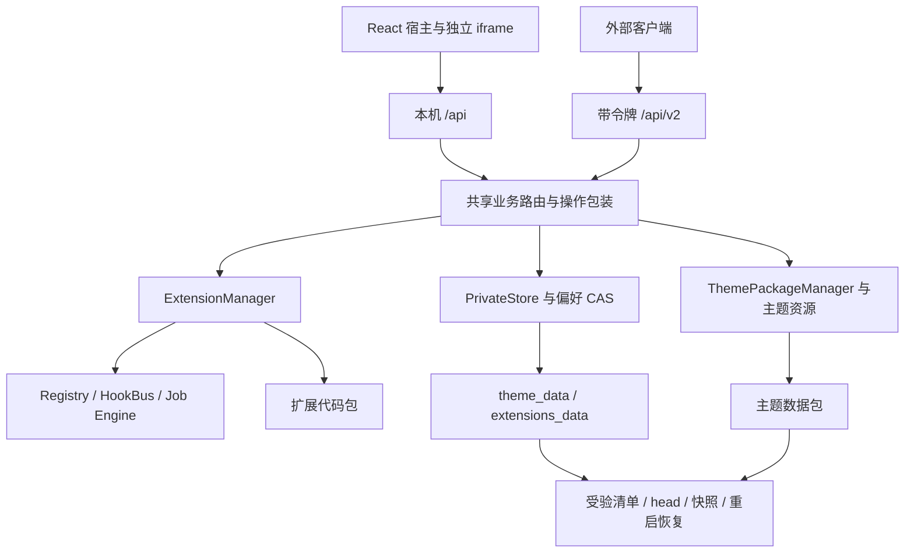

# Mio · 绘页：扩展与自定义主题架构详解及维护审查

> 更新日期：2026-11-19。生产实现基线：`6aca389`；本文按已完成的平台加固维护，正文描述当前行为，未来能力单列为提案。
> 原审查针对 `7837110`，八项确认缺陷已修复；原始审查可从 Git 提交 `cf54c68` 读取。已完成的加固计划与旧实施笔记的有效验收证据已合并到本文，不再维护重复的状态文档。

## 阅读目录

- [1. 阅读范围与当前结论](#1-阅读范围与当前结论)
- [2. 系统全景与信任边界](#2-系统全景与信任边界)
- [3. 扩展后端与执行生命周期](#3-扩展后端与执行生命周期)
- [4. 主题包、资源与便携身份](#4-主题包资源与便携身份)
- [5. 前端状态与 iframe 会话](#5-前端状态与-iframe-会话)
- [6. 私有状态、备份与恢复](#6-私有状态备份与恢复)
- [7. 已修复发现与剩余边界](#7-已修复发现与剩余边界)
- [8. 验证、维护入口与不变量](#8-验证维护入口与不变量)
- [9. 2026-11-21 专业扩展与通用契约同步](#9-2026-11-21-专业扩展与通用契约同步)

## 1. 阅读范围与当前结论

### 1.1 本文与其他文档的分工

本文解释扩展和主题如何接入宿主、状态归谁所有、何时建立或撤销能力，以及跨模块恢复为什么成立。
接口格式和作者操作以对应契约为准；不在多份文档复制完整字段清单，也不继续使用已经漂移的源码行号。

| 文档 | 维护内容 |
| --- | --- |
| [README](README.md)、[路线图](docs/ROADMAP.md) | 产品使用、架构方向和完成状态 |
| [扩展 SDK](server/mio_server/extensions/README.md) | 清单、注册、运行服务、受限面板及受信工作区 |
| [主题包](docs/THEME_PACKAGES.md)、[扩展市场](docs/EXTENSION_MARKET.md) | 分发格式、导入导出、依赖及作者契约 |
| [工作区备份](docs/WORKSPACE_BACKUPS.md)、[扩展备份参与者](docs/EXTENSION_BACKUP_CONTRACT.md) | 可恢复范围、凭据策略、参与者和停机操作 |
| [平台 CTK](docs/EXTENSION_PLATFORM_CTK.md) | 只读合规检查、运行诊断和浏览器专项命令 |
| [创作与扩展验收索引](docs/EXTENSIBILITY_ACCEPTANCE.md) | 用户目标与工作流、套装、恢复、扩展测试的对应关系 |
| [专业扩展](docs/PROFESSIONAL_EXTENSIONS.md)、[媒体桥](docs/EXTENSION_MEDIA_BRIDGE.md) | 六个独立工具包的操作、权限、采用与图片/下载生命周期 |
| [复杂节点指南](docs/COMFY_ADAPTER_GUIDE.md)、[通用自动化](clients/python/AUTOMATION.md) | 独立适配器、Markdown 生成导出与 Webhook 接收边界 |
| [高扩展度演进 RFC](docs/HIGH_EXTENSIBILITY_RFC.md) | 演进提案与后续范围；当前实际子集以本文 §9 为准 |

### 1.2 已实现与尚未实现

已实现的平台基础包括：包安装与摘要审阅、动态路由、贡献分层、依赖闭包与精确安装计划、主题独立包、
统一私有状态、备份与真实重启恢复、偏好 CAS 子树写入、iframe 长会话、协议生成及 opt-in 诊断。

本轮已落盘的专业面板和媒体能力见 §9。声明式宿主槽位与只读上下文采用比 RFC 更窄的首批实现，
该子集已有专项回归与本机 Chrome 验证；下列完整提案不能因为部分入口出现就称为全部可用：

- 超出首批 `open_panel` 的宿主槽位条件、直接请求动作和可写 Inspector；
- 跨资源细粒度失效通知、扩展间业务事件及可同步消费的预声明快捷键；
- 配色/布局/背景分层组合、声明式设置绑定 CSS 变量、新版事件驱动单次 Worker；
- 从真实扩展抽取的版本化 SDK、`ext.<id>.<point>` 互操作和受管 Sidecar；
- 主题导入导出与工作区备份的大包维护 Job、全局磁盘预算和阶段性重启恢复。

当前 Python 扩展仍与宿主共享解释器和依赖环境；`mio.internal` 仍是不稳定逃生口。
主题 HTML 设置页保留维护者明确接受的自身导航外发限制，不能称为绝对断网环境。

### 1.3 五种身份与三种状态

| 身份 | 回答的问题 | 不能代替什么 |
| --- | --- | --- |
| 包/主题 ID | 哪个分发单元或视觉所有者 | 不能证明内容已经审阅 |
| digest | 哪份具体包内容 | 不能证明正在使用哪次激活实例 |
| activation | 哪次扩展加载和贡献发布 | 不能替代 iframe 来源窗口校验 |
| surface ID 与 session | 哪个界面、哪次宿主会话 | 不能用 React 普通重渲染次数替代 |
| preference revision | 哪份规范化私有 JSON 内容 | 它是内容摘要，不是递增数据库版本 |

服务端事实由 HTTP/Query Cache 承载；浏览器当前主题、脚本授权等本机偏好在 `ui-store`；
滑块草稿、拖动中位置等属于交互暂态。备份服务端偏好，不等于备份浏览器 localStorage 或尚未提交的草稿。

## 2. 系统全景与信任边界

### 2.1 模块地图



`api/extensions.py` 现在是组合入口，不再同时承载全部扩展功能：

| 模块 | 职责 |
| --- | --- |
| `api/extension_transport.py` | 列表、ZIP/文件夹传输、审阅启停和卸载 |
| `api/extension_surfaces.py` | 工作区、浮窗、普通面板、桥及静态页面 |
| `api/extension_private.py` | SDK 设置与宿主扩展偏好 |
| `api/theme_catalog.py` | 主题目录和用户令牌主题导入 |
| `api/theme_packages.py` | 独立包、资源、完整/卡片样式、自定义设置页、删除 |
| `api/theme_preferences.py` | 主题私有偏好、壁纸上传与读取 |
| `api/extension_diagnostics.py` | 管理员只读平台诊断 |

扩展执行和包生命周期仍在 `extensions/manager.py`，不移入 HTTP 处理器。
本机和 v2 复用同一操作实现；版本前缀改变认证入口，不另建一套业务语义。

### 2.2 三层信任不能混用

| 类型 | 执行能力 | 约束与事实边界 |
| --- | --- | --- |
| 主题 | 视觉令牌、受验 CSS、媒体、隔离 Worker 颜色脚本、无同源设置页 | 不提供业务 API 桥；设置页自身导航是已接受例外 |
| 普通扩展面板 | `sandbox="allow-scripts"` iframe 与声明请求桥 | 没有宿主同源权限；请求模板、激活摘要、scope、体积和会话均受校验 |
| 受信扩展 | Python、同源 workspace/浮窗 | 用户显式审阅摘要；拥有高权限，不是代码安全沙箱 |

宿主不直接 import 扩展 React，也不把其组件挂进宿主 DOM 树。
独立工作区使用包内前端构建产物和相对资源，与宿主通过数据和消息协作。
同源工作区的桥主要解决协作、身份与生命周期，不是恶意同源代码的权限隔离墙。

### 2.3 HTTP、作用域与操作包装

本机 `/api` 不要求登录，因此 `api/guard.py` 承担 Host、写请求来源和 WebSocket 防护；
不能把它当作公网多用户认证。`/api/v2` 另外要求 Bearer 令牌和对应 scope。
管理路径优先分类：扩展偏好 `/ext/{id}/preferences` 和 `/extensions/diagnostics` 即使 GET 也要求 admin；
不能仅凭 GET 推断只需 read。具体分类以 `auth.required_scope` 和路由声明为准。

`api/operations.py` 在参数验证和认证后捕获当前包装链，按固定操作 ID 调用；每层 `next` 最多一次。
包装失败不自动重试副作用，已经开始的操作继续使用原链。
扩展启停或重新加载期间，新核心 HTTP 请求快速返回 409，避免捕获半发布的贡献目录。
静态文件、WebSocket、后台服务和任务回调不经过该 HTTP 包装器。

### 2.4 单一协议源与生成链

`extensions/manifest.py` 仍是清单权威模型；`extensions/protocol.py` 复用它，并统一 Panel HTTP、
Panel/Workspace/Theme Settings 的消息、生命周期、事件决定、版本和限额。
`panel_bridge.py` 使用同一请求模型，不维护形似但独立的副本。

`api/extension_contracts.py` 为本机与 v2 OpenAPI 注入 `MioContract_*` 组件，不增加业务路由。
`tools/generate_extension_contracts.py` 生成前端 `extensionProtocol.ts` 的类型别名和运行常量；
注入页面的桥、前端宿主与颜色令牌白名单实际消费同一来源。HTTP 类型及 Python 客户端沿用既有生成器。

类型生成不等于运行时完全安全。来源窗口、origin、nonce、有限数值、请求时序、路径和权限仍由实际入口验证；
Pydantic 自定义语义也不能仅用 JSON Schema 的形状推断。CI 检查协议产物、OpenAPI 和两类客户端漂移。

## 3. 扩展后端与执行生命周期

### 3.1 发现、安装和内容审阅

随包扩展在仓库 `extensions/<id>`，用户安装包在工作区 `extensions/<id>`；同 ID 的用户包优先。
清单规定入口、工作区、声明式贡献、浮窗和可选数据备份入口。安装保存包，但不自动执行或启用。
覆盖同 ID 包后也保持禁用，不沿用旧包信任；卸载用户覆盖版不会自动激活重新显露的随包实现。

包摘要按排序后的相对路径、长度和内容计算 SHA-256，媒体按块读取；缓存、node_modules、虚拟环境等不参与。
用户明确启用时提交 expected_digest，管理器在启用、依赖处理后、激活发布前核对内容。
安装成功表示结构和文件已接受；激活成功才表示贡献已发布，真实业务仍有独立执行验收。

扩展 ZIP 压缩后上限 50 MiB、展开后 200 MiB、最多 2000 文件。
原始上传和 multipart 均有实际字节上限；安装器校验越界、大小写重复、文件数量和实际展开体积，并以普通文件写出条目。
扩展 ZIP 不复用主题提取器对条目属性的全部校验，不能把两者描述为同一套链接/特殊文件规则；本地目录、读取和删除另有各自路径检查。
文件夹上传先形成临时归档，再复用相同安装权威；不会绕开包身份或确认流程。

### 3.2 依赖闭包与精确计划

`requirements.txt` 最多 64 KiB、100 条，接受 PEP 508 包声明、extras 和环境 marker；
不接受 pip 参数、包含文件、本地目录、直接 URL 或任意 requirements 语法。
依赖安装属于用户审阅后启用可信代码的动作，不是无代码安全预览。

`extensions/dependencies.py` 的当前流程为：

1. 递归检查直接依赖和全部基础传递依赖，再按选中 extras 计算附加要求；规范化包名、求值 marker、去环。
2. 存在缺失或失配时，通过当前解释器的 `pip --dry-run --report` 生成计划。
3. 验证唯一合法的 name/version、直接根依赖及受支持来源；拒绝改变任何宿主已有包版本。
4. 将宿主现有版本与计划版本写入临时 constraints，正式安装只使用精确 pins 和 `--no-deps`。
5. 安装后核对精确版本、原宿主版本以及原声明的完整依赖闭包，再继续激活。

空、重复、非法或无法固定的计划失败关闭；pip 输出不直接回显为可能携带凭据的错误文本。
这固定了解析版本，不是 wheel 内容哈希锁，也不是跨进程解释器事务。
扩展仍共享 Python 环境，不能自动解决互斥版本；卸载扩展不自动卸载共享依赖。

### 3.3 激活、贡献分层与回滚

`ExtensionManager` 使用任务操作屏障串行化安装、启停和替换；短目录过渡标记保护 HTTP 捕获贡献链。
激活建立绑定 id/digest/activation 的 `ExtensionAPI`，保存旧贡献和钩子，执行声明和 activate，再发布新实例。
失败时回收本次服务、撤销失败来源并恢复旧贡献、钩子和启用状态；不重新执行旧 activate 来制造恢复副作用。

Registry 保存同一贡献的来源层，而非破坏性覆盖；停用撤销本来源后，原内置或其他来源可恢复。
同来源重注册不无限累积；`replace=True` 不意味着任意业务协议可兼容替换。
HookBus 的过滤与通知遵循固定钩子签名，优先级较高先执行，同级稳定排序，异常记录后继续。
注册一个没人消费的扩展点名称，不等于已有核心执行路径。

SDK 提供贡献、钩子、类型化路由、任务、服务和设置入口；`mio.internal` 明确是不稳定 AppContext 访问。
当前并没有一层稳定代理替用户封装 AppContext 全部字段；未来稳定 SDK 只能从真实使用需求提取。

### 3.4 路由、服务和长任务身份

启用、停用与重新启用动态刷新本机及 v2 路由，无需重启挂载。
每条路由校验捕获的加载实例、启用状态和审阅摘要；同 ID 重新激活不能让旧路由借用新确认。
通过 `mio.route` 显式声明更窄 scope；普通 router 默认 admin。

`mio.service` 登记的运行对象在停用或失败激活时逆序 close；busy 状态参与生命周期保护。
close 不是强杀任意 Python 线程，宿主无法撤销可信扩展已经执行的外部写操作或网络副作用。
activate/deactivate 应管理贡献和资源，不自动开始生成或收费请求。

Job Engine 冻结 `(kind, source, digest)`，执行、取消、核对、结果交付和重启恢复解析相同身份。
排队任务缺少原执行器时保留并阻塞；运行中、结果未知、待交付或端点状态未恢复时阻止危险停用/替换。
已收到结果先持久化，再执行回写；只有声明 replay_safe 的交付才可重放，作品变更和回执以 delivery 身份去重。
受限管理员改绑仅面向从未尝试且无结果、无端点租约的任务，不把换实现当作通用恢复手段。

### 3.5 市场、安全模式与卸载

市场是包发现和下载目录，不是信任根；安装校验目录摘要、ZIP 摘要、清单 ID 和版本，再交给相同安装器。
更换目录源清空旧缓存，下载内容不会自动启用。市场配置与代码包分开，错误不触发静默换源。
`MIO_SAFE_MODE=1` 跳过扩展加载，不删除包或数据，也不修复已经受损的共享 Python 环境。

卸载默认保留 `extensions_data/<id>` 和已识别旧偏好；显式 `delete_data=true` 才删除所属数据。
删除前校验代码根和数据树，执行可信停用代码后再次校验目标，避免路径被更换后删除错误位置。
扩展贡献主题的用户私有数据属于主题 ID，不因该扩展关闭而消失。

## 4. 主题包、资源与便携身份

### 4.1 四类来源与主题模型

| 来源 | 注册和资源所有者 | 删除语义 |
| --- | --- | --- |
| builtin | 内置令牌或随包 `themes/<id>` | 不能从用户主题删除入口删除 |
| user | 数据库中的用户令牌主题 | 可删除定义，私有状态默认保留 |
| theme-package | 工作区中的独立主题包 | 可删除用户包，私有状态默认保留 |
| ext:<id> | 已审阅且启用的扩展贡献 | 随扩展启停，不从独立主题入口误删扩展 |

`themes.py` 校验语义颜色、尺寸、圆角、间距、阴影、背景和设置声明，未知令牌拒绝。
解析后的主题补齐同模式基础色；控件派生色仍由统一语义样式参与计算。
令牌验证不代表全量 CSS 无法改变交互外观：CSS 仍能重排、隐藏或遮挡宿主已有界面。

### 4.2 包闭包与唯一 ZIP 权威

独立包以 `mio-theme.json` 和 `theme.json` 为核心，可带已声明 CSS、脚本、设置 HTML、说明及被引用 assets。
清单身份与主题定义一致，设置页、样式、脚本和媒体必须属于允许集合；多放无关文件不是自动忽略的附加能力。
字符串路径校验和真实文件系统校验分开，读取时检查根、中间目录及最终普通文件，拒绝链接和 Windows 重解析点。

主题单包与单文件上限 10 GiB，最多 64 文件；元数据、CSS、脚本和设置 HTML 另有较小上限。
ZIP 磁盘提取是权威结构入口；内存字节适配调用同一提取路径，不再维护另一套大段结构校验。
它检查路径、加密/特殊条目、大小写重复、声明大小和实际复制量，并在发布前重新校验清单与资源闭包。

安装先写 staging，再在管理器锁下发布；已有合法包冲突明确拒绝。
只有旧 `user_wallpapers` 私有容器可以按明确形态保留，并在同 ID 重装时仅发布包文件；注册失败回退包文件，不动壁纸。
不能把“忽略用户壁纸”扩展成忽略所有缺清单目录，否则会把真正损坏的安装静默漏出备份。

### 4.3 CSS 与卡片逻辑自作用域

完整主题 CSS 的资源扫描拒绝外链、`@import`、转义标识符、image-set 等不受支持资源语法；
`url()` 只引用实际存在的包内 assets。它是受限扫描器，不是通用 CSS 解析器或视觉可用性证明。
对抗语料检查注释拼接、大小写、转义、畸形闭合与不支持资源函数。

卡片协议使用逻辑根：

```css
.theme-card[data-theme-id="self"] > .title {
  color: #345678;
}
```

导出仍按规范化内容和资源摘要派生新的主题 ID；旧显式 ID 仅在选择器语法位置规范为 self。
重绑定只替换对应属性值，保留注释、声明字符串和 URL；支持已验证的注释分隔以及完整 CSS 的 scope/supports 选择器头。
`/style` 与 `/card-style` 在服务端把 self 绑定当前真实 ID，不依赖导出时全局替换任意 CSS 文本。

卡片端点再执行隔离过滤：只暴露该根及允许后代，不暴露全局规则、选择器列表、顶层兄弟逃逸或未支持嵌套块。
完整样式支持某个结构，不意味着卡片过滤器也接受；被过滤规则可从 CTK 诊断，而不是扩大隔离范围来迁就样式。
前端每张卡的 link 只管理生命周期，不构成 CSS 沙箱。

### 4.4 同一 MediaDescriptor 与显式 MIME

包背景和用户上传媒体共享 `kind/url/animated/mime_type`，背景另外保留 opacity。
后端由 `theme_media.py` 统一格式、魔数、有限前缀动画探测和后缀到 MIME 映射；不依赖操作系统注册表猜类型。
前端类型引用生成的响应模型，Provider 与主题卡通过 `effectiveThemeBackground` 选择同一有效背景。

选择到存在的用户 wallpaper_id 时覆盖包背景；不存在则回退包背景。
卡片暂停、透明度和视频系统动效覆盖入口都按有效背景决定，不能只检查原始 theme.background。
GIF、PNG 容器的 APNG、动画 WebP 等沿途保留 animated；静态图不因背景暂停而被当作动画移除。

媒体签名和前缀探测不是完整解码验证。单测小头部夹具只证明路由、元数据与策略一致；
不能据此认证任意编码器、所有动画容器或真实视频播放表现。

### 4.5 设置页、Worker 与授权边界

声明式 settings_schema 渲染 slider、switch、select、file_upload；动态壁纸列表仍使用私有媒体接口。
Schema 是表单声明，不是对任意私有 JSON 字段的完整业务约束，消费偏好时仍须检查数值与范围。
有 settings_page 时，当前实现优先显示自定义无同源 iframe；外层标题、关闭和焦点控件由宿主负责。

设置页注入桥只有 `getSettings()` 和 `updateSettings()`，输入有限，使用请求 ID、随机 session 和具体 iframe 来源。
作者脚本带每响应 nonce；CSP 的 sandbox 与 script-src 是独立指令，已修复缺分号导致全部脚本被阻止的问题。
updateSettings 是整对象 CAS，远程冲突返回错误，不把它伪装成可以任意自动合并的字段更新。

**已接受边界**：Chrome 157.0.8103.50 真实测试中，fetch、图片与顶层导航被阻断，但作者脚本自身导航仍到达探测端一次。
该受测浏览器不支持 navigate-to；维护者已明确选择保留设置页并接受自身导航外发限制。
页面可能把自己已知的设置放进目标地址；没有同源权限或业务 API 桥不等于所有网络原语都被禁止。
此例外不向主题添加作品读写、生成或宿主通用请求能力，也不能把普通面板和受信工作区混称为相同权限。

视觉脚本是另一条链：授权绑定主题 ID 和脚本 SHA-256，取回后核对实际摘要，再经无同源 iframe 建立 Worker。
只允许颜色白名单的 setColor/resetColors，不开放宿主 DOM 或业务接口；宿主限制每秒消息量和单次存活时间。
当前约束为 30 条/秒、30 秒 watchdog；错误、超限和超时可诊断。watchdog 结束执行环境后，已写颜色保留到 effect 清理，
清理仅在当前值仍属于本次脚本时恢复，避免旧脚本把新主题覆盖回去。新版事件驱动单次调用仍在 RFC。

## 5. 前端状态与 iframe 会话

### 5.1 主题只有一个有效应用者

Shell 中的 ThemeProvider 解析主题目录、系统明暗、本机选择、服务端偏好与有效媒体。
卡片和其他入口只改变选择，不分别写根令牌或建立多份系统订阅。
切换主题清理自己写过的变量、样式 link、Worker 和媒体，保留其他模块拥有的根元素属性。

背景通过 Portal 放在应用根之外，不占布局且不截获指针；透明化作用于表面令牌，不降低整棵应用文字透明度。
视频按 URL 装载，卸载时 pause、移除 src 并 load；隐藏页面暂停，恢复可见时重新按策略同步。
手动暂停和 Mio 减动态优先；系统减动态仅可被用户明确允许的视频例外覆盖，不扩展到脚本或动画图片。
动画图片暂停采用移除动态背景的保守方式，不宣称冻结 GIF 某一帧；静态图片继续显示。

`Ctrl/Cmd+Shift+0` 是宿主主题逃生键，扩展分发明确跳过对应组合，恢复不删除包和私有数据。
真实专项覆盖了宿主页被 CSS 遮挡的情形；不能把该结果扩展成所有 iframe 焦点、浏览器或系统快捷键环境的全面认证。

### 5.2 服务端偏好的 CAS 契约

两类资源分别是 `/themes/{theme_id}/preferences` 和 `/ext/{ext_id}/preferences`。
GET/PUT/PATCH 均返回完整 JSON 对象与强 ETag，revision 是去除 ETag 双引号后的 64 位内容摘要。

```json
{
  "expected_revision": "0000000000000000000000000000000000000000000000000000000000000000",
  "path": ["floating_surfaces", "palette"],
  "value": {"position": {"x": 12, "y": 24}, "clickThrough": false}
}
```

示例摘要仅表示格式，调用时必须先 GET 并使用该对象的真实 ETag。
path 最多 16 个对象键，拒绝原型相关键；缺失对象父层可创建，已有数组/标量中间节点不能被静默覆盖。
空 path 表示替换整个对象，value 必须是对象；null 是写入值，不是删除操作。
比较 revision、读取、修改子树与原子落盘在同一个任务操作屏障中完成，旧 revision 返回 409。

PUT 保留显式整对象替换语义，可用单个强 If-Match 条件化；不带时是明确无条件替换。
不接受弱 ETag、通配或列表作为该条件；这不是通用 JSON Patch，也不是任意多客户端无冲突合并协议。

### 5.3 意图队列、缓存和草稿

`api/preferenceWrites.ts` 按 QueryClient 和资源路径保存写入队列，调用入队时冻结输入并乐观投影最新意图。
真正发送时使用最近确认的 revision；同资源的不同组件共用顺序，不同 QueryClient 不串扰。
子树 409 后重取权威对象，最多重放一次；整对象冲突不自动重放，排队期间已观察远程版本变化也会拒绝整对象替换。

sequence/read/epoch 防止旧 GET 或旧 PATCH 响应覆盖已经观察的新事实。
失败响应不保证服务端未写入，因此先重取权威值再回滚；队列结束将已确认对象和剩余意图重新投影到缓存。
这是本资源的一致写入协调，不是跨标签页总线或业务事务管理器。

ThemeSettingsPanel 按字段提交，滑块尚未提交的脏草稿不被后台读取覆盖；连续字段事件从最新草稿计算。
自定义设置页仍提交整对象 CAS；上传媒体和选择 wallpaper_id 是两个独立操作，前者成功、后者失败时媒体保留可再次选择。
组件卸载后请求可完成持久化，但停止向失效组件、旧 iframe 或新主题会话回复。

### 5.4 浮窗订阅与生命周期

目录包含 extension_id、surface ID、URL、activation、digest 和显示属性；宿主按身份建立独立 iframe。
`WorkspaceFrame` 将最新回调放 ref，消息订阅和清理不再依赖每次拖动、缩放或穿透渲染产生的新函数。
逻辑全局事件订阅属于 iframe 会话；active=false 只挂起宿主登记，恢复时重放，不清空逻辑意图。
文档 load 清理旧订阅后发送 context，注入桥从当前处理器集合幂等重放 listen；真正卸载、停用或身份改变才撤销能力。
会话 nonce 由组件持有，不能把一次普通重渲染说成已经创建新文档或新激活。

宿主发送 shown、hidden、focused、blurred，桥提供 onLifecycle。
最小化保留 iframe 与页面状态，不代表停止页面内全部定时器、连接或可信业务执行。
焦点和显示状态与 priority 不同：优先级影响基础层级和事件顺序，不等于完整桌面窗口管理器。

浮窗初载偏好、恢复显示及视口变化使用夹取；尺寸与位置必须有限且适合当前视口。
穿透由浮窗容器拥有 pointer-events:none，标题栏显式恢复交互；不是仅让 iframe 透明或禁用自身指针。
当前 surface 只 PATCH `floating_surfaces.<surface_id>`，不把兄弟窗口和扩展自有字段读出来再整对象覆盖。
保存失败按最新意图处理反馈与权威回滚，不再静默吞掉错误。

### 5.5 全局按键是异步扩展链

宿主跳过 IME、已阻止事件和输入控件；按 priority 与稳定身份顺序向有效订阅发送按键副本。
每个处理器有 250 ms 回复窗口，eventId 与所属 frame/session 一起匹配；卸载时结束未决等待并继续后续链。
派发前再次检查订阅仍有效，避免前一个处理器等待期间，已卸载的后一个 surface 仍收到消息。

handled/stop_propagation 只截断扩展分发链，不能异步撤销已继续传播的原浏览器按键。
可同步消费浏览器默认动作的预声明快捷键仍是 RFC，当前不应向作者承诺这一能力。

## 6. 私有状态、备份与恢复

### 6.1 物理目录与逻辑所有者

下表路径均相对工作区数据目录；程序随包目录是另一份只读分发来源。

| 路径 | 数据性质 | 分发和保留语义 |
| --- | --- | --- |
| `extensions/<id>/` | 用户扩展代码 | 审阅摘要覆盖，不是通用用户数据区 |
| `themes/<id>/` | 用户独立主题包 | 公开主题 ZIP 的资源来源 |
| `extensions_data/<id>/settings.json` | SDK 设置 | 宿主保留文件，完整备份可恢复 |
| `extensions_data/<id>/preferences.json` | 扩展/浮窗偏好 | 宿主保留文件，默认跨卸载保留 |
| `extensions_data/<id>/...` | 扩展业务数据 | 由已审阅备份参与者声明，不整目录盲拷 |
| `theme_data/<id>/preferences.json` | 所有来源主题私有偏好 | 不随公开主题 ZIP 分发 |
| `theme_data/<id>/wallpapers/` | 用户媒体和对应 JSON 索引 | 完整工作区备份包含，公开主题 ZIP 排除 |
| `extension_data/<id>/preferences.json` | 已识别旧偏好来源 | 只读回退，不再写新数据 |
| `themes/<id>/user_wallpapers/` | 已识别旧媒体来源 | 保留、读回和完整备份，不进入公开包 |

新位置优先；同名新旧内容不同时两份都保留，诊断显示 conflict，既不静默合并也不搬迁删除。
新写只进入 canonical；备份和 head 包含被新值遮蔽的旧物理来源，因此修改旧副本仍会使恢复计划失效。
显式删除媒体时校验并删除其所有已识别副本，避免旧副本在下次读取时复活。

扩展保留偏好可在代码已卸载后读取；主题 HTTP 读取仍要求当前注册，该主题未注册不影响私有数据被备份。
重装同 ID 后重新使用保留状态；读取保留数据不应偷偷激活已卸载代码。

### 6.2 PrivateStore 的受验原语

`private_store.py` 统一扩展设置、两类偏好和媒体的身份、目录、JSON、原子写及媒体校验。
它在 resolve 前检查祖先、目录和文件，拒绝符号链接、Windows junction/重解析点与特殊文件。
JSON 必须有界、UTF-8、顶层对象，拒绝重复键、NaN/Infinity、溢出非有限浮点、非法代理字符和超深嵌套。
默认 JSON 上限 1 MiB、最大深度 64；壁纸单文件 64 MiB，元数据另有较小上限。

保存先编码并验证独立字节快照，再写同目录临时文件、flush/fsync、原子替换；正常失败清理自己拥有的临时文件。
SDK `backups/extension_data.py` 是薄适配，不再保留第二套重复 JSON/路径规则。
这些是文件与进程内协作保证，不是对同权限恶意进程反复替换文件系统节点的完全防竞争沙箱。

### 6.3 备份的一份受验清单

`backups/extension_data.py` 管 SDK settings；`backups/ui_data.py` 管新旧偏好与配对媒体；
`backups/themes.py` 管主题包；`participants.py` 汇聚已审阅扩展的业务数据规则。
同一数据定义用于 head、快照、白名单、单项限额和恢复校验，不能仅往 ZIP 塞文件却忘记内容头。

head 在数据库内容之外纳入受验文件名与文件摘要。
任何主题偏好、用户媒体、扩展窗口偏好或已保留旧副本的变动，都必须使旧恢复计划失效。
四类主题及已卸载保留数据均可备份；不依赖当时主题是否启用，也不通过扫描目录执行归档代码。
媒体和索引缺失、签名不匹配及不支持文件不会被默默忽略；CTK 可报告孤儿文件，但不自动清理用户状态。

扩展参与者只能声明 `extensions_data/<本扩展id>`，且不能抢占或修改宿主 settings.json/preferences.json。
规则从随包或本工作区已审阅内容快照装载；导入 ZIP 中的 Python 不是恢复时的执行来源。
快照遵循任务操作锁、引擎锁、参与者锁与数据库锁的顺序，并保护宿主保留文件不被参与者改写。

### 6.4 公开包、完整备份与凭据策略

公开主题 ZIP 只携带可分发视觉内容；用户照片、壁纸、偏好绝不因导出主题而被附带。
完整工作区备份保存数据库、已登记素材、主题包、主题私有状态、扩展设置及已声明业务数据；
不携带扩展可执行包、模型、ComfyUI 插件、缓存或未知个人目录。

默认备份移除已知配置凭据；无法安全清理的结构化历史凭据会拒绝导出，不偷偷改写不可变历史。
明确 include_credentials 才可包含这些值，恢复前本机保护备份包含凭据，应按秘密文件管理。
秘密检测不能识别任意文字或图片中的所有秘密，备份成功不等于适合公开分享。

当前归档上限压缩后 12 GiB、展开后 16 GiB，数据库单文件另有限额；媒体按块复制与哈希。
流式并不意味着磁盘消耗只有最终文件大小：上传、staging、快照、归档与保护副本可能共存。
跨请求全局磁盘预算和后台大包 Job 尚未实现，不把单操作体积限制宣传为全局配额。

### 6.5 恢复计划与真实重启闭环

```text
导出 → inspect → stage(expected_head, archive_sha256)
     → apply 创建当前保护备份并安排 pending
     → 关闭服务 → 下次启动复验 → 目录事务安装
     → AppContext 重建 → 读回并确认 installed / rejected / rolled_back
```

stage/apply 不是在线恢复成功；`requires_restart` 是安排结果，不能显示成数据已经恢复。
暂存后或安排后继续编辑偏好、媒体等私有状态，会因 head 不匹配拒绝过时计划。
启动在工作区租约下校验、记录目录交换并处理正常进程中断；失败保留保护副本，不执行备份内任意代码。
恢复后队列暂停，外部服务与扩展保持需要重新确认的状态；主题贡献需显式重装或审阅启用后再解析。
不能从目录事务推出突然断电绝对无损，磁盘损坏仍需独立外部备份。

## 7. 已修复发现与剩余边界

### 7.1 原八项发现均已修复

以下编号保留原审查追溯，不表示当前仍有同名开放缺陷。详细根因用当前契约解释，不再以旧行号指导修复。

| 编号 | 原根因 → 当前契约 | 关键回归路径 |
| --- | --- | --- |
| TB-1 | 内置主题上传生成无清单包目录 → 媒体移至私有根，旧私有容器明确识别 | `test_backup_ui_data.py` 四来源上传→head→备份→重启 |
| TB-2 | 偏好/媒体不参与 head 和恢复 → 统一受验清单覆盖全备份生命周期 | `test_backup_ui_data.py` 篡改、过期计划、保护副本、旧来源 |
| EX-1 | 单数偏好目录绕开 SDK 数据契约 → 复数所有者目录写入，旧路径完整保留和回退 | `test_private_store.py`、`test_private_data_lifecycle.py` |
| EX-2 | 基础依赖检查置于 extras 循环且二次解析漂移 → 完整闭包、固定计划、安装后核验 | `test_extension_dependencies.py` 元数据/子进程矩阵 |
| TB-3 | 导出重算 ID 但 CSS 固绑旧 ID → self 语法作用域、服务端绑定、注释与声明保留 | `test_theme_packages.py`、`test_theme_platform_contract.py` |
| F-FE-1 | 普通渲染清理会话订阅 → iframe 身份所有权与稳定回调、active 挂起恢复 | `host.test.tsx` 长会话、目录刷新、派发中卸载 |
| F-FE-2 | 旧整对象请求/响应覆盖新意图 → CAS 子树、资源队列、epoch、脏草稿和权威对账 | `test_preference_concurrency.py`、`preferenceWrites.test.tsx`、`ThemeSettingsPanel.test.tsx` |
| F-FE-3 | 用户媒体丢失 animated → 同源 MediaDescriptor 与有效背景策略 | `test_theme_platform_contract.py`、`useTheme.test.tsx`、`ThemesSection.test.tsx` |

### 7.2 加固过程补出的边界

- 注释分隔卡片根原本能通过过滤却无法重绑定，已补 old→self→新 ID 往返；完整 CSS 的 scope/supports 选择器头也有回归。
- 旧壁纸目录默认保留后会挡住同 ID 重装，已修复包文件发布及失败回退，保留原私有内容。
- 真实浏览器发现设置页 CSP 缺分号，已修复指令拼接，并以指令拆分断言及实际脚本运行验证。
- 浏览器脚本在 Windows 上改为父进程持有临时工作区，等待子进程退出后清理，避免子进程 finally 不执行造成残留。
- 运行诊断模型采用独立名称，避免 OpenAPI 名称冲突破坏既有工作流诊断的生成类型。

### 7.3 当前仍需诚实保留的限制

| 限制 | 当前处理和下一步 |
| --- | --- |
| 自定义 HTML 设置页可自身导航外发 | 已真实验证并明确接受；不宣称绝对断网，进一步运行时设计在 RFC |
| 可信 Python/同源工作区权限高，共享依赖有冲突 | 摘要审阅、安全模式、服务与任务身份保护；Sidecar 尚未实现 |
| CSS 可遮挡宿主，卡片过滤只接受受限子集 | 宿主逃生键、资源校验和过滤诊断；不证明任意 CSS 可用 |
| 安装/删除/文件检查不是跨进程和任意断电事务 | 受验 staging、锁和失败回退；保留威胁模型边界，不承诺回滚外部副作用 |
| 媒体头部不等于完整解码、jsdom 不做真实布局/CSP | 单独运行浏览器与编解码专项，按实际环境报告结果 |
| 单包上限不是全局磁盘预算，备份仍非维护 Job | 保留现有限额；Job/内容头控制面划分见 RFC，不能先放宽 restore_guard |

## 8. 验证、维护入口与不变量

### 8.1 已完成的跨边界回归

这些组合测试比重复检查一个纯函数更能守住平台边界：

- 数据：四类主题与扩展偏好，从写入/上传、head 变化、归档、篡改拒绝，到 stage/apply、关闭和重建 AppContext、读回及保留/删除。
- 扩展贡献主题通过真实临时扩展包审阅启用；恢复不自动执行归档代码，显式重装启用后读回原私有状态。
- 包隐私：完整备份含私有偏好和媒体，公开主题 ZIP 始终不含；旧路径被遮蔽的副本仍影响 head。
- 依赖：无 extras 子依赖缺失、版本失配、嵌套、循环、marker、拒绝升级宿主和精确计划固化，全部使用替身。
- 主题：内置主题导出再导入、再次导出，卡片和完整 CSS 均可绑定；注释、字符串和 URL 不被全局替换。
- 动效：包背景/用户媒体 × 静态图/GIF/APNG/WebP/视频 × 系统/Mio/手动策略，保留明确的视频例外。
- 异步：Deferred 控制旧成功、旧失败、旧 GET/旧 PATCH 晚到、远程冲突、双 QueryClient、连续操作后卸载。
- 长会话：同一 iframe 一次订阅后拖动、缩放、穿透、最小化/恢复、切路由、目录刷新、身份替换及卸载。
- 对抗：CSS 注释、转义、大小写、image-set、畸形闭合、兄弟组合器；multipart 104 种分块、伪边界、超限、断连与取消后临时文件回收。

### 8.2 真实浏览器与已接受边界

2026-11-19 使用已安装的 Chrome 157.0.8103.50 和 Python Playwright，运行临时工作区及回环探测服务：

| 检查 | 实测结果 |
| --- | --- |
| 穿透内容区命中底层真实按钮 | 通过 |
| 穿透后标题栏仍能关闭穿透 | 通过 |
| 恶意遮挡 CSS 下宿主题恢复键 | 通过 |
| 设置页 fetch、图片、顶层导航探测 | 被阻断 |
| 设置页自身导航 | 1 次请求真实到达；不是阻断通过 |
| 清理 | 父进程所属临时树残留为 0，关闭自己创建的子进程；旧探测树经 fixture 身份校验后清理 |

维护者明确选择保留现有设置页并接受自身导航外发限制。测试默认输出此观察结果；
加 `--require-navigation-blocked` 会把它当作硬门禁，当前受测 Chrome 返回非零。
未安装浏览器，未调用用户模型或重启用户服务；也未由单一 Chrome 推断跨浏览器或所有编码格式均通过。

### 8.3 实际执行记录与边界

下表是 2026-11-19 平台加固结束时的实际记录，关联 `a23923c`、`d5a4164` 和 `6aca389`。
本次架构文档维护只校核文档和引用，不把下表冒充为本次重新运行的业务测试。

| 验证 | 结果与解释 |
| --- | --- |
| 后端 unittest 全量 | 1118 项首跑 1 失败、1 跳过，367.815 秒；失败是新增 CTK 测试 text=True 未声明 encoding。修复后受影响编码/CTK/主题/协议 24 项通过；四来源真实重启矩阵强化后单项通过。没有声称再次跑过全量 unittest |
| 后端 pytest 全量 | 系统已有环境 1061 passed、2 skipped，另 892 subtests passed，712.68 秒；两条重复 ZIP 成员警告来自拒绝测试。未安装 pytest 或真实第三方依赖 |
| Python lint/format | server、extensions、clients、tools 全通过，313 文件格式一致 |
| Python 客户端/协议生成 | 重新生成并通过两个 --check |
| TS OpenAPI | 再生成前后 SHA-256 一致，零漂移；新诊断模型与既有类型冲突已消除 |
| 前端格式/类型/构建 | Prettier、tsc、Vite 通过；>500 kB chunk 提示保留，不是失败 |
| 前端单测 | 84 文件、782 项通过；颜色白名单改为同源常量后受影响 4 文件 186 项通过 |
| 独立 AI 扩展前端 | 22 项、Prettier、build 通过，dist 无漂移 |
| Spike | 80 项通过 |
| 静态 CTK | AI 扩展和壁纸主题 valid=true；不是代码信任或实际运行认证 |
| 本机发行清单 | check_distribution 和 build_distribution --check 因原有 3 项差异拒绝通过；未重置个人数据，未调用 --approve-changes |
| 干净种子与临时发行 ZIP | 使用清单夹具/Git 中批准的 64 文件，校验通过；当前候选打包 431 成员、ZIP CRC 通过，未签名、未发布，临时产物清理 |
| 浏览器及收尾 | 结果见 §8.2；Windows 父进程清理修正后专项再跑通过，编码检查 2 项通过 |

分阶段证据保留：M1 私有数据/恢复集成 61 项通过，SDK 适配相关 6 模块 54 项通过；
M2 后端 91 项、依赖专测 22 项、前端 198 项（含 160 动效组合）通过；
M3 后端 71 项（含 13 并发测试）、前端队列 10/设置 7/浮窗 8 项通过；
M4 契约、CTK 和运行诊断分别有生成引用闭合、只读/不执行、错误与生命周期回归。
阶段首跑中的旧目录/字段/桥字符串断言、探测命名空间和 fake timer 时序问题均修正后复验，未以放宽产品校验换取通过。

历史范围另行保留：2026-11-17 AI/更新隔离实例验证了默认市场、AI 热启停、独立资源及 MIME、
未提交请求回执和重新启用后的对话持久化，并修复启用失败误报成功、发送未到后端后的会话恢复问题。
当时未提交真实云端请求，浏览器调试连接超时，不作为视觉认证；也未验证真实官方签名下载安装。
这些历史结果不用于推断当前官方 Release 目录、密钥配置或真实模型可用性。

平台加固没有调用真实模型、GPU、云端或收费服务，没有执行真实 pip 安装测试、签名发布、
跨浏览器/全部媒体解码认证或突然断电实验。模拟成功不能替代这些项目。
本机已有运行数据差异和干净种子验证是两个结论，不能合成“当前个人工作区可直接发行”。

### 8.4 日常维护入口

| 需要改变的契约 | 首先检查的文件 | 必须联动 |
| --- | --- | --- |
| 包身份、依赖、启停、卸载 | `extensions/manifest.py/manager.py/dependencies.py` | 摘要、服务/执行器保护、路径与回滚矩阵 |
| 清单或浏览器消息 | `extensions/protocol.py` 与清单模型 | 两份 OpenAPI、生成 TS/Python、注入桥与实际消费者 |
| 主题格式/CSS/媒体 | `themes.py/theme_media.py/theme_packages.py` | 导入、导出、HTTP MIME、卡片过滤、动效和备份 |
| 新私有文件 | `private_store.py`、`backups/ui_data.py/participants.py` | 所有者、新旧路径、head、快照、归档白名单、重启恢复和删除 |
| 偏好及新控件 | 两类偏好 API、`api/preferenceWrites.ts` | CAS/子树、脏草稿、乱序、冲突、卸载与权威对账 |
| workspace/浮窗 | `api/extension_surfaces.py`、`web/src/extensions/host.tsx` | activation/digest、frame/session、active、订阅和待决事件清理 |
| 新诊断 | `extensions/ctk.py`、`app/themeDiagnostics.ts` | 只读、固定错误码、有界容量、无凭据或原始私有值 |

开发者命令和诊断开启方式统一维护在[平台 CTK](docs/EXTENSION_PLATFORM_CTK.md)，不在本页复制第二份可漂移的完整命令清单。
正式协议或 Pydantic 变更需重新生成并校验；只有文档维护时，不声称执行了代码或真实服务验收。
后续范围以 [RFC](docs/HIGH_EXTENSIBILITY_RFC.md) 的 E1–E5 为提案来源；当前窄实现见 §9，不能把方案本身当作其余运行能力已完成。

### 8.5 后续变更应维护的五个不变量

1. **身份一致**：审阅摘要、加载实例、贡献、路由和 iframe 会话对应同份内容；导出改变主题身份时处理合法选择器引用。
2. **数据所有权清晰**：包、偏好、用户媒体、业务数据和临时文件各自有创建、备份、保留、删除与恢复规则；公开包排除私有数据不影响完整备份。
3. **最终状态符合最后意图**：服务端权威值、缓存和草稿由明确顺序/CAS 协调；远程冲突清楚拒绝或有界重放，不让迟到成功或失败反转已确认状态。
4. **临时能力有明确生命周期**：订阅、消息会话、Worker、样式、媒体、请求和临时文件在建立及撤销处可追踪；重渲染不误撤销，真正停用不残留。
5. **验证结论有边界**：区分单测、类型、生成一致、发行、浏览器、媒体和真实模型；同时记录首跑失败、复验、接受的限制及未执行项目。

## 9. 2026-11-21 专业扩展与通用契约同步

本节描述本轮代码的接入方式，不替换 §8.2、§8.3 的历史环境和测试记录，也不提前宣称最终全门禁、
真实浏览器全链路或真实模型效果已经通过。六包的用户操作见[专业扩展说明](docs/PROFESSIONAL_EXTENSIONS.md)。

### 9.1 六项能力复用正式操作

`panel-retouch`、`qa-review`、`finalize-studio`、`variant-workshop`、`script-review` 和 `motion-studio`
分别封装编辑、质检、成品、版本、剧本提案和镜头导出；均位于 `examples/extensions/`，没有 Python 激活入口。
它们使用清单 `panels.requests` 的准确操作模板与原权限，不需要 `ctx.internal`，也没有新增六个固定主导航。
启用只发布可用入口，打开面板不执行收费生成；读取、提交、接受提案和下载均有明确操作。

写入语义继续由核心拥有：单格编辑新增候选；QA 固定关闭自动采用；成品完成时仅接替仍被采用的原图；
变体按版本采用；剧本按修订应用作者选中的操作；镜头保存不改变图片采用。停用的本地编辑阶段在面板过滤，
服务端也在编译和提交之前拒绝；只有完全缺少本地 `edit` 阶段时才保留云端编辑回退。

### 9.2 普通沙箱的受控媒体

`PanelRequestSpec.response` 在原 JSON 语义外增加 `image` 和 `download`。路径、scope、摘要和 activation
仍在实际操作入口验证，不允许任意 URL、请求头、跳转或跨扩展路由。图片限定 GET/read，内容经大小、
像素和真实格式校验；原始 Blob 通过 MessagePort 到达 opaque iframe，由面板自己的来源创建 URL。
不能把宿主 Blob URL 字符串当作隔离面板可访问的地址。

媒体会话计量对象数量与字节；换图、迟到结果、释放、导航和停用分别清理 URL、端口和宿主引用。
撤销不是已显示像素的追溯删除。下载准备后只由宿主的原生按钮接收用户手势，不授予 iframe 静默下载权限。
完整边界统一维护在[媒体桥契约](docs/EXTENSION_MEDIA_BRIDGE.md)，不在多个包复制第二套私有协议。

### 9.3 通用适配器和客户端

[复杂节点包](examples/extensions/comfy-complex-adapters/README.md)通过已有槽位、绑定和输出适配器识别明确
节点形态，冻结来源与摘要；多槽 LoRA、分阶段采样、参考图权重和特殊 history 读取的插件判断留在包内。
明确标签和手动映射继续优先；不承诺任意图片处理链、任意插件或浏览器脚本都能执行。

[标准图像渠道](examples/extensions/standard-image-channels/README.md)提供四种明确线协议，普通 `extra_options`
由宿主冻结，当前凭据只在执行时绑定。一次调用不重复生成 POST，已发送但结果不明时保留核对语义；安全 GET
的有限重试不变成重复收费提交。v1 不提供逐任务主动中断 HTTP、远端取消或跨进程恢复轮询保证。

[通用 CLI 和 Webhook 工具](clients/python/AUTOMATION.md)只依赖公开 API／SDK：Markdown 保留为分镜正文，
参数明确选择来源和采用策略；输出与续跑记录使用指纹、资源 ID 和文件摘要，不保存令牌。
Webhook 校验原始字节、签名时间与事件身份，再原子占用重放 ID；业务处理仍需要自己的持久收件箱。

### 9.4 版本追加与画布修订

`POST /series/{series_id}/variants` 在作品存储锁内追加原生 `VariantSet`，每批最多 24 项。
相同 ID／内容幂等，不同内容固定 409，冲突整批不写入；不替换其他窗口的新版本或设定集。
面板保留本轮版本 ID 重试，不再把读取到的旧清单通过整表 PATCH 写回。

画布 `PUT /episodes/{episode_id}/strip` 支持 `base_revision`；编辑器提交当前话的修订号，旧版本保存
返回冲突，不覆盖另一窗口的几何。未保存草稿不会被远程查询副本自动替换，保存只确认提交的那份快照，
保存期间继续编辑的内容仍保留为未保存修改。省略修订号的既有 API 调用仍是明确无条件保存，不能称为强制 CAS。
节奏预设和气泡避让使用原生 Strip／分幕字段与同一渲染路径，不复制第二份成品布局模型。

### 9.5 限定宿主槽位与只读上下文

首批 `host_slots` 只允许三个已知槽位打开本包的 episode 面板：命令面板、话上下文菜单和画格检查器。
宿主渲染声明文字、图标与排序，不加载扩展 React 或任意 HTML；没有直接执行请求、条件脚本、同步快捷键
或可写 Inspector。清单版本固定为 1，目录仍经当前启用摘要验证，复杂操作继续进入既有沙箱面板。

面板可明确订阅 `creation.context.changed`、`selection.changed`，收到的版本 1 快照只含路由、作品／话 ID、
选区 ID 和修订号，不自动传递剧本、提示词、图片、设置或凭据。宿主核对来源窗口、opaque origin、session、
activation 和 digest，合并高频更新并丢弃旧序号；导航、跨话和卸载清理订阅。事件仅由宿主发向本面板，
没有扩展发布业务事件或跨扩展广播。声明与限制统一见[创作扩展槽位](docs/CREATION_EXTENSION_SLOTS.md)。

该窄子集已完成本机 Chrome 的 1440×960／390×844、浅／深四组专项：命令入口、非当前分幕右键上下文、
真实画布选格后的 Inspector、只读事件及显式版本核对、停用后的入口与 iframe 撤销均在检查范围。
测试未访问模型或外部服务，也没有提交生成任务；方法、临时截图清理和复跑入口统一记录在
[槽位专项说明](docs/CREATION_EXTENSION_SLOTS.md#验证入口)。这不把 RFC E1 的其余提案标为完成。

### 9.6 文件发布与持久结果交付

`jobs/delivery.py` 的持久投递与作品库去重回执是既有机制。本轮补强其之前的文件发布窗口：
原先若云端返回图片后 `assets.put()` 已写文件、执行器还未返回结果就中断，没有 history 的渠道可能留下
无法按任务追溯的素材。现在执行器先调用 `AssetStore.describe()` 计算元数据，再通过
`ItemContext.publish_result(result, artifacts, stage=0, terminal=True)` 发布，不把“文件已落盘”
等同于“结果已经有可恢复的任务归属”。

发布前先在已有 `job_deliveries` 写入 `mio.result-publication.v1` 信封，固定 job/item、尝试、epoch、
原执行器身份、阶段、结果与 SHA256，以及累积素材清单。随后才写受管哈希命名的暂存文件、同步文件、
安全改名、核验摘要和媒体内容、登记素材元数据。完整终态转入原 pending 流程，在作品库同一事务内
提交作品变更与 delivery receipt，最后由任务库确认；不是把两个 SQLite 库合并成一个物理事务。
pending／applied 仍保留发布清单，统一结果读取器为既有完成回调和任务结果解包，不让内部信封泄露成业务结果。
进入 pending 交付前还会复验实际素材字节，不只相信“文件名等于哈希”或已登记的元数据。
暂存和目标文件拒绝危险链接，素材垃圾回收与备份把发布清单中的对象也视为有主结果，不只依赖作品当前引用。

重启只做本地文件与元数据恢复，再复用原回执补写，不能通过重新调用生成服务来“恢复”已经收到的图。
`terminal=False` 的中间阶段与部分文件保留原归属，记录 stage、可用／缺失素材和暂存字节，保持 `uncertain`；
后续付费或 GPU 阶段不会自动执行。不完整素材不进入完成回调，已保存文件也不会被当作无主垃圾回收。
执行器、尝试或结果身份冲突保留核对状态，不能交给同名的新执行器悄悄处理。

文件同步不能替代硬件持久性；Windows 不支持目录 fsync 的情况明确保留边界。本轮的
[发布窗口回归](server/tests/test_result_publication.py)、[发布结果备份回归](server/tests/test_result_publication_backup.py)
与[既有投递回归](server/tests/test_result_delivery.py)
使用受控崩溃注入和重建存储检查，不等同于真实断电、损坏文件系统或存储设备故障测试。

### 9.7 本轮验证与边界

专业包、受控媒体、版本追加和画布修订具有独立离线回归；模拟 ComfyUI／VLM／云端协议不会消耗真实额度，
也不能据此推断真实模型效果。CTK 只做静态检查，浏览器、发行、生成一致与全量门禁需按实际执行记录分别报告。
限定宿主槽位的专项结果见 §9.5。持久结果发布的作者集中回归共 154 项通过，覆盖发布、备份、原有投递、
ComfyUI 状态／编译／适配器、出图、云端和任务模块；旧投递 16 项继续保留。新发布测试覆盖六个云端切点、
连续两次启动、部分文件诊断、pending 前字节复验、JPEG 完整解码及像素限制、硬链接拒绝，以及仅被通用
发布清单引用的结果在垃圾回收和备份中的保护。

另增真实子进程强退回归 1 项：在完整 staging 已 fsync、尚未 rename 时执行 `os._exit(91)`，
跳过所有 finally／close；父进程连续两次重开工作区恢复同一候选，模拟收费请求日志仍只有一次。
这与上述 154 项合计为 155 项专项验证，未将模拟异常等同于物理断电。

稳定源码另经独立只读审计，审计中发现的暂存硬链接覆写和 pending 结果未复验文件两项阻塞问题已修复，
并用独立离线最小复现回验关闭；本地补交付未增加上游提交。信封、元数据、阶段、epoch、取消、垃圾回收
和备份路径同时经过静态复核。154 项是作者执行的集中回归计数，不冒称审计方重复跑过全部测试。
这些结论只覆盖进程崩溃切点、受控存储重建和模拟上游，没有进行物理断电或真实收费生成，
也没有消除 Windows 目录 fsync 的边界。最终全门禁和整条用户流程由主控验收报告另行记录。
